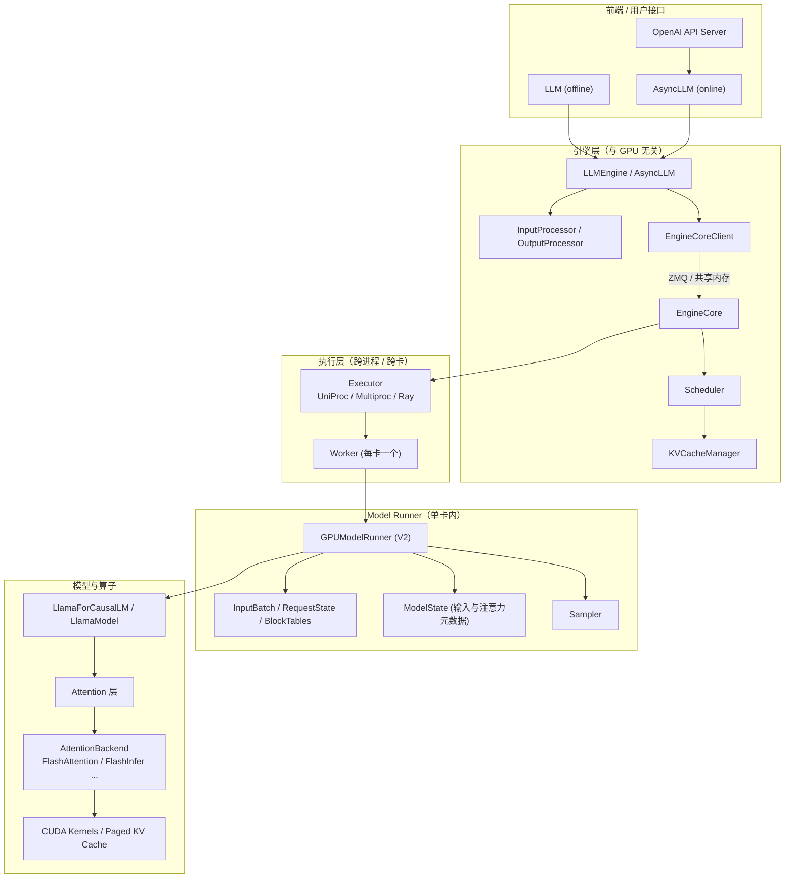
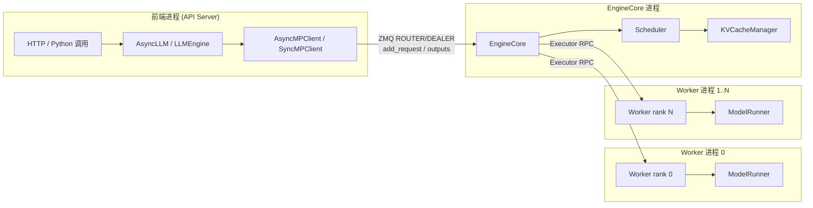
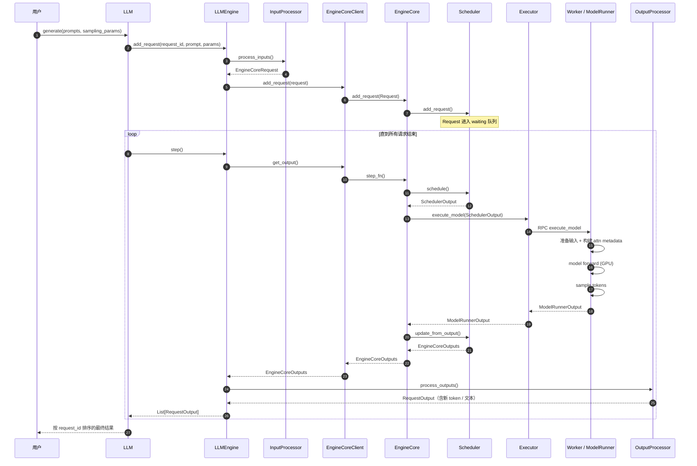
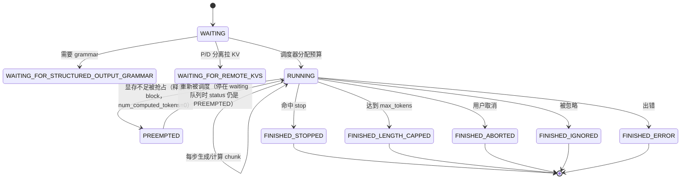

# 00 · vLLM 整体架构与源码阅读路线

> 分析对象：本仓库 `vllm/`，commit `5082c45853`（2026-10-29），V1 引擎 + **默认启用 Model Runner V2**。
> 本文只做“地图”和“路线图”，不深入单个机制；后续文档按调用链逐个展开。

---

## 1. 先建立三个基本认知

在读源码之前，先纠正三个最常见的误解，否则会看不懂后面的设计。

### 1.1 vLLM 没有“batch 维”的输入张量

训练框架里常见 `[batch, seq, hidden]`。vLLM 的推理路径正好相反：

- 调度器每一步把所有请求**拼成一条扁平 token 序列**；
- 模型收到的 `input_ids` 形状是 `[T]`，`hidden_states` 是 `[T, H]`；
- “哪段 token 属于哪个请求”由 `query_start_loc`、`seq_lens`、`block_table` 等元数据表达。

这样做是为了让 prefill、decode、chunked prefill 共用同一套模型代码和 kernel，并统一走同一套 CUDA Graph 分桶机制，避免按阶段写两套执行路径。

### 1.2 “Prefill 阶段 / Decode 阶段”在 V1 调度器里并不存在

`Scheduler.schedule()` 顶部注释写得很明确（`vllm/v1/core/sched/scheduler.py:699`）：

> There's no "decoding phase" nor "prefill phase" in the scheduler.

调度器只维护每个请求的两个计数：

- `num_computed_tokens`：这个请求的 KV 已经算到第几个 token；
- `num_tokens_with_spec`：这个请求当前总共有多少个 token（prompt + 已生成 + 投机 token）。

每一步它只做一件事：**在 token 预算内，让每个请求的 `num_computed_tokens` 尽量追上 `num_tokens_with_spec`**。追的过程如果是多 token，就是 prefill/chunked prefill；只差 1 个 token，就是 decode。二者是同一套逻辑的不同参数状态。

### 1.3 当前版本默认跑的是 Model Runner V2，不是 `gpu_model_runner.py`

这是本快照最容易踩坑的一点：

| 文件 | 角色 | 是否默认 |
|---|---|---|
| `vllm/v1/worker/gpu_model_runner.py`（7192 行） | 旧版（V1）Model Runner，`VLLM_USE_V2_MODEL_RUNNER=0` 时使用 | 否 |
| `vllm/v1/worker/gpu/model_runner.py`（2550 行） | **V2 Model Runner**，模块化拆分到 `gpu/` 子目录 | **是**（有 Triton 且无已知不支持特性时） |

判定逻辑在 `vllm/config/vllm.py:746` 的 `use_v2_model_runner`：

```python
use_v2_model_runner = envs.VLLM_USE_V2_MODEL_RUNNER
if use_v2_model_runner is not None:
    return use_v2_model_runner
...
return True   # Triton 可用且特性兼容时的默认值
```

因此学习时建议：

- **主线读 V2**：`vllm/v1/worker/gpu/model_runner.py` + `gpu/` 子模块；
- 遇到 V2 没覆盖的模型/特性，再回退读 `gpu_model_runner.py`；
- 两者共享同一套 `SchedulerOutput`、KV Cache 配置、Attention Backend 和模型定义，所以上层知识完全通用。

---

## 2. 仓库目录地图

只列与“推理主链路”相关的部分。

```text
vllm/
├── entrypoints/                 # 用户入口：LLM / OpenAI API Server / CLI
│   ├── llm.py                   # 离线 LLM 类（包一层 LLMEngine）
│   ├── common/offline.py        # _run_engine() 驱动 step 循环
│   ├── openai/                  # OpenAI 兼容 HTTP 服务
│   └── cli/                     # `vllm serve` 等命令
│
├── v1/                          # 当前引擎（V1 架构）
│   ├── engine/
│   │   ├── llm_engine.py        # 离线同步引擎门面
│   │   ├── async_llm.py         # 在线异步引擎门面
│   │   ├── core.py              # EngineCore / EngineCoreProc（真正的心脏）
│   │   ├── core_client.py       # InprocClient / SyncMPClient / AsyncMPClient
│   │   ├── processor.py         # EngineCoreRequest 预处理（tokenize 之后）
│   │   ├── input_processor.py   # 原始输入 -> EngineCoreRequest
│   │   └── output_processor.py  # EngineCoreOutput -> RequestOutput（含 detokenize）
│   │
│   ├── core/
│   │   ├── sched/scheduler.py   # 调度器：token 预算、抢占、前缀缓存命中
│   │   ├── kv_cache_manager.py  # KV block 分配/回收/复用
│   │   ├── block_pool.py        # 物理 block 池 + 空闲队列
│   │   └── single_type_kv_cache_manager.py
│   │
│   ├── worker/
│   │   ├── gpu_worker.py        # Worker：设备初始化、显存探测、执行 RPC
│   │   ├── gpu_model_runner.py  # V1 Model Runner（旧）
│   │   ├── gpu/                 # V2 Model Runner（默认）
│   │   │   ├── model_runner.py
│   │   │   ├── input_batch.py   # GPU 输入缓冲区
│   │   │   ├── states.py        # RequestState
│   │   │   ├── block_table.py   # block table 的 CPU/GPU 镜像
│   │   │   ├── model_states/    # 不同模型族的输入/注意力元数据适配
│   │   │   └── sample/          # V2 采样器
│   │   └── ...
│   │
│   ├── attention/backends/      # FlashAttention / FlashInfer / Triton 等后端
│   ├── executor/                # UniProc / Multiproc / Ray 执行器
│   └── kv_cache_interface.py    # KVCacheConfig / KVCacheSpec
│
├── model_executor/
│   ├── models/llama.py          # 模型定义（以 Llama 为例）
│   └── layers/
│       ├── linear.py            # 各种并行 Linear / QKVParallelLinear
│       ├── layernorm.py
│       ├── rotary_embedding/
│       └── attention/attention.py  # 统一 Attention 层（写 KV + 调后端）
│
├── forward_context.py           # 全局 forward context（attn_metadata 等）
├── config/                      # 全部配置解析与校验
└── distributed/                 # TP/PP/DP/EP 通信组
```

---

## 3. 分层架构

### 3.1 静态结构



职责一句话总结：

| 层     | 组件                       | 一句话职责                                        |
| ----- | ------------------------ | -------------------------------------------- |
| 前端    | `LLM` / `AsyncLLM`       | 把用户 prompt 变成请求，驱动或流式返回结果                    |
| 引擎门面  | `LLMEngine` / `AsyncLLM` | 编排输入处理、EngineCore、输出处理                       |
| 输入    | `InputProcessor`         | 校验、tokenize、多模态预处理、构造 `EngineCoreRequest`    |
| 核心    | `EngineCore`             | **调度 + 执行 + 更新状态** 的主循环                      |
| 调度    | `Scheduler`              | 决定这一步跑哪些请求、各跑几个 token、用哪些 block              |
| KV 管理 | `KVCacheManager`         | 按 block 分配/回收 KV，维护前缀缓存哈希                    |
| 执行器   | `Executor`               | 把一次 `execute_model` RPC 发给所有 Worker          |
| 单卡    | `Worker`                 | 设备/显存/分布式环境管理，调用 Model Runner                |
| 单卡执行  | `ModelRunner`            | 准备输入张量、构建注意力元数据、跑模型、采样                       |
| 模型    | `LlamaModel` 等           | 纯模型结构：Embedding → Layer × N → Norm → LM Head |
| 注意力   | `Attention` + Backend    | 写 KV Cache，调用底层 attention kernel             |
| 输出    | `OutputProcessor`        | detokenize、拼接增量文本、生成 `RequestOutput`         |

### 3.2 进程模型

默认 `VLLM_ENABLE_V1_MULTIPROCESSING=1`（`vllm/envs.py:1449`），因此：



两个容易忽略的点：

1. **默认多进程模式下，EngineCore 进程不持有模型权重**，它只做调度和状态管理；GPU 内存和模型在 Worker 进程里。
2. **前端与 EngineCore 之间传的是“差异”而不是完整请求**：`SchedulerOutput.scheduled_new_reqs` 只在请求第一次被调度时带完整数据，之后用 `CachedRequestData` 只传变化量（`vllm/v1/core/sched/output.py:232`）。

> 如果设置 `VLLM_ENABLE_V1_MULTIPROCESSING=0`，则走 `InprocClient`，`EngineCore.step()` 由前端 `LLMEngine.step()` 直接调用（`vllm/v1/engine/core_client.py:408`），没有 ZMQ。调试时这条路径最省心。
>
> 多进程模式下，真正的驱动循环在 `EngineCoreProc.run_busy_loop()`（`vllm/v1/engine/core.py:1669`）：它自己轮询输入队列、执行 `step_fn()`、把输出推进输出队列；前端只是发送请求并异步收取结果。上面的时序图把两条路径合并展示了。

---

## 4. 一次请求的完整生命周期

### 4.1 总时序图

以离线 `LLM.generate()` 为例（在线只是把 `step` 换成异步循环 + 流式返回）。



### 4.2 关键代码位置（按调用顺序）

| 步骤             | 位置                                        | 说明                                                           |
| -------------- | ----------------------------------------- | ------------------------------------------------------------ |
| 1. 创建引擎        | `vllm/entrypoints/llm.py:341`             | `LLM.__init__` 内部持有 `self.llm_engine`                        |
| 2. 加请求         | `vllm/v1/engine/llm_engine.py:229`        | `LLMEngine.add_request`                                      |
| 3. 输入预处理       | `vllm/v1/engine/input_processor.py`       | tokenize / 多模态 / 构造 `EngineCoreRequest`                      |
| 4. 发给核心        | `vllm/v1/engine/llm_engine.py:299`        | `self.engine_core.add_request(request)`                      |
| 5. 核心收请求       | `vllm/v1/engine/core.py:525`              | `EngineCore.add_request` -> `Scheduler.add_request`          |
| 6. 驱动循环        | `vllm/entrypoints/common/offline.py:589`  | `_run_engine()` 里的 `while has_unfinished_requests(): step()` |
| 7. 取输出         | `vllm/v1/engine/llm_engine.py:319`        | `LLMEngine.step()`                                           |
| 8. 核心一步        | `vllm/v1/engine/core.py:674`              | `EngineCore.step()`：schedule → execute → update              |
| 9. 调度          | `vllm/v1/core/sched/scheduler.py:699`     | `Scheduler.schedule()`                                       |
| 10. 执行         | `vllm/v1/executor/abstract.py:254`        | `Executor.execute_model()`                                   |
| 11. 单卡执行       | `vllm/v1/worker/gpu/model_runner.py:1794` | V2 `GPUModelRunner.execute_model()`                          |
| 12. 采样         | `vllm/v1/worker/gpu/model_runner.py:2181` | `sample_tokens()`                                            |
| 13. 更新状态       | `vllm/v1/core/sched/scheduler.py:2260`    | `Scheduler.update_from_output()`                             |
| 14. 输出处理       | `vllm/v1/engine/output_processor.py:728`  | `OutputProcessor.process_outputs()`                          |
| 15. detokenize | `vllm/v1/engine/detokenizer.py`           | 增量解码 + stop string 检测                                        |

### 4.3 请求状态机

`vllm/v1/request.py:384` 定义了 `RequestStatus`：



注意：**抢占不是“暂停”，而是丢弃 KV**。被抢占的请求回到 `WAITING` 后，`num_computed_tokens` 会被重置，下一步需要重新 prefill（除非前缀缓存命中）。这是 vLLM 用“重算”换“显存”的核心取舍。

---

## 5. 核心数据结构

理解 vLLM，先把下面 6 个结构吃透，后面所有代码都是它们的生产者和消费者。

### 5.1 `EngineCoreRequest` / `Request`

| 结构                  | 位置                           | 生命周期                   | 关键字段                                                                                                       |
| ------------------- | ---------------------------- | ---------------------- | ---------------------------------------------------------------------------------------------------------- |
| `EngineCoreRequest` | `vllm/v1/engine/__init__.py` | 前端 → EngineCore 的跨进程消息 | `request_id`、`prompt_token_ids`、`mm_features`、`sampling_params`、`arrival_time`                             |
| `Request`           | `vllm/v1/request.py:60`      | EngineCore 内部长期状态      | `status`、`num_computed_tokens`、`num_tokens_with_spec`、`_output_token_ids`、`block_hashes`、`sampling_params` |

`Request` 的 `_all_token_ids` 是“prompt + 已生成 token”的连续列表；`num_computed_tokens` 表示这些 token 里有多少 KV 已经写进 cache。

### 5.2 `SchedulerOutput`（调度 → 执行）

位置：`vllm/v1/core/sched/output.py:232`。

| 字段 | 含义 | 为什么需要 |
|---|---|---|
| `scheduled_new_reqs: list[NewRequestData]` | 本步第一次被调度的请求 | 首次需要把 prompt、block 表、采样参数完整传给 Worker |
| `scheduled_cached_reqs: CachedRequestData` | 之前已调度过的请求 | 只传增量，降低跨进程序列化成本 |
| `num_scheduled_tokens: dict[str, int]` | 每个请求本步算几个 token | **整个执行层的核心驱动量** |
| `total_num_scheduled_tokens` | 上面之和 = 本步扁平 token 数 `T` | Model Runner 用它分配缓冲区 |
| `scheduled_spec_decode_tokens` | 投机解码候选 token | 每个请求可能一次验证多个 token |
| `scheduled_encoder_inputs` | 多模态 encoder 输入索引 | 视觉/音频编码与文本解码解耦 |
| `finished_req_ids` | 本步结束的请求 | 通知 Worker 释放槽位和状态 |
| `kv_connector_metadata` | KV 传输元数据 | P/D 分离、KV offload |

一句话：**`SchedulerOutput` 是“这一步要算什么”的唯一真相**，Model Runner 不应该自己再猜。

### 5.3 `ModelRunnerOutput`（执行 → 调度）

位置：`vllm/v1/outputs.py:267`。

| 字段 | 含义 |
|---|---|
| `req_ids` / `req_id_to_index` | 本步参与执行的请求及其在 batch 中的下标 |
| `sampled_token_ids: list[list[int]]` | 每个请求新采样的 token（投机解码时可能多个） |
| `logprobs` | 采样 token 的 logprob |
| `prompt_logprobs_dict` | 需要返回 prompt logprobs 时的结果 |
| `pooler_output` | embedding / pooling 模型输出 |
| `kv_connector_output` | KV 传输结果（成功/失败/无效 block） |
| `num_nans_in_logits` | 数值异常统计 |

### 5.4 `KVCacheConfig` / `KVCacheSpec`

位置：`vllm/v1/kv_cache_interface.py:1526` 与 `:619`。

- `KVCacheConfig`：整个引擎的 KV 布局，包括 `num_blocks`、`kv_cache_tensors`（每层分到多少显存）、`kv_cache_groups`（按注意力类型分组）。
- `KVCacheSpec`：**某一层**需要什么样的 KV，例如 `FullAttentionSpec`（普通因果注意力）、`MLAAttentionSpec`（DeepSeek MLA）、`SlidingWindowSpec`（滑动窗口）、`MambaSpec`。
- `block_size` 默认 16（`vllm/config/cache.py:185`），即一个 block 存 16 个 token 的 K/V。

“group”这个概念很重要：混合模型（比如部分层全注意力、部分层滑动窗口）会分成多个 group，每组独立分配 block，但共享同一个 `num_blocks` 上限。

### 5.5 `InputBatch` / `RequestState`（V2 Runner）

| 结构 | 位置 | 作用 |
|---|---|---|
| `InputBatch` | `vllm/v1/worker/gpu/input_batch.py:43` | GPU 上的输入缓冲区：`input_ids`、`positions`、`seq_lens`、`query_start_loc`、`slot_mapping` 等 |
| `RequestState` | `vllm/v1/worker/gpu/states.py:9` | 每个请求的 GPU 侧状态：`num_computed_tokens`、`temperature`、`generators` 等；Runner 里实例化为 `self.req_states` |
| `BlockTables` | `vllm/v1/worker/gpu/block_table.py:17` | block table 的 CPU 镜像 + GPU 张量，支持分步提交 |

这些缓冲区都是**预分配 + 原地复用**的，这是 CUDA Graph 能工作的前提。

### 5.6 `RequestOutput`（最终返回）

位置：`vllm/outputs.py`。包含 `request_id`、`prompt`、`outputs: list[CompletionOutput]`、`finished`、`metrics`。`CompletionOutput` 里有 `token_ids`、`text`、`cumulative_logprob`、`finish_reason`。

---

## 6. 数据流：从 token 到下一个 token

这一节先给“主干”，细节留到模型执行文档。

### 6.1 端到端数据流

```mermaid
flowchart LR
    P["prompt token ids<br/>list[int]"] --> IP["InputProcessor"]
    IP --> R["Request<br/>_all_token_ids"]
    R --> S["Scheduler.schedule()"]
    S --> SO["SchedulerOutput<br/>num_scheduled_tokens"]
    SO --> MR["ModelRunner.prepare_inputs()"]
    MR --> IB["InputBatch<br/>input_ids [T]<br/>positions [T]"]
    IB --> EMB["Embedding<br/>[T, H]"]
    EMB --> LAYERS["DecoderLayer × N<br/>hidden [T, H]"]
    LAYERS --> NORM["RMSNorm<br/>[T, H]"]
    NORM --> LOGITS["LM Head<br/>取 logits_indices<br/>[L, V]"]
    LOGITS --> SAMP["Sampler<br/>[num_reqs, max_samples]"]
    SAMP --> NEXT["sampled_token_ids"]
    NEXT --> R
```



### 6.2 一个具体例子

设：

- `batch = 2` 个请求；
- 请求 A：prompt 4 个 token，本步是 prefill，算 4 个 token；
- 请求 B：prompt 3 个 token + 已生成 2 个 token，本步 decode，算 1 个 token；
- `hidden_size H = 128`，`num_heads = 4`，`head_dim = 32`，`num_kv_heads = 2`（GQA）；
- `block_size = 16`。

于是本步：

```text
T = 4 + 1 = 5
num_scheduled_tokens = {"A": 4, "B": 1}
```

关键张量：

| 张量 | Shape | dtype | 设备 | 含义 |
|---|---|---|---|---|
| `input_ids` | `[5]` | int32 | GPU | 扁平 token id：A 的 4 个 + B 的 1 个 |
| `positions` | `[5]` | int64 | GPU | A: 0,1,2,3；B: 5（因为已算 5 个 token） |
| `hidden_states` | `[5, 128]` | bf16 | GPU | 每层输入/输出 |
| `qkv` | `[5, 256]` | bf16 | GPU | `q_size=128`，`kv_size=64`，合计 256 |
| `q` | `[5, 128]` | bf16 | GPU | 4 头 × 32 |
| `k` / `v` | `[5, 64]` | bf16 | GPU | 2 个 KV 头 × 32 |
| `q`（attention 内 view） | `[5, 4, 32]` | bf16 | GPU | 3D 视图，不复制 |
| `k` / `v`（view） | `[5, 2, 32]` | bf16 | GPU | 3D 视图 |
| `attn_output` | `[5, 128]` | bf16 | GPU | 4 头 × 32 拼回 |
| `o_proj` 输出 | `[5, 128]` | bf16 | GPU | 回到 hidden |
| `logits_indices` | `[2]` | int64 | GPU | 只取 A 的最后一个 token、B 的当前 token |
| `logits` | `[2, V]` | bf16/fp16（采样内部转 fp32） | GPU | 2 个请求各一个分布 |
| `sampled_token_ids` | `[2, 1]` | int64 | GPU → CPU | 每个请求下一个 token；最终以 `list[list[int]]` 返回 |

几个“为什么”：

- **为什么 `qkv` 是 256 而不是 128×3？** 因为 `QKVParallelLinear` 把 Q/K/V 三个投影融成一个矩阵乘，输出按 `[q_size, kv_size, kv_size]` 切分（`vllm/model_executor/models/llama.py:229`）。GQA 下 K/V 头数比 Q 少，所以不是 3 倍。
- **为什么 attention 里要 `view` 成 3D？** kernel 需要 `[num_tokens, num_heads, head_dim]` 的连续布局；`view` 不复制内存，只是换索引方式（`vllm/model_executor/layers/attention/attention.py:543`）。
- **为什么 `positions` 对 B 是 5？** B 已经算过 5 个 token（3 prompt + 2 生成），当前要算第 6 个（下标 5）。RoPE 必须用绝对位置。
- **为什么 logits 只有 2 行？** prefill 时中间 token 的 logits 不需要（除非要 prompt logprobs），只取每个请求“最后一个被调度 token”的位置。这个位置列表就是 `logits_indices`。

### 6.3 逻辑 Shape vs 运行时 Shape

| 概念 | 逻辑值 | 运行时可能值 | 原因 |
|---|---|---|---|
| token 数 | `T = Σ num_scheduled_tokens` | `T_padded` | CUDA Graph 需要固定 bucket，会 pad 到最近的 capture size |
| 请求数 | `num_reqs` | `num_reqs_padded` | 同上；uniform decode 时由 token 桶除以 query_len 推出 |
| `input_ids` | `[T]` | `[T_padded]` | pad 位置填 dummy token，attention 用 mask 屏蔽 |
| `block_table` | `[num_reqs, max_blocks]` | `[num_reqs_padded, max_blocks]` | 预分配固定宽度 |
| `seq_lens` | `[num_reqs]` | `[num_reqs_padded]` | 同上 |

> 看到 `num_tokens_padded`、`num_reqs_padded`、`batch_desc.num_tokens` 时，不要假设它们等于真实调度量；真实值在 `SchedulerOutput.total_num_scheduled_tokens`。

---

## 7. 五个关键设计决策

### 7.1 Token 预算调度，而不是“按请求轮转”

`Scheduler.schedule()` 每步有一个全局预算 `max_num_scheduled_tokens`（默认等于 `max_num_batched_tokens`）。它在预算内依次处理：

1. `running` 队列：优先让已运行的请求推进（decode 优先，降低尾延迟）；
2. `waiting` 队列：有空余预算则接纳新请求（prefill）；
3. 预算不够时：对 running 请求做 **chunked prefill**（只算一部分 prompt），或者 **抢占**（preempt）低优先级请求。

为什么这样设计？

- 固定 token 预算 → 每步计算量可预测 → 显存峰值可控、CUDA Graph 容易分桶；
- decode 优先 → 在线服务中 decode 是延迟敏感路径；
- chunked prefill → 长 prompt 不会阻塞短请求，改善公平性。

### 7.2 PagedAttention 与 block 化管理

KV Cache 被切成固定大小的 block（默认 16 token），每个请求维护一张 `block_table`（逻辑 block → 物理 block）。好处：

- 不需要为每个请求预留 `max_model_len` 的连续显存；
- 前缀相同的请求可以共享物理 block（prefix caching）；
- 请求结束或抢占时回收 block，空闲 block 进入 free queue 复用，碎片少（异步调度下回收可能延迟到相关 GPU 写完成）。

代价：

- attention kernel 必须支持“按 block 索引”的间接寻址；
- block table 需要随请求动态更新，并同步到 GPU。

### 7.3 扁平 token + 元数据，而不是 padded batch

所有请求拼成 `[T, H]`，用 `query_start_loc` / `seq_lens` 描述边界。这样：

- prefill 和 decode 共用同一套模型代码；
- 不同请求的 query 长度可以不同（varlen）；
- 避免了 `[batch, max_seq, H]` 的 padding 浪费。

### 7.4 CUDA Graph 分桶

CUDA Graph 要求固定的张量地址和 shape。vLLM 的做法：

- 预分配输入/输出缓冲区（`InputBuffers`）；
- 以 **token 数**为桶：把真实 `num_tokens` 向上取整到已 capture 的尺寸（`vllm/v1/cudagraph_dispatcher.py` 的 `_bs_to_padded_graph_size`）；
- uniform decode 时，`num_reqs = num_tokens_padded / query_len`，因此 batch size 也间接固定；
- 运行时 pad 到最近的桶，replay 对应图；
- 不满足条件（如 shape 太特殊、有 CPU 同步操作）时回退 eager。

V2 里这套逻辑在 `vllm/v1/worker/gpu/attn_utils.py` 和 `vllm/compilation/` 中。

### 7.5 采样与模型执行解耦

`execute_model()` 只负责跑到 hidden states（以及必要的 logits），`sample_tokens()` 单独做采样。为什么拆开？

- 采样需要 grammar bitmask、logits processor 等 CPU/GPU 混合逻辑，放在 graph 外更灵活；
- 异步调度时可以先启动下一步的模型执行，再对上一步结果采样，掩盖采样延迟。

---

## 8. 推荐源码阅读顺序

不要从 `vllm/__init__.py` 开始逐文件读。按“请求怎么流动”读，效率最高。

### 阶段 0：跑起来 + 建立直觉（0.5 天）

1. 读 `docs/00-整体架构与阅读路线.md`（本文）。
2. 用一个小模型跑一次离线推理，打开 `VLLM_LOGGING_LEVEL=DEBUG`，观察每一步的 scheduler 日志。
3. 设置 `VLLM_ENABLE_V1_MULTIPROCESSING=0`，在 `LLMEngine.step()` 打断点，单步跟一遍。

### 阶段 1：入口与请求对象（1 天）

- `vllm/entrypoints/llm.py`：`LLM.__init__`、`generate`
- `vllm/entrypoints/common/offline.py`：`_run_engine`
- `vllm/v1/engine/input_processor.py`：`process_inputs`
- `vllm/v1/request.py`：`Request`、`RequestStatus`
- `vllm/v1/engine/__init__.py`：`EngineCoreRequest`

目标：能说清“一个字符串 prompt 如何变成 `Request`”。

### 阶段 2：EngineCore 主循环与进程通信（1~2 天）

- `vllm/v1/engine/llm_engine.py`：`add_request`、`step`
- `vllm/v1/engine/core_client.py`：`InprocClient` vs `SyncMPClient` vs `AsyncMPClient`
- `vllm/v1/engine/core.py`：`EngineCore.__init__`、`step`、`EngineCoreProc.run_busy_loop`
- `vllm/v1/engine/utils.py`：`CoreEngineProcManager`、ZMQ 地址与握手

目标：能画出“前端 → ZMQ → EngineCore → Executor”的完整时序，理解为什么调度在独立进程。

### 阶段 3：调度器（2~3 天，重点）

- `vllm/v1/core/sched/scheduler.py`：
  - `__init__`：预算、队列、KV 管理器
  - `schedule`：running / waiting / preempt / chunked prefill
  - `update_from_output`：停止条件、token 追加、block 释放
- `vllm/v1/core/sched/output.py`：`SchedulerOutput`、`NewRequestData`、`CachedRequestData`
- `vllm/v1/core/sched/request_queue.py`：FCFS / priority
- `vllm/v1/core/sched/utils.py`：停止条件判断

目标：给定任意请求集合和预算，能手算出这一步的 `SchedulerOutput`。

### 阶段 4：KV Cache 管理（1~2 天）

- `vllm/v1/core/kv_cache_manager.py`：`KVCacheManager`
- `vllm/v1/core/block_pool.py`：`BlockPool`、free queue、LRU
- `vllm/v1/core/single_type_kv_cache_manager.py`：按注意力类型分配
- `vllm/v1/kv_cache_interface.py`：`KVCacheConfig`、`KVCacheSpec`
- `vllm/v1/core/kv_cache_utils.py`：block hash、prefix caching

目标：理解“一个请求要 10 个 block，从哪来、何时还、前缀命中如何复用”。

### 阶段 5：Model Runner 输入准备（2~3 天，重点）

- `vllm/v1/worker/gpu/model_runner.py`：
  - `execute_model`（1794）
  - `prepare_inputs`（1422）
  - `prepare_attn`（1629）
  - `_model_forward`
- `vllm/v1/worker/gpu/input_batch.py`：`InputBatch`
- `vllm/v1/worker/gpu/states.py`：`RequestState`
- `vllm/v1/worker/gpu/block_table.py`：`BlockTables`
- `vllm/v1/worker/gpu/model_states/default.py`：`DefaultModelState`

目标：能说清 `SchedulerOutput` 的每个字段如何变成 GPU 上的哪个张量。

### 阶段 6：模型前向与 Attention（3~4 天，最高优先级）

- `vllm/model_executor/models/llama.py`：
  - `LlamaAttention.forward`（224）
  - `LlamaDecoderLayer.forward`（313）
  - `LlamaModel.forward`（406）
- `vllm/model_executor/layers/linear.py`：`QKVParallelLinear`、`RowParallelLinear`
- `vllm/model_executor/layers/layernorm.py`：`RMSNorm`
- `vllm/model_executor/layers/attention/attention.py`：`Attention.forward`（495）
- `vllm/v1/attention/backends/flash_attn.py`：`FlashAttentionImpl.forward`（1182）
- `vllm/forward_context.py`：`attn_metadata` 如何注入

目标：能对一个具体 batch 画出每一层 Tensor Shape 变化表，并指出 KV 写入点。

### 阶段 7：采样与输出（1~2 天）

- `vllm/v1/worker/gpu/sample/sampler.py`：V2 `Sampler.__call__` / `sample`
- `vllm/v1/sample/sampler.py`：V1 `Sampler.forward`
- `vllm/v1/sample/ops/topk_topp_sampler.py`
- `vllm/v1/engine/output_processor.py`：`process_outputs`
- `vllm/v1/engine/detokenizer.py`

目标：理解 logits → 概率 → token 的完整路径，以及 stop string 如何触发 abort。

### 阶段 8：性能机制（2~3 天）

- `vllm/v1/worker/gpu/attn_utils.py`：CUDA Graph 分桶
- `vllm/compilation/`：`torch.compile` 集成、`CUDAGraphWrapper`
- `vllm/v1/worker/gpu_worker.py`：显存探测 `determine_available_memory`
- `vllm/v1/executor/`：多进程/多卡执行
- `vllm/v1/spec_decode/`：投机解码

目标：能解释“为什么这个配置下 CUDA Graph 没生效”“显存为什么不够”。

---

## 9. 学习文档目录规划

后续每篇文档聚焦一个主题，按依赖顺序编号。

| 编号 | 文档 | 核心问题 | 依赖 |
|---|---|---|---|
| 00 | 整体架构与阅读路线（本文） | vLLM 由哪些层组成？请求怎么流动？ | 无 |
| 01 | 入口与请求生命周期 | `LLM.generate` 到 `Request` 的完整链路？ | 00 |
| 02 | EngineCore 与进程通信 | 为什么调度要独立进程？ZMQ/共享内存怎么用？ | 01 |
| 03 | 调度器原理 | token 预算、chunked prefill、抢占、前缀缓存命中 | 02 |
| 04 | KV Cache 与 PagedAttention | block 分配/回收、block table、前缀哈希 | 03 |
| 05 | Model Runner 输入准备 | `SchedulerOutput` → GPU 张量，shape 怎么变 | 04 |
| 06 | 模型前向与 Tensor 流 | Embedding → Layer → Logits 的逐层 shape | 05 |
| 07 | Attention 层与 Backend | `Attention.forward` 如何写 KV、调 kernel | 06 |
| 08 | 采样与输出 | logits → token → 文本，stop/grammar 怎么处理 | 06 |
| 09 | CUDA Graph 与编译优化 | 分桶、pad、replay、eager 回退 | 05 |
| 10 | 显存管理与性能调优 | `gpu_memory_utilization`、KV 容量、OOM 排查 | 04, 09 |
| 11 | 扩展实践 | 加新模型 / 新 backend / 新调度策略该改哪 | 全部 |

> 每篇文档都会包含：一句话概括、Why、输入输出、执行流程、关键源码（文件+行号）、具体例子、Mermaid 图、总结。

---

## 10. 如何验证你的理解

读源码时，不要只“看”，要用下面这些手段验证。

### 10.1 断点/日志

```bash
# 单进程模式，方便断点
VLLM_ENABLE_V1_MULTIPROCESSING=0 \
VLLM_LOGGING_LEVEL=DEBUG \
python your_script.py
```

在以下位置打断点，观察变量：

- `Scheduler.schedule()` 返回前：看 `num_scheduled_tokens`、`total_num_scheduled_tokens`；
- `GPUModelRunner.execute_model()` 里 `prepare_inputs` 之后：看 `input_batch.input_ids.shape`、`positions`；
- `Attention.forward()` 入口：看 `query.shape`、`key.shape`、`self.kv_cache.shape`；
- `Scheduler.update_from_output()`：看 `sampled_token_ids` 和请求状态变化。

### 10.2 对比 V1 / V2 Runner

```bash
# 强制 V1 runner
VLLM_USE_V2_MODEL_RUNNER=0 python your_script.py
# 强制 V2 runner
VLLM_USE_V2_MODEL_RUNNER=1 python your_script.py
```

同一个 batch，对比两边的 `input_ids`、`slot_mapping`、`block_table`，能快速理解 V2 重构了什么。

### 10.3 用 profiler 看真实 kernel

```python
from vllm import LLM, SamplingParams
llm = LLM(model="...", enforce_eager=True)  # 先关闭 graph，方便看 kernel
llm.generate(...)
```

或用 `torch.profiler` / `nsys` 抓一次 decode step，确认：

- attention kernel 是否按预期读取 paged KV；
- 是否有意外的 D2H 同步（会破坏 CUDA Graph）；
- `lm_head` 是否只计算了 `logits_indices` 对应的行。

### 10.4 读测试用例

`tests/v1/` 下有大量针对 scheduler、KV cache、model runner 的单元测试，它们比文档更精确地定义了边界行为。例如：

- `tests/v1/core/test_scheduler.py`
- `tests/v1/core/test_kv_cache_planning.py`、`tests/v1/core/test_prefix_caching.py`
- `tests/v1/worker/test_gpu_model_runner.py`、`tests/v1/worker/test_gpu_model_runner_v2.py`

当一个行为“看起来很奇怪”时，先搜测试，通常能找到设计意图。

---

## 11. 常见陷阱清单

| 陷阱 | 正确理解 |
|---|---|
| 以为 `input_ids` 是 `[batch, seq]` | 实际是扁平 `[T]`，batch 由元数据表达 |
| 以为有独立的 prefill/decode 两套代码 | 调度器只有 token 追赶逻辑，模型只有一套 forward |
| 以为 `num_computed_tokens` 等于已生成 token 数 | 它是“KV 已写入的 token 数”，包含 prompt 和被调度的生成 token |
| 以为抢占会保留 KV | 抢占会释放 block，恢复时需要重算（除非前缀缓存命中） |
| 以为 `block_table` 是逻辑到物理的固定映射 | 请求生命周期内会变，前缀缓存命中/抢占都会改 |
| 以为 CUDA Graph 一定生效 | 有动态 shape、CPU 同步、不支持的算子时会回退 eager |
| 以为 V2 Runner 只是 V1 的拆文件 | V2 重新设计了输入缓冲、状态管理、采样和 graph 调度 |
| 以为 `logits` 一定是 `[num_reqs, vocab]` | prefill 要 prompt logprobs 时行数会更多；投机解码也不同 |

---

## 12. 下一步

建议从 **01 入口与请求生命周期** 开始，把“字符串 → `Request` → `EngineCoreRequest`”这条链路彻底走通；然后进入 **02 EngineCore** 和 **03 调度器**。

如果你希望先看某一块（例如“直接深入 Attention”或“直接看 KV Cache”），告诉我模块名，我可以跳过前置章节，直接从对应源码切入，并在文中补齐必要的前置知识。
