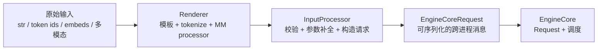
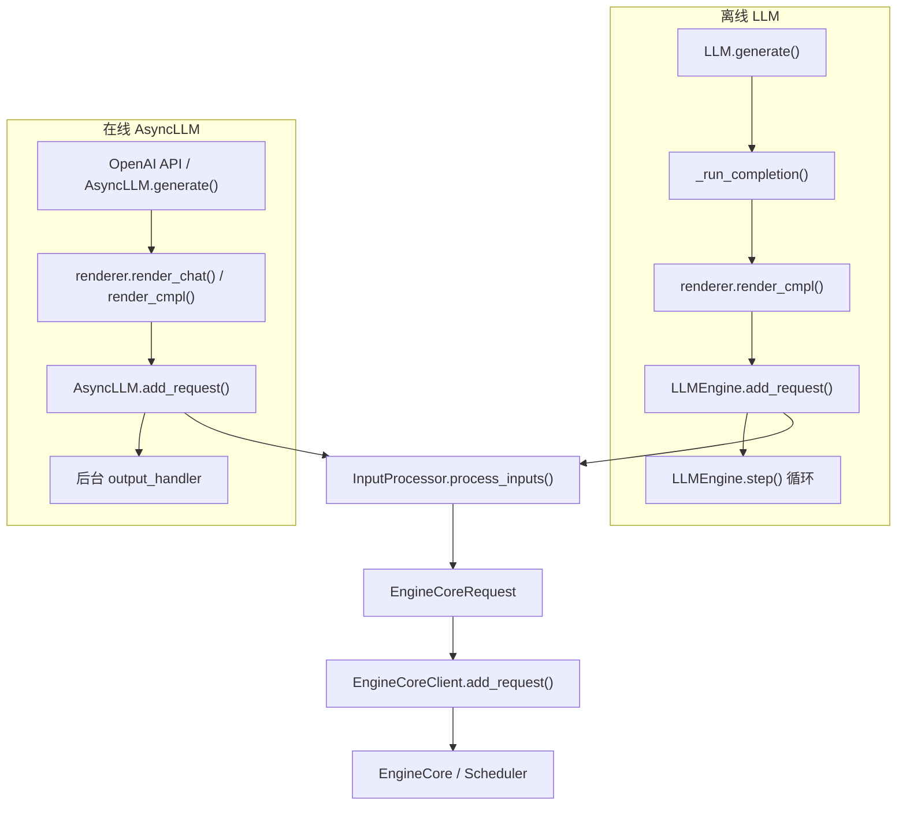
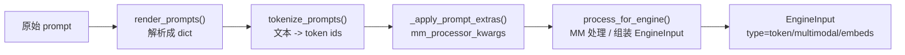
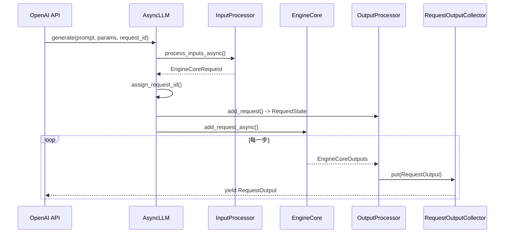

# 01 · 入口与请求生命周期

> 前置阅读：[00 · 整体架构与阅读路线](./00-整体架构与阅读路线.md)
> 对应源码：`vllm/entrypoints/`、`vllm/renderers/`、`vllm/v1/engine/input_processor.py`、`vllm/v1/request.py`、`vllm/v1/core/sched/scheduler.py`
> 适用版本：本仓库 commit `5082c45853`（2026-10-29）

---

## 1. 一句话概括

入口层的职责只有一句话：

> **把用户输入（字符串 / token id / embedding / 多模态数据）变成一个可跨进程传输、可被调度器排队、带唯一 ID 的 `EngineCoreRequest`，然后交给 EngineCore。**

它不负责 GPU 计算，也不负责分配 KV Cache；但它决定了后面所有环节能看到什么数据。

---

## 2. 为什么需要独立的入口层

如果把 tokenize、图片解码、采样参数校验直接塞进 EngineCore，会带来三个问题：

1. **CPU 预处理会阻塞 GPU 调度**
   tokenize 和 HF processor 可能耗时几十到几百毫秒。EngineCore 是串行 busy loop，一旦阻塞，GPU 就空转。

2. **跨进程消息必须可序列化**
   EngineCore 默认在独立进程（`VLLM_ENABLE_V1_MULTIPROCESSING=1`）。请求必须能通过 msgspec + ZMQ 传过去，大张量还要支持零拷贝/IPC。

3. **同一份参数会被多个请求共享**
   `SamplingParams` 对象可能被用户复用。如果直接修改（比如补 `max_tokens`、加 EOS），会污染其他请求。入口层通过 `clone()` 做请求级隔离。

因此 vLLM 把入口层拆成三段：



这三段分别解决：**文本怎么变成 token**、**请求对象怎么构造**、**请求怎么跨进程**。

---

## 3. 两条入口路径

vLLM 有两个前端：

| 入口 | 类 | 驱动方式 | 典型场景 |
|---|---|---|---|
| 离线 | `LLM` → `LLMEngine` | 同步 `while step()` | 批量推理、脚本、评测 |
| 在线 | `AsyncLLM` → `EngineCoreClient` | asyncio + 后台 output handler | `vllm serve`、OpenAI API |

两者最终都走 `InputProcessor.process_inputs()` 和同一个 `EngineCoreRequest`，区别只在“谁驱动循环”和“结果怎么返回”。



---

## 4. 离线路径逐步拆解

以 `LLM.generate(["Hello, vLLM!"], SamplingParams(...))` 为例。

### 4.1 参数归一化

入口：`vllm/entrypoints/common/offline.py:304` 的 `_add_completion_requests`。

它做三件事：

```python
seq_prompts = prompt_to_seq(prompts)          # 单个 prompt -> list
seq_params = self._params_to_seq(params, len(seq_prompts))
seq_lora_requests = self._lora_request_to_seq(lora_request, len(seq_prompts))
seq_priority = self._priority_to_seq(priority, len(seq_prompts))
```

作用：

- `prompts` 可以是单个字符串，也可以是列表；统一成序列。
- `sampling_params` 可以是单个对象，也可以是和 prompt 一一对应的列表；统一成长度一致的序列。
- `lora_request`、`priority` 同理，支持“一个值广播到所有请求”。

这一步只做形状归一化，不做 tokenize。

### 4.2 Renderer：字符串 → `EngineInput`

入口：`vllm/entrypoints/common/offline.py:147` 的 `_preprocess_cmpl_one`，最终调用 `BaseRenderer.render_cmpl`（`vllm/renderers/base.py:1290`）。

`render_cmpl` 内部按顺序做：



关键点：

1. **tokenize 在 `_tokenize_prompt`（`vllm/renderers/base.py:667`）里完成**
   ```python
   encoding = tokenizer(prompt["prompt"], **kwargs)
   return self._build_tokens_prompt(encoding["input_ids"], prompt, ...)
   ```
   输出是 `TokensPrompt`，里面是 `prompt_token_ids: list[int]`。

2. **多模态在 `_process_multimodal`（`vllm/renderers/base.py:944`）里完成**
   - `mm_processor.apply(...)` 会把图片/音频变成模型需要的 tensor；
   - 同时把 prompt 里的占位符展开成对应的 token 数；
   - 产出 `mm_kwargs`、`mm_placeholders`、`mm_hashes`。

3. **`process_for_engine`（`vllm/renderers/base.py:1246`）负责组装**
   - 纯文本：`{"type": "token", "prompt_token_ids": [...]}`；
   - 多模态：`{"type": "multimodal", "prompt_token_ids": [...], "mm_kwargs": ..., "mm_placeholders": ..., "mm_hashes": ...}`；
   - 纯 embedding：`{"type": "embeds", "prompt_embeds": tensor}`；
   - 最后写入 `arrival_time = time.time()`。

4. **chat 路径只是多了一步模板渲染**
   `render_chat()` 先用 chat template 把 messages 拼成字符串，后面复用同一套 tokenize / MM 流程。所以“聊天”和“补全”在请求对象层面没有区别。

> 注意：`arrival_time` 在 render 开始时取一次，主要用于统计排队延迟。离线路径通常逐个 prompt 渲染，所以每个请求各有自己的时间戳；同一批渲染则共用一个。

### 4.3 `LLMEngine.add_request`：请求对象的主入口

入口：`vllm/v1/engine/llm_engine.py:229`。

代码骨架（省略分支）：

```python
request = self.input_processor.process_inputs(
    request_id, prompt, params,
    supported_tasks=self.get_supported_tasks(),
    ...
)

self.input_processor.assign_request_id(request)

req_id = request.request_id
params = request.params
n = params.n if isinstance(params, SamplingParams) else 1

if n == 1:
    self.output_processor.add_request(request, prompt_text, None, 0)
    self.engine_core.add_request(request)
    return req_id

# n > 1：拆成 n 个子请求
parent_req = ParentRequest(request)
for idx in range(n):
    request_id, child_params = parent_req.get_child_info(idx)
    child_request = request if idx == n - 1 else copy(request)
    child_request.request_id = request_id
    child_request.sampling_params = child_params
    self.output_processor.add_request(child_request, prompt_text, parent_req, idx)
    self.engine_core.add_request(child_request)
return req_id
```

这里出现了三个非常重要的动作：**ID 改写、n>1 拆分、前端状态注册**。

### 4.4 请求 ID：为什么要加随机后缀

`InputProcessor.assign_request_id`（`vllm/v1/engine/input_processor.py:363`）：

```python
request.external_req_id = request.request_id
request.request_id = f"{request.external_req_id}-{random_uuid():.8}"
```

效果：

```text
用户传入:        "req-1"
external_req_id: "req-1"          # 返回给用户、用于 abort
内部 request_id: "req-1-a1b2c3d4" # EngineCore/Scheduler 内部唯一键
```

为什么需要？

- 多个客户端可能同时使用 `"req-1"`，内部加随机后缀避免冲突；
- 返回给用户的仍然是原始 ID，方便对账；
- 内部日志、block 表、输出队列都用内部 ID，保证唯一。

`vllm/envs.py` 里的 `VLLM_DISABLE_REQUEST_ID_RANDOMIZATION` 可以关闭这个行为，但会打警告，因为重复 ID 会导致输出串台。

### 4.5 `n > 1`：并行采样如何拆分

`SamplingParams.n` 表示“同一个 prompt 采样几条独立结果”。

vLLM 的做法不是让一个请求在采样器里出多条，而是**在入口层拆成 n 个独立请求**：

```text
父请求:   req-1-a1b2c3d4
子请求 0: 0_req-1-a1b2c3d4
子请求 1: 1_req-1-a1b2c3d4
...
```

拆分逻辑在 `ParentRequest`（`vllm/v1/engine/parallel_sampling.py:13`）：

- `get_child_info(idx)` 生成子 ID：`f"{idx}_{self.request_id}"`；
- 子请求的 `sampling_params.n = 1`；
- 如果设置了 `seed`，每个子请求的 seed 是 `seed + idx`，保证结果可复现且互不相同；
- 如果没设置 seed，所有子请求复用同一个 `cached_child_sampling_params`，减少拷贝。

为什么这样设计？

- 每个子请求可以独立调度、独立抢占、独立结束；
- 采样器只需要处理“每个请求一个 token”，逻辑简单；
- 输出的 `CompletionOutput.index` 直接对应子请求序号。

代价：

- `n` 个子请求会各自占用一个 batch slot 和一份 KV Cache；
- 前端需要用 `ParentRequest` 聚合结果（`output_aggregator` / `child_requests`）。

### 4.6 `InputProcessor.process_inputs`：真正的请求构造

入口：`vllm/v1/engine/input_processor.py:382`。

按执行顺序：

#### 第 1 步：校验参数与 LoRA

```python
watermarking = self._validate_params(params, supported_tasks)
self._validate_lora(lora_request)
```

- `SamplingParams.verify(...)` 会检查 logprobs、logit_bias、stop_token_ids、结构化输出等是否合法；
- 如果模型不支持生成任务，直接抛错；
- LoRA 未加载、ID 不存在也会在这里被拒。

#### 第 2 步：拿到 `EngineInput`

如果传入的是已经渲染好的 `EngineInput`（带 `type` 字段），直接使用；否则走兼容路径，现场调用 renderer（会打 deprecation 警告）。

#### 第 3 步：拆分 encoder / decoder 输入

```python
encoder_input, decoder_input = split_enc_dec_input(engine_input)
self._validate_model_inputs(encoder_input, decoder_input)
```

- 编码器-解码器模型（如 Whisper）有独立的 encoder prompt；
- `_validate_prompt_len` 会检查 prompt 长度不超过 `max_model_len`；
- 如果 prompt 长度刚好等于 `max_model_len`，还会检查“至少生成 1 个 token”后是否超限；
- 多模态还会检查单个 item 的 embedding token 数是否超过 encoder cache。

#### 第 4 步：克隆并补全采样参数

```python
sampling_params = params.clone()               # 默认 deepcopy
sampling_params.max_tokens = (                 # 未指定时
    self.model_config.max_model_len - prompt_len
)
sampling_params.update_from_generation_config(...)
sampling_params.update_from_tokenizer(...)
```

这一步是整个入口层最容易被忽略、但最影响正确性的地方：

- **`clone()` 保证请求隔离**：调用方的 `SamplingParams` 不会被引擎修改；
- **`max_tokens` 默认值**：不传就生成到模型上限；
- **`update_from_generation_config`**：从模型的 `generation_config.json` 继承 `eos_token_id`、`stop_token_ids` 等；
- **`update_from_tokenizer`**：把 `bad_words` 转成 token id 列表，并做前缀空格变体。

#### 第 5 步：构造多模态特征

```python
if decoder_input["type"] == "multimodal":
    ...
    sorted_mm_idxs = argsort_mm_positions(decoder_mm_positions)
    mm_features = [
        MultiModalFeatureSpec(
            data=decoder_mm_inputs[modality][idx],
            modality=modality,
            identifier=...,
            mm_position=decoder_mm_positions[modality][idx],
            mm_hash=base_mm_hash,
        )
        for modality, idx in sorted_mm_idxs
    ]
```

`MultiModalFeatureSpec`（`vllm/multimodal/inputs.py:344`）的字段：

| 字段 | 含义 |
|---|---|
| `data` | 该多模态 item 预处理后的 tensor；如果命中缓存可以为 `None` |
| `modality` | `"image"` / `"audio"` / `"video"` |
| `identifier` | 带 LoRA 前缀的缓存键 |
| `mm_position` | 占位符在 prompt 中的位置 `(offset, length)` |
| `mm_hash` | 不带 LoRA 的处理器缓存键 |

#### 第 6 步：构造 `EngineCoreRequest`

最终返回（`vllm/v1/engine/input_processor.py:553`）：

```python
return EngineCoreRequest(
    request_id=request_id,
    prompt_token_ids=prompt_token_ids,
    prompt_embeds=prompt_embeds,
    prompt_is_token_ids=prompt_is_token_ids,
    mm_features=mm_features,
    sampling_params=sampling_params,
    pooling_params=pooling_params,
    arrival_time=arrival_time,
    lora_request=lora_request,
    cache_salt=decoder_input.get("cache_salt"),
    priority=priority,
    ...
)
```

### 4.7 `EngineCoreRequest` 字段详解

定义在 `vllm/v1/engine/__init__.py:137`，是一个 `msgspec.Struct`：

| 字段 | 类型 | 作用 |
|---|---|---|
| `request_id` | `str` | 内部唯一 ID（带随机后缀） |
| `prompt_token_ids` | `list[int] \| None` | 文本 prompt 的 token；embedding 模式下可能为 `None` |
| `prompt_embeds` | `Tensor \| None` | 预计算的 prompt embedding，形状 `[prompt_len, hidden]` |
| `prompt_is_token_ids` | `list[bool] \| None` | 混合模式：哪些位置是真实 token、哪些位置用 embedding |
| `mm_features` | `list[MultiModalFeatureSpec] \| None` | 多模态输入及其占位符 |
| `sampling_params` | `SamplingParams \| None` | 生成参数 |
| `pooling_params` | `PoolingParams \| None` | embedding / pooling 参数 |
| `arrival_time` | `float` | 到达时间，用于统计 |
| `lora_request` | `LoRARequest \| None` | LoRA 适配器 |
| `cache_salt` | `str \| None` | 前缀缓存隔离盐 |
| `priority` | `int` | 优先级（priority 调度策略） |
| `client_index` | `int` | 前端客户端编号，用于把输出送回正确的客户端 |
| `current_wave` | `int` | DP 场景下的请求波次 |
| `external_req_id` | `str \| None` | 用户原始 ID |
| `resumable` / `session_id` | | 流式输入 / 会话续写 |
| `kv_hints` | | KV 缓存提示（前缀复用） |

> `EngineCoreRequest` 是“跨进程契约”，字段一旦改动，前端和 EngineCore 必须同步升级。这也是它用 `msgspec.Struct` 而不是普通 dataclass 的原因：序列化快、字段顺序固定。

### 4.8 跨进程：请求怎么到 EngineCore

#### 情况 A：单进程（`VLLM_ENABLE_V1_MULTIPROCESSING=0`）

`InprocClient.add_request`（`vllm/v1/engine/core_client.py:416`）直接调用：

```python
req, request_wave = self.engine_core.preprocess_add_request(request)
self.engine_core.add_request(req, request_wave)
```

没有序列化，适合调试。

#### 情况 B：多进程（默认）

`SyncMPClient.add_request`（`vllm/v1/engine/core_client.py:1072`）：

```python
self._send_input(EngineCoreRequestType.ADD, request)
```

`_send_input` 用 `MsgpackEncoder` 编码，通过 ZMQ `ROUTER/DEALER` 发给 EngineCore 进程：

```python
msg = (self.core_engine, request_type.value, *self.encoder.encode(request))
self.input_socket.send_multipart(msg, copy=False)
```

在 EngineCore 侧，`EngineCoreProc.process_input_sockets`（`vllm/v1/engine/core.py:1990`）由一个**独立 I/O 线程**接收：

```python
req = add_request_decoder.decode(data_frames)
request = self.preprocess_add_request(req)
self.input_queue.put_nowait((request_type, request))
```

注意：**`preprocess_add_request` 在 I/O 线程里执行，不在 GPU busy loop 里**。这样“请求初始化”可以和“上一步的 GPU forward”重叠，是 vLLM 降低首 token 延迟的一个细节。

### 4.9 `EngineCore.preprocess_add_request`：`EngineCoreRequest` → `Request`

入口：`vllm/v1/engine/core.py:1168`。

```python
if self.mm_receiver_cache is not None and request.mm_features:
    request.mm_features = self.mm_receiver_cache.get_and_update_features(
        request.mm_features
    )

req = Request.from_engine_core_request(request, self.request_block_hasher)

if req.use_structured_output:
    self.structured_output_manager.grammar_init(req)

return req, request.current_wave
```

三件事：

1. **多模态缓存对齐**：如果前端和 EngineCore 的多模态缓存有偏差，这里会修正/命中。
2. **构造 `Request`**：这是 EngineCore 内部的长期状态对象。
3. **初始化 grammar**：结构化输出（JSON schema / regex）是异步编译的，所以请求初始状态可能是 `WAITING_FOR_STRUCTURED_OUTPUT_GRAMMAR`。

### 4.10 `Request.from_engine_core_request`：内部状态初始化

入口：`vllm/v1/request.py:244`。

关键初始化（`Request.__init__`，`vllm/v1/request.py:60`）：

```python
self.status = RequestStatus.WAITING
self._output_token_ids = []
self._all_token_ids = prompt_token_ids.copy()   # 或全 0（embedding 模式）
self.num_computed_tokens = 0
self.spec_token_ids = []
self.mm_features = mm_features or []
self.block_hashes = []
...
self.update_block_hashes()
```

几个要点：

- **`_all_token_ids` 是 prompt + 已生成 token 的连续列表**，后续只追加、不删除；
- **`num_computed_tokens = 0`**：刚入队时一个 token 的 KV 都没算；
- **`num_tokens_with_spec` 的初始值 = prompt 长度**（还没有投机 token）；
- **`block_hashes` 在构造时就算好**（仅当前缀缓存/connector 启用时由 `request_block_hasher` 提供）：
  - 只对“完整 block”计算；
  - 哈希是链式的：`hash(parent_hash, block_tokens, extra_keys)`，所以相同前缀的请求会得到相同哈希；
  - 这就是后续 prefix caching 能命中物理 block 的基础。

`Request` 与 `EngineCoreRequest` 的最大区别：

| | `EngineCoreRequest` | `Request` |
|---|---|---|
| 生命周期 | 跨进程消息，构造后基本只读 | EngineCore 内长期存活，状态不断变化 |
| 是否含调度状态 | 否 | 是（`status`、`num_computed_tokens`、`block_hashes`） |
| 是否含 tokenizer 信息 | 否（只有 token id） | 否 |
| 是否可序列化 | 是（msgspec） | 否（含 callable hasher 等） |

### 4.11 `Scheduler.add_request`：真正入队

入口：`vllm/v1/core/sched/scheduler.py:2929`。

```python
existing = self.requests.get(request.request_id)
if existing is not None:
    # 流式输入：追加下一段输入
    ...
else:
    if request.resumable:
        request.streaming_queue = deque()
    self._enqueue_waiting_request(request)
    self.requests[request.request_id] = request
    ...
    if self.log_stats:
        request.record_event(EngineCoreEventType.QUEUED)
```

`_enqueue_waiting_request`（`vllm/v1/core/sched/scheduler.py:2710`）按状态选择队列：

```python
if self._is_blocked_waiting_status(request.status):
    self.deferred_waiting.add(request)
if self._holds_kv_blocks(request):
    self.kv_holding_waiting.add_request(request)
else:
    self.waiting.add_request(request)
```

对于刚创建的普通请求：`status == WAITING`、没有任何 block，所以进入 **`waiting` 队列**。

注意：**入队时不分配 KV block**。block 分配发生在 `Scheduler.schedule()` 里，由 `KVCacheManager` 根据本步预算决定。

### 4.12 `OutputProcessor.add_request`：前端侧的状态

在请求发给 EngineCore 之前，`LLMEngine`/`AsyncLLM` 会先在前端注册一个 `RequestState`（`vllm/v1/engine/output_processor.py:663`）：

```python
req_state = RequestState.from_new_request(
    tokenizer=self.tokenizer,
    request=request,
    prompt=prompt,
    parent_req=parent_req,
    request_index=request_index,
    queue=queue,
    log_stats=self.log_stats,
    stream_interval=self.stream_interval,
)
self.request_states[request_id] = req_state
```

`RequestState` 负责：

- **增量 detokenize**：`IncrementalDetokenizer`；
- **logprobs 处理**：`LogprobsProcessor`；
- **流式输出合并**：`RequestOutputCollector`（在线）或直接返回（离线）；
- **n>1 聚合**：`ParentRequest`；
- **请求统计**：到达时间、首 token 时间、生成 token 数。

为什么要在前端做 detokenize？

- EngineCore 只传 token id，传输量小；
- tokenizer 通常不是线程安全的，放前端更安全；
- 流式输出需要在 token 生成后立刻解码，前端更靠近网络层。

---

## 5. 在线路径的差异

`AsyncLLM.add_request`（`vllm/v1/engine/async_llm.py:397`）与离线路径结构相同，但有四个差异：

### 5.1 异步预处理

```python
request = await self.input_processor.process_inputs_async(...)
```

`process_inputs_async` 是 `make_async(self.process_inputs, executor=renderer._executor)`，把阻塞的 tokenize/MM 处理丢到线程池，避免阻塞 asyncio 事件循环。

### 5.2 每个请求一个输出队列

```python
queue = RequestOutputCollector(params.output_kind, request.request_id)
```

`generate()` 返回一个异步生成器，内部不断从 `queue` 取 `RequestOutput` 并 yield 给调用方。

### 5.3 后台 output handler

`AsyncLLM` 启动一个后台任务，持续从 EngineCore 拉取 `EngineCoreOutputs`，交给 `OutputProcessor.process_outputs()`，再把结果放进每个请求的 `RequestOutputCollector`。



### 5.4 准入控制

在线路径多了 `check_admission()`：

- 队列太长时直接拒绝（`admission_control.py`）；
- `n>1` 时按 `n` 个请求计入准入；
- 被拒绝的请求不会进入 EngineCore，前端直接返回错误。

离线路径没有这个限制，因为调用方自己控制批量。

---

## 6. 完整示例：一个请求的字段变化

假设：

```python
prompt = "Hello, vLLM!"
sampling_params = SamplingParams(temperature=0.7, max_tokens=16, n=2)
```

并且 tokenizer 把它切成 5 个 token（示例 ID）：

```text
[15496, 11, 1234, 5678, 0]
```

### 6.1 离线调用

```python
llm = LLM(model="meta-llama/Llama-3.2-1B-Instruct")
outputs = llm.generate(prompt, sampling_params)
```

### 6.2 字段变化表

| 阶段 | 对象 | 关键字段 | 值 |
|---|---|---|---|
| 用户输入 | `prompt` | 文本 | `"Hello, vLLM!"` |
| 参数归一化 | `seq_params[0]` | `n` / `max_tokens` | `2` / `16` |
| Renderer 输出 | `EngineInput` | `type` / `prompt_token_ids` | `"token"` / `[15496, 11, 1234, 5678, 0]` |
| InputProcessor | `EngineCoreRequest` | `external_req_id` | `"0"` |
| ID 改写 | `EngineCoreRequest` | `request_id` | `"0-a1b2c3d4"` |
| `Request` 初始 | `Request` | `status` | `WAITING` |
| `Request` 初始 | `Request` | `num_computed_tokens` | `0` |
| `Request` 初始 | `Request` | `num_tokens_with_spec` | `5` |
| `Request` 初始 | `Request` | `max_tokens` | `16` |
| `Request` 初始 | `Request` | `block_hashes` | 空（5 个 token 不足一个完整 block） |
| n>1 拆分 | 子请求 0 | `request_id` | `"0_0-a1b2c3d4"` |
| n>1 拆分 | 子请求 1 | `request_id` | `"1_0-a1b2c3d4"` |
| 子请求参数 | `SamplingParams` | `n` | `1` |
| Scheduler | `waiting` 队列 | 请求数 | `2`（两个子请求） |

> `block_hashes` 是否非空取决于 `hash_block_size`（默认等于 `block_size`，通常是 16）。5 个 token 连一个完整 block 都不够，所以哈希为空；如果 prompt 有 20 个 token，则会算出 1 个完整 block 的哈希。

### 6.3 如果 `n=1`

不会创建 `ParentRequest`，直接：

```text
request_id = "0-a1b2c3d4"
waiting 队列 +1
RequestState +1
```

### 6.4 如果 prompt 是多模态

例如一张图片 + 文本：

```python
prompt = {
    "prompt": "<image>What is this?",
    "multi_modal_data": {"image": image},
}
```

变化：

| 阶段 | 结果 |
|---|---|
| Renderer | 图片被替换成 N 个占位 token；`mm_placeholders` 记录 `(offset, length)` |
| `EngineInput` | `type="multimodal"`，带 `mm_kwargs` / `mm_hashes` |
| `EngineCoreRequest` | `mm_features=[MultiModalFeatureSpec(...)]` |
| `Request` | `mm_features` 保存；`num_prompt_tokens` 包含占位 token |
| Scheduler | 首次调度时先检查 encoder cache，再分配 KV |

注意：多模态的 `data` 可能在前端处理后被缓存，跨进程时只传 `mm_hash` 和占位符，真正 tensor 由缓存/IPC 提供。

---

## 7. 关键数据结构对比

### 7.1 `EngineInput` 的三种形态

| `type` | 关键字段 | 说明 |
|---|---|---|
| `"token"` | `prompt_token_ids` | 纯文本 token |
| `"multimodal"` | `prompt_token_ids` + `mm_kwargs` + `mm_placeholders` + `mm_hashes` | 多模态占位符已展开 |
| `"embeds"` | `prompt_embeds` | 预计算 embedding，形状 `[L, H]` |

编码器-解码器模型还有 `encoder_prompt` / `decoder_prompt` 两层结构，由 `split_enc_dec_input` 拆开。

### 7.2 `Request` 出生时的状态

| 字段 | 初始值 | 后续由谁修改 |
|---|---|---|
| `status` | `WAITING`（结构化输出时可能 `WAITING_FOR_STRUCTURED_OUTPUT_GRAMMAR`） | Scheduler |
| `num_computed_tokens` | `0` | Scheduler（每步推进） |
| `_output_token_ids` | `[]` | Scheduler `update_from_output` |
| `_all_token_ids` | prompt 的拷贝 | 同上 |
| `spec_token_ids` | `[]` | 投机解码 |
| `block_hashes` | 完整 block 的链式哈希 | `append_output_token_ids` 时增量更新 |
| `mm_features` | 请求带的多模态特征 | 调度/缓存管理 |
| `max_tokens` | `sampling_params.max_tokens` | 不变 |
| `num_preemptions` | `0` | Scheduler 抢占时 +1 |

### 7.3 `RequestState` 出生时的状态（前端）

| 字段 | 作用 |
|---|---|
| `external_req_id` | 返回给用户的 ID |
| `prompt` / `prompt_token_ids` | 用于输出和统计 |
| `detokenizer` | 增量解码 |
| `logprobs_processor` | 处理 logprobs |
| `queue` | 在线模式的输出队列；离线为 `None` |
| `parent_req` | `n>1` 时的父请求 |
| `request_index` | 子请求序号，对应 `CompletionOutput.index` |
| `is_prefilling` | 是否还在 prefill（用于首 token 统计） |

---

## 8. 设计思考（Why）

### 8.1 为什么 tokenize 放在前端，而不是 EngineCore？

- **并行性**：前端进程可以多线程/多进程处理多个 prompt，EngineCore 的 GPU 循环不必等待；
- **进程隔离**：tokenizer / HF processor 可能依赖大量 Python 对象，放前端避免污染 EngineCore；
- **可替换性**：不同前端（OpenAI、gRPC、离线）可以复用同一套 renderer。

代价是：请求在前端被“渲染”一次，EngineCore 只认 token id，无法回头修改文本。

### 8.2 为什么 `SamplingParams` 要 deepcopy？

因为 `process_inputs` 会做这些修改：

- 补 `max_tokens`；
- 加 `eos_token_id` / `stop_token_ids`；
- 把 `bad_words` 转成 token id；
- 设置 `watermarking`。

如果直接改用户传入的对象：

- 同一个 `SamplingParams` 被多个 prompt 复用时，第二个请求会看到第一个请求的修改；
- 在线服务中，调用方可能在请求进行中复用/修改参数，导致数据竞争。

`skip_clone=True` 是给“确定不会复用”的高性能场景用的逃生口。

> 一个例外：离线入口 `_add_request`（`vllm/entrypoints/common/offline.py:568`）会在调用 `process_inputs` 之前，直接把传入 `params` 的 `output_kind` 改成 `FINAL_ONLY`。这是入口层唯一一处会修改调用方 `SamplingParams` 对象的地方；如果同一个对象随后还要用于在线流式场景，需要自己重新设置 `output_kind`。

### 8.3 为什么 `n>1` 要拆成多个请求？

表面上看，让采样器一次输出 n 个 token 更省事。但拆开有三个实际好处：

1. **调度粒度一致**：每个子请求可以独立被抢占/恢复；
2. **KV Cache 独立**：不同采样结果从第一个 token 开始就分叉，KV 不能共享；
3. **采样器简单**：采样器只需处理“每请求一个 token”，不需要维护多路 RNG 和 beam 状态。

代价是前端要维护 `ParentRequest` 聚合逻辑，且 `n` 越大显存占用越高。

### 8.4 为什么请求 ID 要加随机后缀？

EngineCore 内部有多个映射表：

- `Scheduler.requests: dict[request_id, Request]`
- `OutputProcessor.request_states: dict[request_id, RequestState]`
- block 表、KV connector、指标系统

这些表都假设 ID 唯一。多个客户端可能同时发 `"0"`，加后缀是最低成本的全隔离方案。

### 8.5 为什么 `Request` 要保存 `_all_token_ids`？

因为调度器需要频繁回答：

- 这个请求现在总共有多少 token？
- 第 i 个 token 是什么？
- 哪些 block 已经完整、可以算哈希？

把这些放在一个连续列表里，比每次从 prompt + output 拼接要快得多。`_output_token_ids` 和 `_all_token_ids` 同步追加，`output_token_ids` / `all_token_ids` 以 `ConstantList` 只读视图暴露，防止外部破坏一致性。

---

## 9. What if：修改/移除会发生什么

| 改动 | 后果 | 需要注意 |
|---|---|---|
| 移除 `assign_request_id` 的随机后缀 | 多客户端 ID 冲突，输出串台、block 表覆盖 | 需要自己保证全局唯一 |
| 把 tokenize 移进 EngineCore | 首 token 延迟上升，GPU 可能空转 | 需要把 renderer 也搬过去 |
| 不 clone `SamplingParams` | 请求间参数污染、并发修改风险 | 至少要在修改前 copy |
| 不拆 `n>1` | 采样器/调度器需要支持多输出，KV 管理复杂 | 现有代码没有这条路 |
| 在 `Scheduler.add_request` 里直接分配 block | 入队即占显存，waiting 队列可能 OOM | 现有设计是“调度时才分配” |
| 在 `Request` 里保存 tokenizer 文本 | 内存占用上升，跨进程传输变大 | 文本只在前端 `RequestState` 保存 |
| 修改 `EngineCoreRequest` 字段 | 前端/EngineCore 协议不兼容 | 必须同步升级两端 |

---

## 10. 常见陷阱

| 陷阱 | 正确理解 |
|---|---|
| `request_id` 就是用户传入的 ID | 内部 ID 带随机后缀；用户看到的是 `external_req_id` |
| `n>1` 是一个请求 | 实际是 n 个子请求，父 ID 只用于聚合 |
| 请求一入队就分配 KV | 入队只进 `waiting`，block 在 `schedule()` 时分配 |
| `num_computed_tokens` 初始等于 prompt 长度 | 初始是 0；被调度后才逐步增长 |
| `prompt_token_ids` 一定非空 | embedding 模式下是 `None`，`_all_token_ids` 用 0 填充占位 |
| `max_tokens` 一定是用户传的 | 不传时由 `max_model_len - prompt_len` 补全 |
| 多模态 tensor 一定走 ZMQ | 大 tensor 可能走共享内存/IPC，`mm_features.data` 甚至可能为 `None` |
| 离线 `LLM.generate` 会流式返回 | 离线强制 `FINAL_ONLY`，只在结束时返回完整结果 |
| `arrival_time` 是每个请求单独取的 | 同一批 render 共用一个时间戳 |

---

## 11. 如何验证

### 11.1 断点位置

```python
# 1. 看渲染结果
vllm/renderers/base.py: BaseRenderer.render_cmpl

# 2. 看请求构造
vllm/v1/engine/input_processor.py: InputProcessor.process_inputs

# 3. 看 ID 改写
vllm/v1/engine/input_processor.py: InputProcessor.assign_request_id

# 4. 看 n>1 拆分
vllm/v1/engine/llm_engine.py: LLMEngine.add_request

# 5. 看 EngineCore 侧
vllm/v1/engine/core.py: EngineCore.preprocess_add_request
vllm/v1/request.py: Request.__init__

# 6. 看入队
vllm/v1/core/sched/scheduler.py: Scheduler.add_request
```

### 11.2 打印示例

```python
# 在 InputProcessor.process_inputs 返回前
print(request.request_id, request.external_req_id)
print(request.prompt_token_ids[:10], len(request.prompt_token_ids or []))
print(request.sampling_params)

# 在 Scheduler.add_request 里
print("waiting:", len(self.waiting), "running:", len(self.running))
print(request.status, request.num_computed_tokens, request.num_tokens_with_spec)
```

### 11.3 单进程调试

```bash
VLLM_ENABLE_V1_MULTIPROCESSING=0 \
VLLM_LOGGING_LEVEL=DEBUG \
python your_script.py
```

单进程下 `InprocClient` 会直接调用 `EngineCore`，不需要跨进程调试。

### 11.4 用 `n=2` 验证拆分

```python
from vllm import LLM, SamplingParams

llm = LLM(model="...", enforce_eager=True)
outs = llm.generate(
    "Hello",
    SamplingParams(n=2, max_tokens=8, temperature=0.8),
)
print(len(outs))          # 1 个 RequestOutput（父请求）
print(len(outs[0].outputs))  # 2 个 CompletionOutput
for o in outs[0].outputs:
    print(o.index, o.text)
```

在 `LLMEngine.add_request` 里能看到两个子请求 ID；最终返回仍然是一个父 `RequestOutput`。

---

## 12. 总结

| 最值得记住的点 | 说明 |
|---|---|
| 入口层做“规范化”，不做计算 | tokenize / MM / 参数补全都在前端完成 |
| 两个 ID | `external_req_id` 给用户，`request_id` 给引擎 |
| `n>1` 是入口层拆分 | 子请求独立调度，父请求只负责聚合 |
| `EngineCoreRequest` 是跨进程契约 | msgspec 序列化，字段变更要两端同步 |
| `Request` 是 EngineCore 的长期状态 | `status`、`num_computed_tokens`、`block_hashes` 都在这里 |
| 入队不分配 KV | block 在 `schedule()` 时才分配 |
| 前端持有 tokenizer | EngineCore 只认 token id |

下一步进入 **02 EngineCore 与进程通信**：看 `EngineCore` 如何把 `Scheduler`、`Executor`、`Worker` 串起来，以及 ZMQ / 共享内存 / DP 协调器如何工作。
