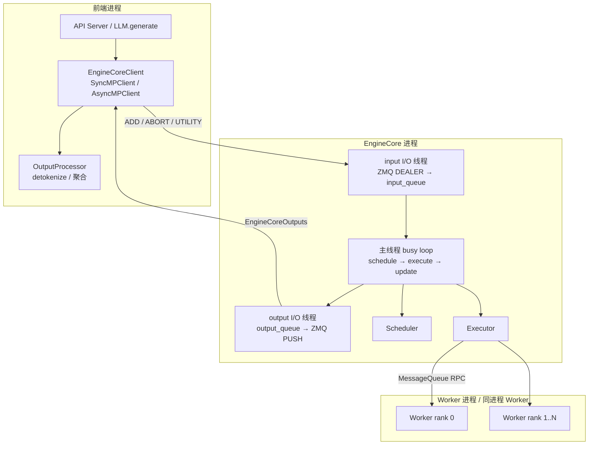
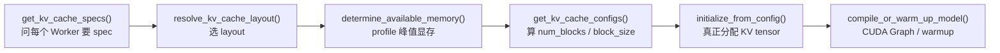
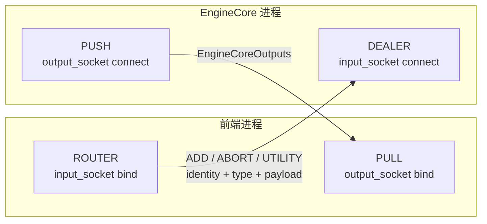
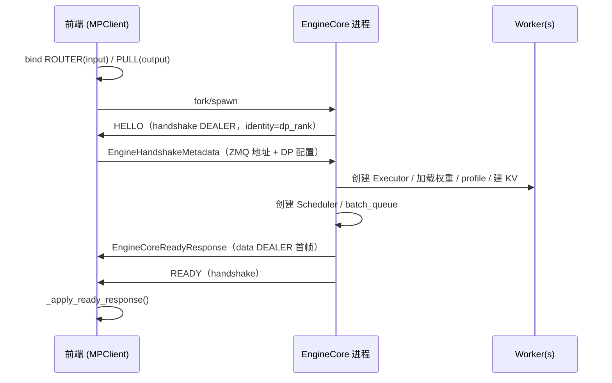
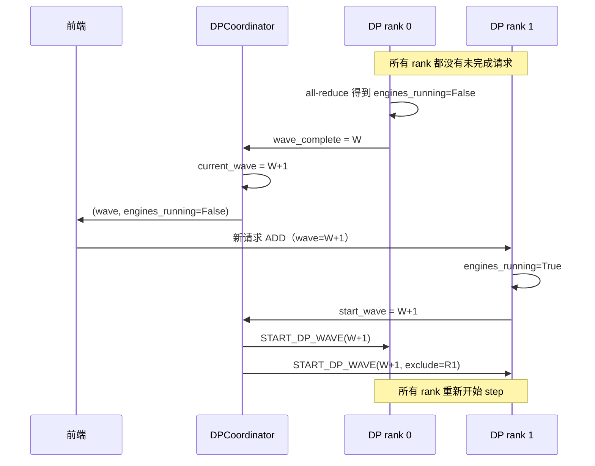
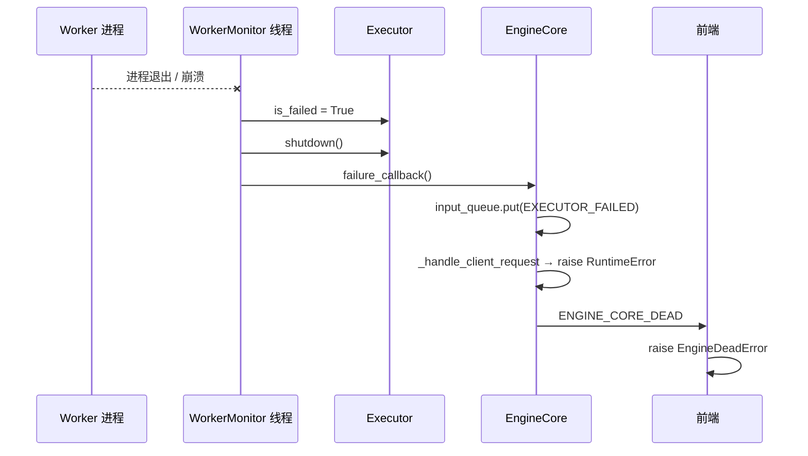
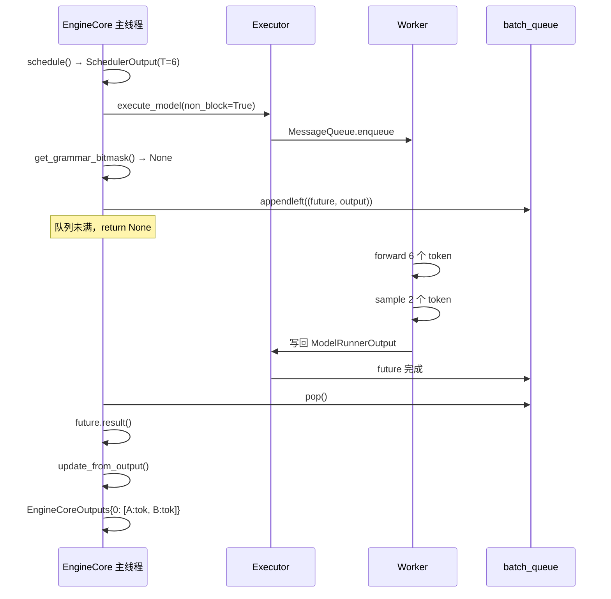

# 02 · EngineCore 与进程通信

> 前置阅读：[00 · 整体架构与阅读路线](./00-整体架构与阅读路线.md)、[01 · 入口与请求生命周期](./01-入口与请求生命周期.md)
> 对应源码：`vllm/v1/engine/core.py`、`vllm/v1/engine/core_client.py`、`vllm/v1/engine/utils.py`、`vllm/v1/engine/coordinator.py`、`vllm/v1/executor/`
> 适用版本：本仓库 commit `5082c45853`（2026-10-29）

---

## 1. 一句话概括

EngineCore 是 vLLM 的“发动机控制单元”：

> **它在一个（默认独立的）进程里持有 Scheduler、KV Cache 和模型执行器，用一个串行 busy loop 把“调度 → GPU 执行 → 采样 → 更新状态 → 发输出”串起来；EngineCoreClient 把这条循环包装成同步/异步 API；Executor 再把控制指令广播给 TP/PP Worker。**

上一篇结束在 `Scheduler.add_request()`。从这一篇开始，请求已经进入 EngineCore，接下来要看的是：

- EngineCore 什么时候、以什么顺序初始化；
- 每一步 `step()` 到底做了什么；
- 请求和输出如何跨进程传输；
- 单卡、TP、PP、DP 四种形态下，进程和线程分别长什么样。

---

## 2. 为什么需要 EngineCore 这一层

### 2.1 三个必须解决的问题

**问题 1：GPU 资源需要一个长期持有者。**

模型权重、KV Cache、CUDA Graph、NCCL 通信组，这些都和“进程 + CUDA context”绑定。不能每来一个请求就重新加载模型，所以必须有一个对象长期活着，持有这些资源。EngineCore 就是这个持有者。

**问题 2：调度循环不能被前端阻塞。**

在线服务里，HTTP 解析、tokenize、图片解码都可能很慢。如果这些逻辑和 `scheduler.schedule()` 在同一个线程里，GPU 就会等 CPU。EngineCore 默认独立成一个进程，前端再慢也不会直接卡住 GPU 循环。

**问题 3：一个引擎可能要服务多个前端。**

在 DP 或多 API server 部署里，多个前端进程会把请求发给同一组 EngineCore。每个请求带 `client_index`，输出再按 `client_index` 送回正确的前端。EngineCore 因此不能假设“只有一个客户端”。

### 2.2 为什么默认独立进程

`VLLM_ENABLE_V1_MULTIPROCESSING` 默认为 `1`（`vllm/envs.py:163`）。独立进程带来四个好处：

| 好处 | 说明 |
|---|---|
| GIL 隔离 | 前端的 tokenize / JSON / HTTP 不会和调度器抢 GIL |
| 故障隔离 | 前端崩溃不一定立刻带走 GPU 进程；GPU 进程崩溃可以被 monitor 检测到 |
| 多前端复用 | 一个 EngineCore 可以被多个 API server 通过 ZMQ 连接 |
| 资源清理 | CUDA context、NCCL、共享内存可以在进程退出时整体回收 |

代价也很明确：

- 所有请求/输出都要序列化；
- 启动时要做握手；
- 调试不能直接打断点，需要 `py-spy` 或单进程模式。

### 2.3 一个容易混淆的点

“多进程”有两个层次，不要混为一谈：

| 层次 | 由谁控制 | 默认行为 |
|---|---|---|
| 前端 ↔ EngineCore | `VLLM_ENABLE_V1_MULTIPROCESSING` | 开启，EngineCore 独立进程 |
| EngineCore ↔ Worker | `distributed_executor_backend` | TP=1 用 `uni`（同进程）；TP/PP>1 用 `mp`（Worker 独立进程） |

所以“单卡 + 默认配置”实际上是：

```text
前端进程（LLMEngine / AsyncLLM）
   │  ZMQ
   ▼
EngineCore 进程
   └── UniProcExecutor ── Worker 就在这个进程里
```

而 TP=8 是：

```text
前端进程
   │  ZMQ
   ▼
EngineCore 进程（driver）
   ├── Worker rank 0
   ├── Worker rank 1
   ├── ...
   └── Worker rank 7
```

---

## 3. 进程与线程拓扑

### 3.1 总览



### 3.2 线程清单

EngineCore 相关进程里常见的线程：

| 线程 | 所在进程 | 入口 | 职责 |
|---|---|---|---|
| 主线程 | EngineCore | `EngineCoreProc.run_busy_loop` | 调度、提交 GPU 任务、取结果、更新 Scheduler |
| input I/O 线程 | EngineCore | `EngineCoreProc.process_input_sockets` | 收 ZMQ 消息、反序列化、`preprocess_add_request`、塞进 `input_queue` |
| output I/O 线程 | EngineCore | `EngineCoreProc.process_output_sockets` | 从 `output_queue` 取 `EngineCoreOutputs`、序列化、发给前端/coordinator |
| Worker monitor | EngineCore（`mp` executor） | `MultiprocExecutor.start_worker_monitor` | 监控 Worker 进程存活 |
| Engine monitor | 前端进程 | `MPClient.start_engine_core_monitor` | 监控 EngineCore 进程存活 |

注意：**Scheduler 和模型提交都在主线程**。EngineCore 不是“多线程调度器”，它靠 I/O 线程把网络和预处理挪走，调度本身仍然是单线程的。

---

## 4. EngineCore 初始化：从 GPU 到 Scheduler

入口：`vllm/v1/engine/core.py:131` 的 `EngineCore.__init__`。

初始化顺序非常重要，因为它决定了“谁先知道显存有多少、block 有多大”。

### 4.1 初始化顺序总表

| 阶段 | 关键调用 | 产物 | 为什么在这个位置 |
|---|---|---|---|
| 1 | `executor_class(vllm_config)` | `self.model_executor` | 先有执行器，才能问 Worker 要 KV spec |
| 2 | `register_failure_callback` | 失败回调 | Worker 初始化失败要能通知 EngineCore |
| 3 | `measure_encoder_output_widths` | encoder 输出宽度 | 多模态预算需要 |
| 4 | `_initialize_kv_caches` | `KVCacheConfig` | 探测显存、算 block 数、真正分配 KV |
| 5 | `StructuredOutputManager` | 结构化输出管理器 | Scheduler 需要它做 grammar 初始化 |
| 6 | `Scheduler(...)` | `self.scheduler` | block_size / num_blocks 已确定，才能建 KV 管理器 |
| 7 | `init_kv_output_aggregator` | KV connector 聚合器 | 依赖 Scheduler 的 connector |
| 8 | `batch_queue` | `deque` 或 `None` | 依赖 `max_concurrent_batches` |
| 9 | `request_block_hasher` | 前缀缓存哈希函数 | 依赖 block_size / hash_block_size |
| 10 | `freeze_gc_heap()` | GC 冻结 | 减少运行期 GC 停顿 |

### 4.2 第 1 步：创建 Executor

```python
self.model_executor = executor_class(vllm_config)
```

`executor_class` 由 `Executor.get_class(vllm_config)` 决定（`vllm/v1/executor/abstract.py:64`）：

| `distributed_executor_backend` | 类 | 场景 |
|---|---|---|
| `"uni"` | `UniProcExecutor` | 单卡 / world_size=1 |
| `"mp"` | `MultiprocExecutor` | 单机多卡 TP/PP |
| `"ray"` | `RayExecutorV2` | 多机 / Ray 集群 |
| `"external_launcher"` | `ExecutorWithExternalLauncher` | torchrun 兼容启动 |

默认规则（`vllm/config/parallel.py:1119`）：

```python
if self.distributed_executor_backend is None and self.world_size == 1:
    self.distributed_executor_backend = "uni"
```

`world_size_across_dp > 1` 时默认 `"mp"`。

### 4.3 第 4 步：KV Cache 初始化

`_initialize_kv_caches` 是整篇文档里最“重”的一步，它做了这些事：



关键点：

1. **KV spec 是 Worker 报上来的**
   `model_executor.get_kv_cache_specs()` 通过 `collective_rpc("get_kv_cache_spec")` 收集。不同层（full attention、sliding window、Mamba）会有不同的 spec。

2. **非因果注意力会改变调度策略**
   如果某个 spec 带 `non_causal=True`，EngineCore 会关闭 chunked prefill 和 prefix caching（`core.py:270` 附近），因为它们假设因果注意力。

3. **显存探测是“峰值减去权重”**
   `determine_available_memory()` 会在 Worker 上跑一个 profile，得到模型峰值显存，再算出还能拿多少给 KV Cache。

4. **block_size 可能被改写**
   `get_kv_cache_configs()` 会算出一个全局 block size；对 hybrid Mamba 模型，Worker 可能把它调大。这个值会通过 `EngineCoreReadyResponse` 同步回前端。

5. **auto-fit 可能降低 `max_model_len`**
   如果显存不够，vLLM 会把 `max_model_len` 调小。Worker 是在 profile 之前启动的，所以之后要通过 `collective_rpc("update_max_model_len", ...)` 把新值同步给 Worker。

> 这一步的细节在 **04 KV Cache 与 PagedAttention** 展开。这里只需要记住：**Scheduler 是在 KV 配置确定之后才创建的**。

### 4.4 第 6 步：创建 Scheduler

```python
Scheduler = vllm_config.scheduler_config.get_scheduler_cls()

self.scheduler = Scheduler(
    vllm_config=vllm_config,
    kv_cache_config=kv_cache_config,
    structured_output_manager=self.structured_output_manager,
    include_finished_set=include_finished_set,
    log_stats=self.log_stats,
    block_size=scheduler_block_size,
    hash_block_size=hash_block_size,
)
```

`get_scheduler_cls()` 的选择：

| 条件 | 类 |
|---|---|
| `async_scheduling=True` | `AsyncScheduler` |
| 否则 | `Scheduler` |

`AsyncScheduler` 继承 `Scheduler`，主要多了一件事：在 `_update_after_schedule` 里为“还没拿回输出”的 token 增加 `num_output_placeholders`。这是异步调度能在输出回来之前继续调度下一步的关键。

### 4.5 第 8 步：batch queue 与 step_fn

```python
self.batch_queue_size = vllm_config.max_concurrent_batches

self.batch_queue = None
if self.batch_queue_size > 1:
    self.batch_queue = deque(maxlen=self.batch_queue_size)

self.step_fn = (
    self.step if self.batch_queue is None else self.step_with_batch_queue
)
```

`max_concurrent_batches` 的定义在 `vllm/config/vllm.py:603`：

```python
pp_size = self.parallel_config.pipeline_parallel_size
if self.scheduler_config.async_scheduling:
    if self.use_v2_model_runner:
        return pp_size + 1
    if pp_size <= 1:
        return 2
return pp_size
```

于是：

| 配置 | `max_concurrent_batches` | 用哪个 step |
|---|---|---|
| 无 async、PP=1 | 1 | `step()` |
| 无 async、PP=4 | 4 | `step_with_batch_queue()` |
| async、PP=1、V2 Runner | 2 | `step_with_batch_queue()` |
| async、PP=4、V2 Runner | 5 | `step_with_batch_queue()` |

**重要**：当前版本 `async_scheduling` 默认开启（除非模型是 pooling、executor 不支持、或 V1 Runner 遇到不兼容项，见 `vllm/config/vllm.py:1701` 附近）。所以**默认 TP=1 场景通常也会启用 batch queue，走 `step_with_batch_queue()`**，而不是 `step()`。

### 4.6 第 9 步：前缀缓存哈希函数

```python
self.request_block_hasher = None
if vllm_config.cache_config.enable_prefix_caching or kv_connector is not None:
    caching_hash_fn = get_hash_fn_by_name(...)
    self.request_block_hasher = get_request_block_hasher(
        hash_block_size,
        caching_hash_fn,
        vllm_config.num_hash_lookahead_tokens,
    )
```

这个函数会在 `preprocess_add_request` 里传给 `Request`，让请求一创建就能算出完整 block 的链式哈希。细节在 04。

---

## 5. `step()`：单批次路径

入口：`vllm/v1/engine/core.py:674`。

```python
def step(self) -> tuple[dict[int, EngineCoreOutputs], bool]:
    if not self.scheduler.has_requests():
        return {}, False

    scheduler_output = self.scheduler.schedule(self._should_throttle_prefills())
    future = self.model_executor.execute_model(scheduler_output, non_block=True)
    grammar_output = self.scheduler.get_grammar_bitmask(scheduler_output)

    with (
        self.capture_iteration_details(scheduler_output) as iteration_details,
        self.log_error_detail(scheduler_output),
    ):
        model_output = future.result()
        if model_output is None:
            model_output = self.model_executor.sample_tokens(grammar_output)

    self._process_aborts_queue()
    engine_core_outputs = self.scheduler.update_from_output(
        scheduler_output, model_output
    )
    self._attach_iteration_details(engine_core_outputs, iteration_details)
    self._attach_weight_version(engine_core_outputs)

    return engine_core_outputs, scheduler_output.total_num_scheduled_tokens > 0
```

### 5.1 逐步解释

#### 第 1 步：`has_requests()`

如果没有未完成请求，直接返回空。这里包括：

- waiting 队列；
- running 队列；
- 被抢占但还持有 block 的请求；
- 等待远程 KV 的请求。

#### 第 2 步：`schedule()`

Scheduler 根据 token 预算、KV block 预算、优先级等，产出一个 `SchedulerOutput`。它描述“这一步要算哪些 token”，而不是“要跑哪些请求”。

关键字段（03 详解）：

| 字段 | 含义 |
|---|---|
| `num_scheduled_tokens` | `{req_id: 本步 token 数}` |
| `total_num_scheduled_tokens` | 本步扁平 token 总数 `T` |
| `scheduled_new_reqs` | 本步新加入的请求 |
| `scheduled_cached_reqs` | 继续运行的请求 |
| `finished_req_ids` | 本步要释放的请求 |
| `num_common_prefix_blocks` | 前缀缓存命中 |
| `kv_connector_metadata` | KV 传输元数据 |

#### 第 3 步：`execute_model(non_block=True)`

这里返回的是 `Future`，不是结果。`non_block=True` 的意义是：

> **把 RPC 发给 Worker 之后立刻返回，让 CPU 可以去干别的。**

对 `MultiprocExecutor`，这会把 `(method, args, kwargs, output_rank)` 写进共享内存 `MessageQueue`，然后返回一个 `FutureWrapper`。GPU 真正开始执行是在 Worker 收到消息之后。

对 `UniProcExecutor`，`run_method` 会同步调用 Worker 的 `execute_model`；如果返回 `AsyncModelRunnerOutput`，则包装成 `AsyncOutputFuture`，`result()` 时才真正 `get_output()`。

#### 第 4 步：`get_grammar_bitmask()`

结构化输出（JSON schema、regex、choice）需要一个 bitmask 来屏蔽非法 token。这个 bitmask 的计算在 CPU 上，可能耗时。

vLLM 把它放在 `execute_model` 之后、`future.result()` 之前，就是为了**让 CPU 计算和 GPU forward 重叠**：

```text
时间轴：
CPU:  schedule ──► 发 RPC ──► 算 grammar bitmask ──────────► 等结果
GPU:                         ──► forward ──► sample ──► 完成
```

如果没有结构化输出，`get_grammar_bitmask` 会很快返回 `None`。

#### 第 5 步：`future.result()`

阻塞等待 GPU 完成。返回值有两种：

| 返回值 | 含义 |
|---|---|
| `ModelRunnerOutput` | 正常，已经包含采样结果 |
| `None` | 模型执行完成，但采样被解耦到 `sample_tokens()` |

第二种情况出现在 V2 Runner 的“decoupled sampling”路径：`execute_model` 只做 forward，把采样留给单独的 `sample_tokens` 调用。这样采样可以和下一步的 forward 重叠。

#### 第 6 步：`sample_tokens(grammar_output)`

如果上一步返回 `None`，这里同步调用采样。

注意：`sample_tokens` 也可能返回 `None`，表示“原来的 `execute_model` 失败了”。在 `step_with_batch_queue` 里会显式再取 `exec_model_fut.result()` 来抛出根因；`step()` 里则直接让后续逻辑报错。

#### 第 7 步：`_process_aborts_queue()`

在 GPU 执行期间，前端可能发来了 abort。这些 abort 被放进 `aborts_queue`，在这里统一处理。

为什么不在执行前处理？因为 abort 是“尽量快”，但没必要打断已经提交的 GPU 任务。等这一步结果回来再 abort，可以避免半途取消带来的状态不一致。

#### 第 8 步：`update_from_output()`

Scheduler 根据 `ModelRunnerOutput`：

- 把新 token 追加到请求；
- 更新 `num_computed_tokens`；
- 判断 stop / max_tokens / abort；
- 释放完成的请求的 block；
- 生成 `EngineCoreOutputs`。

返回类型是 `dict[int, EngineCoreOutputs]`，key 是 `client_index`。这意味着一个 step 的输出可以同时发给多个前端。

#### 第 9 步：附加统计与权重版本

- `_attach_iteration_details`：把本步耗时、batch 信息附到 `SchedulerStats`；
- `_attach_weight_version`：把当前权重版本附上，用于权重热更新场景。

### 5.2 `model_executed` 是什么

返回值第二个元素：

```python
scheduler_output.total_num_scheduled_tokens > 0
```

它表示“本步是否真的有 token 被计算”。注意：

- 调度了请求，但可能因为 KV 不够、等待远程 KV 等原因，`total_num_scheduled_tokens == 0`；
- 这时 `update_from_output` 仍可能产生输出（例如 finished 通知）；
- `run_busy_loop` 会用这个标志决定是否 `sleep(0.001)` 让出 GIL。

---

## 6. `step_with_batch_queue()`：流水线路径

入口：`vllm/v1/engine/core.py:715`。

### 6.1 它解决什么问题

`step()` 的节奏是“调度 → 等 GPU → 更新 → 再调度”。GPU 在等 CPU 更新，CPU 在等 GPU 完成，存在气泡。

`step_with_batch_queue()` 允许**同时有多个 batch 在飞**：

```text
batch 0: forward ──► sample ──► 取结果
batch 1:          forward ──► sample ──► 取结果
batch 2:                   forward ──► sample ──► 取结果
```

这对两种场景是必需的：

1. **PP > 1**：流水线需要多个 microbatch 才能填满 stages；
2. **async scheduling**：在输出还没回来时，就用 placeholder 继续调度下一步。

### 6.2 核心逻辑

```python
batch_queue = self.batch_queue
assert len(batch_queue) < self.batch_queue_size

model_executed = False
deferred_scheduler_output = None

if self.scheduler.has_requests():
    scheduler_output = self.scheduler.schedule(...)
    exec_future = self.model_executor.execute_model(
        scheduler_output, non_block=True
    )
    if not self.is_mm_encoder_only:
        model_executed = scheduler_output.total_num_scheduled_tokens > 0

    if self.is_pooling_model or not model_executed:
        future = exec_future
    else:
        if not scheduler_output.pending_structured_output_tokens:
            grammar_output = self.scheduler.get_grammar_bitmask(scheduler_output)
            future = self.model_executor.sample_tokens(grammar_output, non_block=True)
        else:
            # 需要先拿到上一步的输出，才能算这一步的 grammar
            deferred_scheduler_output = scheduler_output

    if not deferred_scheduler_output:
        batch_queue.appendleft((future, scheduler_output, exec_future))
        if len(batch_queue) < self.batch_queue_size and (
            model_executed or self.scheduler.has_requests()
        ):
            # 队列没满，先不取结果，继续调度
            return None, model_executed

elif not batch_queue:
    return None, False

# 队列满或没有更多可调度请求：阻塞取最早的结果
future, scheduler_output, exec_model_fut = batch_queue.pop()
model_output = future.result()
...
```

### 6.3 三个容易误解的返回值

| 返回值 | 含义 |
|---|---|
| `(None, True)` | 本步只提交了新 batch，还没取回任何输出；`model_executed=True` 表示确实提交了 GPU 工作 |
| `(EngineCoreOutputs, True)` | 取回了一个 batch 的输出，且本步也提交了新的 GPU 工作 |
| `(None, False)` | 队列空且没有可调度请求（通常只在边界出现） |

`_process_engine_step` 会把 `None` 当作“本步没有输出”，但仍会调用 `post_step(model_executed)`。

> 对 `is_mm_encoder_only` 模型，`model_executed` 会被强制保持 `False`，因为这一步只跑视觉编码器，不跑语言模型 forward。

### 6.4 `deferred_scheduler_output`：结构化输出的特殊情况

如果本步的请求需要结构化输出，而且上一步的输出还没回来，Scheduler 无法计算 grammar bitmask（因为 bitmask 依赖上一步采样出的 token）。

vLLM 的做法是：

1. 先提交 forward，但不提交 sample；
2. 把 `scheduler_output` 暂存到 `deferred_scheduler_output`；
3. 等从 `batch_queue` 取回上一步输出后，再算 grammar、调用 `sample_tokens`，然后把新的 future 放回队列。

代码里注释解释了取舍：

> 可以在这里立即处理 deferred，也可以留到下一次 `step_with_batch_queue` 开始时处理。后者略微偏向 TTFT，而不是 TPOT/吞吐。

### 6.5 和 `step()` 的对比

| 维度 | `step()` | `step_with_batch_queue()` |
|---|---|---|
| 在飞 batch 数 | 1 | `max_concurrent_batches` |
| 调度与取结果 | 同一次调用内完成 | 可以分离 |
| 适用 | 无 async、PP=1 | PP>1 或 async scheduling |
| 返回值 | 总是 `(outputs, bool)` | 可能是 `(None, bool)` |
| 实现复杂度 | 低 | 高（deferred、placeholder、queue） |

---

## 7. `EngineCoreProc`：ZMQ 外壳与 busy loop

入口：`vllm/v1/engine/core.py:1207`。

`EngineCore` 只负责“算”，`EngineCoreProc` 负责“收、算、发”。

### 7.1 两个内部队列

```python
self.input_queue = queue.Queue[tuple[EngineCoreRequestType, Any]]()
self.output_queue = queue.Queue[tuple[int, EngineCoreOutputs] | bytes]()
```

| 队列 | 生产者 | 消费者 | 内容 |
|---|---|---|---|
| `input_queue` | input I/O 线程、失败回调 | 主线程 busy loop | `(请求类型, 数据)` |
| `output_queue` | 主线程、utility 调用 | output I/O 线程 | `(client_index, outputs)` 或 `ENGINE_CORE_DEAD` |

队列是线程安全的 Python `queue.Queue`，这样 I/O 线程和主线程之间不需要额外锁。

### 7.2 `run_busy_loop`

```python
def run_busy_loop(self):
    while self._handle_shutdown():
        self._process_input_queue()
        self._maybe_publish_request_counts()
        self._process_engine_step()
        self._maybe_publish_request_counts()
    raise SystemExit
```

三步循环：

1. **`_process_input_queue()`**
   如果当前没有工作（`has_work()` 为 False），就阻塞在 `input_queue.get()`，直到有新请求、abort、utility 调用或 wakeup。如果有工作，就非阻塞地把队列里的消息全部处理掉。

2. **`_maybe_publish_request_counts()`**
   只在 DP + 内部负载均衡时启用，把 waiting/running/KV 使用率发给 coordinator。

3. **`_process_engine_step()`**

   ```python
   outputs, model_executed = self.step_fn()
   for output in outputs.items() if outputs else ():
       self.output_queue.put_nowait(output)
   self.post_step(model_executed)
   if not model_executed and self.scheduler.has_requests():
       time.sleep(0.001)
   ```

   注意 `time.sleep(0.001)`：当没有真正执行模型、但 Scheduler 还有工作（例如等待远程 KV 传输）时，主动让出 GIL，避免忙等把其他线程饿死。

### 7.3 `has_work()`

```python
def has_work(self) -> bool:
    return (
        self.engines_running
        or self.scheduler.has_requests()
        or bool(self.batch_queue)
    )
```

三个条件任一满足就不能睡：

- `engines_running`：DP 全局还有 rank 在工作；
- `scheduler.has_requests()`：本地还有请求；
- `batch_queue`：还有在飞的 batch 没取结果。

### 7.4 请求处理：`_handle_client_request`

```python
if request_type == WAKEUP:
    return
elif request_type == ADD:
    req, request_wave = request
    if self._reject_add_in_shutdown(req) or self._reject_add_while_paused(req):
        return
    self.add_request(req, request_wave)
elif request_type == ABORT:
    self.abort_requests(request)
elif request_type == UTILITY:
    client_idx, call_id, method_name, args = request
    ...
elif request_type == EXECUTOR_FAILED:
    raise RuntimeError("Executor failed.")
```

`ADD` 里的 `request` 已经是 `(Request, wave)` 二元组，因为 `preprocess_add_request` 在 I/O 线程里已经执行过了。

`UTILITY` 是“在 EngineCore 上执行任意方法”的通用 RPC，例如：

- `get_supported_tasks`
- `reset_prefix_cache`
- `sleep` / `wake_up`
- `profile`
- `add_lora` / `remove_lora`

它的返回也走 `output_queue`，但带 `call_id`，前端用 `utility_results` future 匹配。

### 7.5 为什么 `preprocess_add_request` 在 I/O 线程

```python
def preprocess_add_request(self, request: EngineCoreRequest) -> tuple[Request, int]:
    if self.mm_receiver_cache is not None and request.mm_features:
        request.mm_features = self.mm_receiver_cache.get_and_update_features(
            request.mm_features
        )
    req = Request.from_engine_core_request(request, self.request_block_hasher)
    if req.use_structured_output:
        self.structured_output_manager.grammar_init(req)
    return req, request.current_wave
```

这段代码做了三件可能耗时的事：

1. 多模态缓存对齐；
2. 构造 `Request`（包括计算 block hashes）；
3. 初始化 grammar（结构化输出编译）。

如果放在主线程，它会直接阻塞 GPU 调度。放在 I/O 线程后，它可以和上一步的 GPU forward 重叠。

代码注释特别说明了线程安全：

> `mm_receiver_cache` 在 `LLMEngine` 初始化结束时重置，之后只在 input 线程访问；`grammar_init` 也只在 input 线程调用。

---

## 8. `EngineCoreClient`：三种客户端

入口：`vllm/v1/engine/core_client.py:84`。

### 8.1 选择逻辑

`EngineCoreClient.make_client`（`core_client.py:95`）：

```text
multiprocess_mode?
├── False → InprocClient
└── True
    ├── asyncio_mode=False → SyncMPClient
    └── asyncio_mode=True
        ├── DP=1 → AsyncMPClient
        └── DP>1
            ├── external LB → DPAsyncMPClient
            └── internal LB → DPLBAsyncMPClient
```

注意：`asyncio_mode=True` 且 `multiprocess_mode=False` 目前直接 `NotImplementedError`。

### 8.2 `InprocClient`

入口：`core_client.py:376`。

```python
def get_output(self):
    outputs, model_executed = self.engine_core.step_fn()
    self.engine_core.post_step(model_executed=model_executed)
    return outputs and outputs.get(0) or EngineCoreOutputs()

def add_request(self, request):
    req, request_wave = self.engine_core.preprocess_add_request(request)
    self.engine_core.add_request(req, request_wave)
```

特点：

| 特点 | 说明 |
|---|---|
| 没有 ZMQ | 直接方法调用 |
| 没有 busy loop | 前端每次 `get_output()` 才推进一步 |
| `preprocess` 在主线程 | 不能和 GPU forward 重叠 |
| 调试友好 | 可以直接断点、看栈 |
| 适用 | 单元测试、性能分析、`VLLM_ENABLE_V1_MULTIPROCESSING=0` |

`InprocClient` 下 `LLMEngine.step()` 的节奏是：

```text
LLMEngine.step()
  → engine_core.get_output()
      → EngineCore.step()
          → schedule → execute → update
```

### 8.3 `SyncMPClient`

入口：`core_client.py:965`。

初始化时：

1. 创建 ZMQ context；
2. bind `ROUTER` input socket 和 `PULL` output socket；
3. 调 `launch_core_engines` 启动 EngineCore 进程；
4. 等待每个 engine 的 data-socket ready；
5. 启动 output 线程和 engine monitor 线程。

`add_request`：

```python
def add_request(self, request: EngineCoreRequest) -> None:
    if self.is_dp:
        self.engines_running = True
    self._send_input(EngineCoreRequestType.ADD, request)
```

`_send_input`：

```python
msg = (self.core_engine, request_type.value, *self.encoder.encode(request))
self.input_socket.send_multipart(msg, copy=False)
```

第一帧是 engine identity，第二帧是请求类型，后面是 msgpack 编码的请求体。

`get_output`：

```python
outputs = self.outputs_queue.get()
if isinstance(outputs, Exception):
    raise self._format_exception(outputs) from None
if outputs.wave_complete is not None:
    self.engines_running = False
return outputs
```

output 线程负责把 socket 上的字节解码成 `EngineCoreOutputs`，放进 `outputs_queue`；`get_output` 只是阻塞取队列。

### 8.4 `AsyncMPClient`

入口：`core_client.py:1159`。

和 `SyncMPClient` 的区别：

| 维度 | `SyncMPClient` | `AsyncMPClient` |
|---|---|---|
| 输出线程 | 普通 `threading.Thread` | `asyncio.create_task` |
| 输出队列 | `queue.Queue` | `asyncio.Queue` |
| API | `add_request` / `get_output` | `await add_request_async` / `await get_output_async` |
| utility RPC | `Future` | `asyncio.Future` |
| 适用 | 离线 `LLM` | 在线 `AsyncLLM` |

`AsyncMPClient` 的输出任务在 `_ensure_output_queue_task` 里创建（`core_client.py:1197` 附近）。它除了处理普通输出，还会：

- 处理 utility 输出；
- 处理 EEP 通知；
- 把 `outputs.outputs` 或 `scheduler_stats` 放进 `outputs_queue`。

`AsyncLLM` 的后台 output handler 再从 `outputs_queue` 取数据，交给 `OutputProcessor`，最后放进每个请求的 `RequestOutputCollector`。

### 8.5 三种客户端对比

| 能力 | `InprocClient` | `SyncMPClient` | `AsyncMPClient` |
|---|---|---|---|
| 跨进程 | 否 | 是 | 是 |
| 后台 busy loop | 否 | 是 | 是 |
| 请求/输出重叠 | 否 | 是 | 是 |
| asyncio | 否 | 否 | 是 |
| DP | 有限 | 是 | 是（含 LB） |
| 调试难度 | 低 | 中 | 高 |

---

## 9. ZMQ 协议与启动握手

### 9.1 Socket 拓扑



为什么用 `ROUTER/DEALER`？

- 一个前端可能连多个 EngineCore（DP）；
- `ROUTER` 可以根据 identity 把消息路由到正确的 engine；
- engine 侧用 `DEALER` 连接，identity 由 engine 自己设置成 `engine_index` 的 2 字节小端表示。

为什么输出用 `PUSH/PULL`？

- 输出是单向流，不需要请求-响应配对；
- `PUSH` 实现简单，且可以用 `linger` 保证 `ENGINE_CORE_DEAD` 不被丢弃；
- 前端只需要一个 `PULL` socket 就能接收所有 engine 的输出（靠 `engine_index` 区分来源）。

### 9.2 消息帧格式

input 方向：

```text
[engine_identity][request_type][msgpack payload...]
```

output 方向：

```text
[msgpack payload...]
```

`EngineCoreOutputs` 本身带 `engine_index`，所以不需要额外的 identity 帧。

### 9.3 启动握手：HELLO / READY

启动过程分两套 socket：

1. **handshake socket**：进程级握手；
2. **data socket**：真正的请求/输出通道。



#### HELLO

`EngineCoreProc._perform_handshakes` 创建 DEALER，连到 `handshake_address`，发送：

```python
{
    "status": "HELLO",
    "local": local_client,
    "headless": headless,
}
```

前端 `wait_for_engine_startup`（`vllm/v1/engine/utils.py:1403`）收到后：

- 校验 local/remote 是否匹配；
- 校验 remote engine 是否 headless；
- 回复 `EngineHandshakeMetadata`，里面包含：
  - `addresses`：input/output socket 地址；
  - `parallel_config`：DP master IP/port、DP size 等。

#### READY

EngineCore 初始化完成后，在 `_perform_handshakes` 退出时发送：

```python
{
    "status": "READY",
    "local": local_client,
    "headless": headless,
    "parallel_config_hash": ...,
}
```

前端收到后把 engine 标记为 `CONNECTED`，并校验 DP 配置哈希。

#### data socket 的 ready response

还有一条容易被忽略的消息：input I/O 线程启动后，会先往每个 input socket 发一条 `EngineCoreReadyResponse`：

```python
ready_response = self._make_ready_response()
ready_payload = msgspec.msgpack.encode(ready_response)
for input_socket in input_sockets:
    input_socket.send(ready_payload)
```

这条消息有两个作用：

1. **让 ROUTER 知道 DEALER 的 identity**，之后前端才能把消息路由回来；
2. **把初始化后的配置同步回前端**，例如：
   - `max_model_len`（可能被 auto-fit 调小）；
   - `num_gpu_blocks`；
   - `block_size`（可能被 hybrid Mamba 调大）；
   - `kv_cache_size_tokens`；
   - DP stats 地址。

前端 `_apply_ready_response` 会把这些值写回 `vllm_config`，并对 DP 的 `num_gpu_blocks` 求和。

> 所以“启动完成”其实有两次信号：handshake READY 表示进程活着，data ready response 表示数据通道可用且配置已同步。

### 9.4 请求类型

`EngineCoreRequestType`（`vllm/v1/engine/__init__.py:324`）：

| 枚举 | 字节 | 方向 | 含义 |
|---|---|---|---|
| `ADD` | `b"\x00"` | 前端 → EngineCore | 新增请求 |
| `ABORT` | `b"\x01"` | 前端 → EngineCore | 取消请求 |
| `START_DP_WAVE` | `b"\x02"` | coordinator → EngineCore | 启动新一轮 DP wave |
| `UTILITY` | `b"\x03"` | 前端 → EngineCore | 通用方法调用 |
| `EXECUTOR_FAILED` | `b"\x04"` | Executor → EngineCore | 内部哨兵，Worker 永久失败 |
| `WAKEUP` | `b"\x05"` | 信号处理 → EngineCore | 唤醒空闲 busy loop |

用单字节枚举而不是字符串，是为了省掉一次编码，直接作为 ZMQ 帧发送。

### 9.5 输出结构

`EngineCoreOutputs`（`vllm/v1/engine/__init__.py:290`）：

| 字段 | 含义 |
|---|---|
| `engine_index` | 哪个 DP rank 产生的 |
| `outputs` | `list[EngineCoreOutput]`，每个请求一条 |
| `scheduler_stats` | 本步调度统计 |
| `utility_output` | utility RPC 的返回 |
| `finished_requests` | 完成的请求集合 |
| `wave_complete` | DP：本轮 wave 结束 |
| `start_wave` | DP：请求唤醒新一轮 |
| `weight_version` | 权重版本 |

`EngineCoreOutput`（`__init__.py:227`）：

| 字段 | 含义 |
|---|---|
| `request_id` | 内部请求 ID |
| `new_token_ids` | 本步新生成的 token |
| `new_logprobs` | logprobs |
| `pooling_output` | embedding / pooling 结果 |
| `finish_reason` | 结束原因 |
| `stop_reason` | 具体 stop 条件 |
| `kv_transfer_params` | KV 传输参数 |
| `num_nans_in_logits` | logits 中 NaN 数量 |

注意：`EngineCoreOutputs` 是按 `client_index` 分组的，不是按请求分组的。一个 `EngineCoreOutputs` 里可以有多条 `EngineCoreOutput`。

---

## 10. Executor：从 EngineCore 到 Worker

### 10.1 统一接口

`Executor` 基类（`vllm/v1/executor/abstract.py:120`）提供：

| 方法 | 作用 |
|---|---|
| `initialize_from_config(kv_cache_configs)` | 在 Worker 上分配 KV |
| `determine_available_memory()` | profile 显存 |
| `get_kv_cache_specs()` | 收集 KV spec |
| `compile_or_warm_up_model()` | CUDA Graph / warmup |
| `execute_model(scheduler_output)` | 执行一步 forward |
| `sample_tokens(grammar_output)` | 采样 |
| `execute_dummy_batch()` | DP 空转时保持集合通信 |
| `collective_rpc(method, ...)` | 通用 RPC |
| `shutdown()` | 关闭 Worker |

### 10.2 `UniProcExecutor`

入口：`vllm/v1/executor/uniproc_executor.py`。

```python
self.driver_worker = WorkerWrapperBase(rpc_rank=0)
self.driver_worker.init_worker(...)
self.driver_worker.init_device()
self.driver_worker.load_model()
```

`collective_rpc` 直接调用：

```python
result = run_method(self.driver_worker, method, args, kwargs)
if isinstance(result, AsyncModelRunnerOutput):
    result = result.get_output()
```

`non_block=True` 时：

```python
if isinstance(result, AsyncModelRunnerOutput):
    return AsyncOutputFuture(result, single_value)
```

`AsyncOutputFuture.result()` 才真正调用 `async_output.get_output()`，把 device tensor 拷回 host。这样采样/拷贝可以和下一步调度重叠。

### 10.3 `MultiprocExecutor`

入口：`vllm/v1/executor/multiproc_executor.py:125`。

初始化：

1. 计算 `world_size = tp * pp * pcp`；
2. 创建 `rpc_broadcast_mq`（共享内存广播队列）；
3. `spawn` / `fork` 出 `WorkerProc`；
4. 等待每个 Worker 报 `READY`；
5. 收集每个 Worker 的 `worker_response_mq`；
6. 启动 Worker monitor 线程。

RPC 广播：

```python
self.rpc_broadcast_mq.enqueue((send_method, args, kwargs, output_rank))
```

所有 Worker 都从同一个共享内存队列 `dequeue`，所以一次写入就能让所有 rank 收到同一条指令。

### 10.4 `output_rank`：为什么只收一个 Worker 的结果

`MultiprocExecutor._get_output_rank`（`multiproc_executor.py:649`）：

```python
return (
    self.world_size
    - self.parallel_config.tensor_parallel_size
    * self.parallel_config.prefill_context_parallel_size
)
```

注释给的例子：

```text
TP=8, PP=4, world_size=32
PP rank 0: 0-7
PP rank 1: 8-15
PP rank 2: 16-23
PP rank 3: 24-31
output_rank = 32 - 8 = 24
```

也就是“最后一个 PP stage 的第一个 TP rank”。

为什么只需要它？

- TP 内部通过 all-reduce 保证各 rank 的 hidden states 一致；
- PP 只有最后一个 stage 有最终 hidden states；
- 采样只需要一份结果。

所以让其他 rank 只发“执行成功”的状态，只有 `output_rank` 发完整 `ModelRunnerOutput`，可以大幅减少 IPC 数据量。

### 10.5 `WorkerProc.worker_busy_loop`

入口：`multiproc_executor.py:1154`。

```python
def worker_busy_loop(self):
    while True:
        with get_watch_dog().disable():
            rpc_request = self.rpc_broadcast_mq.dequeue(indefinite=True)
        self._execute_worker_rpc(rpc_request)
```

每个 Worker 进程的主循环就是：

1. 从共享内存队列取 RPC；
2. 执行；
3. 把结果写回自己的 `worker_response_mq`；
4. 如果自己是 `output_rank`，结果会被 Executor 取走。

`get_watch_dog().disable()` 是必要的：Worker 在等待 RPC 时是空闲的，不应该触发看门狗超时。

### 10.6 `non_block` 与 `FutureWrapper`

`collective_rpc(non_block=True)` 返回 `FutureWrapper`。它不是标准 `concurrent.futures.Future`，而是把“取响应”的动作延迟到 `result()`：

```python
future = FutureWrapper(self.futures_queue, get_response=get_response, aggregate=aggregate)
return future if non_block else future.result()
```

这样做的好处是：**EngineCore 主线程可以在 GPU 执行期间继续调度**，而不是阻塞在 `mq.dequeue()` 上。

---

## 11. 数据并行（DP）

### 11.1 两种 DP

| 类型 | 条件 | EngineCore 类 | 是否 lockstep |
|---|---|---|---|
| 非 MoE DP | 模型不是 MoE | `EngineCoreProc` | 否，各 rank 独立 |
| MoE DP | 模型是 MoE | `DPEngineCoreProc` | 是，需要全局 all-reduce |

`run_engine_core` 的选择（`core.py:1510`）：

```python
if data_parallel and vllm_config.model_config.is_moe:
    engine_core = DPEngineCoreProc(*args, **kwargs)
else:
    parallel_config.reconfigure_for_independent_dp_rank()
    engine_core = EngineCoreProc(*args, engine_index=dp_rank, **kwargs)
```

非 MoE 的 DP rank 完全独立，可以各自跑各自的请求，不需要协调。

MoE 则不行：专家并行（EP）或 DP attention 需要所有 rank 参与同一个 all-to-all / all-reduce。如果某个 rank 停了，其他 rank 会卡在集合通信里。

### 11.2 Wave 机制



关键角色：

- **`DPCoordinator`**（`vllm/v1/engine/coordinator.py:23`）：独立进程，收集每个 rank 的 waiting/running/KV 使用率，维护全局 wave 号和 running 状态；
- **rank 0**：负责发 `wave_complete` 和 `start_wave`；
- **所有 rank**：通过 `sync_dp_state` 做 all-reduce，判断“是否还有全局未完成请求”。

### 11.3 `START_DP_WAVE` 的处理

`DPEngineCoreProc._handle_client_request`（`core.py:2520`）：

```python
if request_type == START_DP_WAVE:
    if self.ignore_start_dp_wave:
        return
    new_wave, exclude_eng_index = request
    if exclude_eng_index != self.engine_index and new_wave >= self.current_wave:
        self.current_wave = new_wave
        if not self.engines_running:
            self.engines_running = True
```

两个保护：

1. `ignore_start_dp_wave`：暂停期间收到的旧 wave 直接丢弃；
2. `exclude_eng_index`：已经收到请求的那个 rank 不需要再被唤醒。

### 11.4 全局未完成判断

`_has_global_unfinished_reqs`（`core.py:2656`）：

```python
self.step_counter += 1
if self.step_counter != 1 and self.step_counter % self.dp_sync_interval != 0:
    return True

has_unfinished, pause_consensus = parallel_config.sync_dp_state(
    self.dp_group,
    has_unfinished=local_unfinished,
    pending_pause=self.pending_pause,
)
```

`sync_dp_state`（`vllm/config/parallel.py:889`）做一次 2 元素 all-reduce：

```text
[has_unfinished, pending_pause]
  → SUM
has_unfinished_global = sum[0] > 0 或 pause_count % dp_size != 0
pause_consensus = sum[1] == dp_size
```

为什么不是每步都同步？因为 all-reduce 有开销。`dp_sync_interval` 控制同步频率；但 `step_counter == 1` 时强制同步，保证空闲暂停只需要一个 dummy batch。

### 11.5 空闲时的 dummy batch

如果某个 rank 没有本地请求，但全局还有别的 rank 在工作，它不能直接停，否则会卡住集合通信。`DPEngineCoreProc.run_busy_loop` 会：

```python
if not executed:
    if not local_unfinished_reqs and not self.engines_running:
        continue
    elif not self.model_executor.is_sleeping:
        self.execute_dummy_batch()
```

空跑一个 dummy batch，保持集合通信对齐。

### 11.6 Prefill 节流

```python
def _should_throttle_prefills(self) -> bool:
    return (
        self.prefill_schedule_interval > 1
        and self.step_counter % self.prefill_schedule_interval != 0
    )
```

目的：在 DP 场景下，把新 prefill 对齐到固定节奏，避免某个 rank 突然塞入大量 prefill，导致其他 rank 等它，破坏负载均衡。

### 11.7 前端负载均衡

`DPLBAsyncMPClient.get_core_engine_for_request`（`core_client.py:1771`）为每个请求选择 engine：

```python
inflight = self.engine_inflight[self.core_engines[idx]]
score = max(self.client_count * inflight, waiting + running)
```

选择 score 最小的 engine。考虑两个因素：

- **coordinator 的全局统计**：`waiting + running`；
- **本客户端的精确在飞数**：`client_count * inflight`。

后者是“地板”，防止 coordinator 的快照过期导致突发流量全打到同一个 engine。

---

## 12. 失败、监控与关闭

### 12.1 Worker 失败



除了进程崩溃，Worker 内部的 RPC 异常也会通过 `MessageQueue` 返回 `FAILURE` 状态，让 `collective_rpc` 直接抛出“Worker failed with error ...”。但**持久化的失败状态**由 monitor 线程负责标记和通知。

`EngineCoreProc.__init__` 里注册的回调：

```python
executor_fail_callback = lambda: self.input_queue.put_nowait(
    (EngineCoreRequestType.EXECUTOR_FAILED, b"")
)
```

`EXECUTOR_FAILED` 是一个**内部哨兵**，不会从网络进来，只用于把 Executor 的失败传回主线程。

### 12.2 `ENGINE_CORE_DEAD`

`EngineCoreProc._send_engine_dead`（`core.py:1918`）：

```python
self.output_queue.put_nowait(EngineCoreProc.ENGINE_CORE_DEAD)
self.output_thread.join(timeout=5.0)
```

output 线程会把 `b"ENGINE_CORE_DEAD"` 原样发到所有 output socket。前端 `validate_alive` 检测到后：

```python
if len(frames) == 1 and frames[0].buffer == EngineCoreProc.ENGINE_CORE_DEAD:
    self.engine_dead = True
    raise EngineDeadError()
```

之后所有 `_send_input` 都会先 `ensure_alive()`，直接抛 `EngineDeadError`。

### 12.3 Engine monitor

`MPClient.start_engine_core_monitor` 起一个线程，调用 `engine_manager.monitor_engine_liveness()`。如果 EngineCore 进程意外退出：

- 标记 `resources.engine_dead = True`；
- 调用 `shutdown()` 清理；
- 后续操作抛 `EngineDeadError`。

### 12.4 关闭流程

EngineCore 收到 `SIGTERM` / `SIGINT` 时：

```python
engine_core.shutdown_state = EngineShutdownState.REQUESTED
```

`run_busy_loop` 的 `_handle_shutdown`：

| `shutdown_timeout` | 行为 |
|---|---|
| `0` | 立即 abort 所有请求 |
| `> 0` | 进入 `SHUTTING_DOWN`，继续处理直到没有工作或超时 |

没有工作后返回 `False`，循环退出，`run_engine_core` 的 `finally` 里做：

- `model_executor.shutdown()`；
- `scheduler.shutdown()`；
- `gc.unfreeze()`；
- `cleanup_dist_env_and_memory()`。

`MPClient` 的清理顺序：

1. `engine_manager.shutdown()`（停 EngineCore 进程）；
2. `coordinator.shutdown()`；
3. 关闭 ZMQ socket；
4. 取消 output task / 发 shutdown 信号给 output 线程。

注意 `SyncMPClient` 的 output 线程用一个 `PAIR` socket 接收关闭信号，确保线程能干净退出，而不是靠 daemon 线程被强杀。

### 12.5 Watchdog

EngineCore 和 Worker 都有看门狗：

- `run_engine_core` 在进入 busy loop 前调用 `start_watch_dog(f"engine_{dp_rank}", ...)`；
- `_process_engine_step` 每步开头 `get_watch_dog().feed()`；
- `_process_input_queue` 在阻塞等待 `input_queue.get()` 时 `disable()`，因为空闲不是故障；
- Worker 在 `rpc_broadcast_mq.dequeue(indefinite=True)` 时 `disable()`，在 RPC 执行前后 `feed()`。

看门狗的意义：如果 GPU kernel 或集合通信卡死，超过阈值后进程会主动报错/退出，而不是无声地挂住整个服务。

---

## 13. 一个完整 step 的示例

假设：

- 请求 A：prompt 5 个 token，刚被调度，prefill 5 个；
- 请求 B：已经算过 3 个 token，本步 decode 1 个；
- 没有结构化输出；
- TP=1，PP=1，默认 async scheduling。

### 13.1 调度结果

```text
SchedulerOutput:
  num_scheduled_tokens = {A: 5, B: 1}
  total_num_scheduled_tokens = 6
```

### 13.2 张量形状（V2 Runner，示意）

| 张量 | Shape | dtype | 说明 |
|---|---|---|---|
| `input_ids` | `[6]` | `int64` | A 的 5 个 + B 的 1 个 |
| `positions` | `[6]` | `int64` | 每个 token 的绝对位置 |
| `slot_mapping` | `[6]` | `int32` | 每个 token 写到哪个 KV slot |
| `seq_lens` | `[2]` | `int32` | A=5，B=4 |
| `block_table` | `[2, max_blocks]` | `int32` | 两个请求的 block 映射 |
| `logits` | `[6, V]` | `float16/bf16` | 每个 token 的 logits |

> 这里 `T=6` 是扁平 token 数，不是 batch size。V2 Runner 的细节在 05。

### 13.3 执行时序



### 13.4 结果

```text
EngineCoreOutputs:
  outputs = [
    EngineCoreOutput(request_id="A", new_token_ids=[1234]),
    EngineCoreOutput(request_id="B", new_token_ids=[5678]),
  ]
```

下一步：

| 请求 | `num_computed_tokens` | `num_tokens_with_spec` | 状态 |
|---|---|---|---|
| A | 5 | 6 | running |
| B | 4 | 5 | running |

---

## 14. 设计思考（Why）

### 14.1 为什么 Scheduler 在 KV 初始化之后创建

Scheduler 需要知道：

- `block_size`；
- `num_gpu_blocks`；
- KV cache group 的结构；
- 是否有 prefix caching；
- 是否有 KV connector。

这些都在 `_initialize_kv_caches` 之后才确定。如果先创建 Scheduler，再改这些值，Scheduler 内部的 `KVCacheManager` 会和 Worker 的实际分配不一致。

### 14.2 为什么 `execute_model` 用 `non_block=True`

因为 GPU 执行和 CPU 调度可以重叠。`non_block` 让 EngineCore 主线程在 GPU 跑的时候：

- 算 grammar bitmask；
- 处理 abort；
- 在 batch queue 模式下调度下一个 batch。

如果同步等待，GPU 利用率会下降。

### 14.3 为什么 grammar bitmask 在 `future.result()` 之前算

结构化输出的 bitmask 只依赖“上一步的 token”和“当前请求的 grammar 状态”，不依赖本步 forward 的结果。所以可以在 GPU 跑的时候提前算。

这是一个典型的“把 CPU 工作塞进 GPU 气泡”的优化。

### 14.4 为什么 batch queue 用 `deque` + `appendleft/pop`

`step_with_batch_queue` 的行为是：

- 新提交的 batch 放到队首（`appendleft`）；
- 取结果时从队尾（`pop`）取最早的 batch。

这样保证 FIFO：最早提交的 batch 最早被处理。`deque(maxlen=N)` 还自动限制了在飞 batch 数。

### 14.5 为什么 Worker 用共享内存 MessageQueue 而不是普通 RPC

每个 step 都要把 `SchedulerOutput`（可能包含大量 token 元数据）发给所有 Worker。如果每个 Worker 都单独序列化一份：

- CPU 开销大；
- 内存带宽浪费；
- 延迟高。

共享内存广播只写一次，所有 Worker 读同一块内存，天然适合“一对多”的控制消息。

### 14.6 为什么只让 `output_rank` 返回结果

TP 的 all-reduce 已经保证各 rank 的 hidden states 一致；PP 只有最后一个 stage 有最终输出。让所有 rank 都返回完整 `ModelRunnerOutput` 只会增加 IPC 和反序列化开销，没有任何收益。

### 14.7 为什么 DP 需要 wave

MoE 的 all-to-all 是集合通信，要求所有 rank 在同一时刻参与。如果 rank 0 还在跑，rank 1 已经空闲退出，rank 0 会永久阻塞。

Wave 机制把“所有 rank 一起跑”和“所有 rank 一起停”变成显式的全局状态，避免集合通信死锁。

### 14.8 为什么 InprocClient 仍然保留

它是最容易调试的路径：

- 没有 ZMQ；
- 没有跨进程栈；
- 可以直接在 `EngineCore.step` 打断点；
- 可以用 `cProfile` 直接看调度开销。

代价是没有 I/O 线程的重叠，性能不代表生产环境。

---

## 15. What if：修改/移除会发生什么

| 改动 | 后果 | 需要注意 |
|---|---|---|
| 把 EngineCore 改成前端线程 | 前端阻塞会直接卡 GPU；多前端无法共享引擎 | 需要自己处理并发和 GIL |
| 移除 `non_block=True` | GPU 和 CPU 无法重叠，吞吐下降 | 调度逻辑会变简单 |
| 移除 batch queue | PP 无法填满流水线；async scheduling 失效 | 需要同步等待每一步 |
| 把 `preprocess_add_request` 移回主线程 | 请求初始化阻塞 GPU 循环，TTFT 上升 | 多模态/grammar 场景更明显 |
| 让所有 Worker 都返回结果 | IPC 数据量 × world_size，反序列化开销大增 | 需要去重 |
| 移除 `output_rank` | 无法确定哪份结果权威 | TP/PP 需要额外同步 |
| 移除 DP wave | MoE 集合通信可能死锁 | 需要其他全局同步机制 |
| 移除 `ENGINE_CORE_DEAD` | 前端只能靠进程退出检测，错误信息丢失 | monitor 仍能兜底 |
| 把 `SyncMPClient` 改成轮询 | 空闲时 CPU 空转 | 需要事件驱动 |
| 在 `input_queue` 里放大张量 | 跨线程拷贝/序列化开销 | 应走共享内存 IPC |

---

## 16. 常见陷阱

| 陷阱 | 正确理解 |
|---|---|
| “EngineCore 是多线程调度器” | 调度和 GPU 提交都在主线程；只有 I/O 和预处理在其他线程 |
| “batch_queue 是等待请求队列” | 它是**在飞 batch** 的 future 队列；等待请求在 Scheduler 的 `waiting` 里 |
| “`step_with_batch_queue` 返回 None 表示没执行” | 表示“只提交了新 batch，还没取回输出”；`model_executed` 才是是否执行 |
| “`execute_model` 一定返回 ModelRunnerOutput” | 可能返回 `None`，表示采样被解耦到 `sample_tokens` |
| “`sample_tokens` 不会失败” | 它可能返回 `None`，表示原 `execute_model` 失败；要再取 `exec_model_fut.result()` |
| “EngineCore 进程数等于 TP” | 一个 DP replica 一个 EngineCore；TP Worker 是它下面的子进程 |
| “TP=1 也一定有 Worker 子进程” | 默认 `uni` executor，Worker 在 EngineCore 进程内 |
| “`output_rank` 总是 0” | PP>1 时是最后一个 stage 的第一个 TP rank |
| “输出 socket 是 PUB/SUB” | 是 PUSH/PULL；DP stats 才用 XSUB/XPUB |
| “`START_DP_WAVE` 一定生效” | 暂停期间会被 `ignore_start_dp_wave` 丢弃 |
| “DP 所有模型都 lockstep” | 只有 MoE 需要；非 MoE DP 各 rank 独立 |
| “`EngineCoreOutputs` 是每请求一条” | 它按 `client_index` 分组，里面可以有多条 output |
| “`wave_complete` 是给普通前端的” | 主要是 rank 0 发给 coordinator 的 |
| “`InprocClient` 和 MP 客户端性能一样” | Inproc 没有 I/O 重叠，也没有后台 busy loop |
| “`VLLM_ENABLE_V1_MULTIPROCESSING=0` 就没有 Worker 进程” | 它只关闭前端↔EngineCore 的分离；TP>1 仍可能用 `mp` executor |

---

## 17. 如何验证

### 17.1 单进程调试

```bash
VLLM_ENABLE_V1_MULTIPROCESSING=0 \
VLLM_LOGGING_LEVEL=DEBUG \
python your_script.py
```

此时走 `InprocClient`，`EngineCore.step` 就在主线程里，可以直接断点。

### 17.2 观察进程/线程

```bash
# 看 EngineCore 进程
ps -ef | grep -E "EngineCore|VLLM"

# 看线程
py-spy dump --pid <engine_core_pid>

# 看 GPU 进程
nvidia-smi
```

在 TP=1 默认配置下，你应该看到：

- 一个前端进程；
- 一个 `EngineCore` 进程；
- EngineCore 里有主线程、input/output I/O 线程。

TP=8 时，还会看到 8 个 Worker 进程。

### 17.3 关键断点

```python
# 1. 初始化顺序
vllm/v1/engine/core.py: EngineCore.__init__
vllm/v1/engine/core.py: EngineCore._initialize_kv_caches

# 2. 单批次 step
vllm/v1/engine/core.py: EngineCore.step

# 3. 流水线 step
vllm/v1/engine/core.py: EngineCore.step_with_batch_queue

# 4. busy loop
vllm/v1/engine/core.py: EngineCoreProc.run_busy_loop
vllm/v1/engine/core.py: EngineCoreProc._process_engine_step

# 5. 请求分发
vllm/v1/engine/core.py: EngineCoreProc._handle_client_request

# 6. ZMQ 收发
vllm/v1/engine/core.py: EngineCoreProc.process_input_sockets
vllm/v1/engine/core.py: EngineCoreProc.process_output_sockets

# 7. 客户端
vllm/v1/engine/core_client.py: SyncMPClient.get_output
vllm/v1/engine/core_client.py: SyncMPClient._send_input

# 8. Executor
vllm/v1/executor/multiproc_executor.py: MultiprocExecutor.collective_rpc
vllm/v1/executor/multiproc_executor.py: WorkerProc.worker_busy_loop
```

### 17.4 打印示例

```python
# EngineCore.step 开头
print("scheduled:", scheduler_output.num_scheduled_tokens)
print("total tokens:", scheduler_output.total_num_scheduled_tokens)

# step 结束
for client_idx, eco in engine_core_outputs.items():
    print("client", client_idx, "outputs", len(eco.outputs))

# DP busy loop
print("wave", self.current_wave, "running", self.engines_running)
```

### 17.5 验证 batch queue

```python
from vllm import LLM

llm = LLM(model="...", enforce_eager=True)
engine = llm.llm_engine.engine_core

# MP 模式下 engine_core 是客户端，不是 EngineCore 本体；
# 需要看日志或单进程模式。
print(llm.llm_engine.vllm_config.max_concurrent_batches)
print(llm.llm_engine.vllm_config.scheduler_config.async_scheduling)
```

如果 `max_concurrent_batches > 1`，日志里会看到：

```text
Batch queue is enabled with size 2
```

### 17.6 验证 DP wave

开两个 DP rank，运行一个短请求，观察日志：

```text
EngineCore starting idle loop for wave 1.
Wave 1 finished, pausing engine loop.
```

这两条日志分别对应 `START_DP_WAVE` 和 `wave_complete`。

---

## 18. 总结

| 最值得记住的点 | 说明 |
|---|---|
| EngineCore 是 GPU 资源的长期持有者 | Executor、KV Cache、Scheduler 都在这里 |
| 初始化顺序不能乱 | 先 Executor → KV → Scheduler → batch queue |
| `step()` 是单批次路径 | 调度、执行、更新在同一次调用里 |
| `step_with_batch_queue()` 是流水线路径 | PP 或 async scheduling 时启用 |
| `non_block=True` 是重叠的关键 | CPU 可以在 GPU 跑时算 grammar、调度下一步 |
| input I/O 线程做预处理 | `preprocess_add_request` 与 GPU forward 重叠 |
| 三种客户端 | `InprocClient` / `SyncMPClient` / `AsyncMPClient` |
| 两套 socket | handshake 负责启动，data 负责请求/输出 |
| 两次 ready | handshake READY + data ready response |
| Executor 广播 RPC | 共享内存 MessageQueue，一次写入所有 Worker |
| 只收 `output_rank` | PP 最后 stage 的第一个 TP rank |
| DP wave 是 MoE 的锁步机制 | all-reduce 判断全局是否有工作 |
| 失败通过哨兵传播 | `EXECUTOR_FAILED` → `ENGINE_CORE_DEAD` → `EngineDeadError` |

下一篇进入 **03 调度器原理**：看 `Scheduler.schedule()` 如何在 token 预算和 KV block 预算之间做取舍，以及 `update_from_output()` 如何推进请求状态。

---

## 附：关键源码索引

| 主题 | 文件 | 入口 |
|---|---|---|
| EngineCore 初始化 | `vllm/v1/engine/core.py` | `EngineCore.__init__` (131) |
| KV 初始化 | `vllm/v1/engine/core.py` | `EngineCore._initialize_kv_caches` |
| 单批次 step | `vllm/v1/engine/core.py` | `EngineCore.step` (674) |
| 流水线 step | `vllm/v1/engine/core.py` | `EngineCore.step_with_batch_queue` (715) |
| 请求分发 | `vllm/v1/engine/core.py` | `EngineCoreProc._handle_client_request` (1799) |
| busy loop | `vllm/v1/engine/core.py` | `EngineCoreProc.run_busy_loop` (1669) |
| 输入线程 | `vllm/v1/engine/core.py` | `EngineCoreProc.process_input_sockets` (1990) |
| 输出线程 | `vllm/v1/engine/core.py` | `EngineCoreProc.process_output_sockets` (2099) |
| 进程启动 | `vllm/v1/engine/core.py` | `EngineCoreProc.run_engine_core` (1510) |
| DP EngineCore | `vllm/v1/engine/core.py` | `DPEngineCoreProc` (2383) |
| 客户端基类 | `vllm/v1/engine/core_client.py` | `EngineCoreClient` (84) |
| Inproc 客户端 | `vllm/v1/engine/core_client.py` | `InprocClient` (376) |
| 同步 MP 客户端 | `vllm/v1/engine/core_client.py` | `SyncMPClient` (965) |
| 异步 MP 客户端 | `vllm/v1/engine/core_client.py` | `AsyncMPClient` (1159) |
| DP LB 客户端 | `vllm/v1/engine/core_client.py` | `DPLBAsyncMPClient` (1730) |
| 进程管理器 | `vllm/v1/engine/utils.py` | `CoreEngineProcManager` (242) |
| 启动引擎 | `vllm/v1/engine/utils.py` | `launch_core_engines` (1206) |
| 启动握手 | `vllm/v1/engine/utils.py` | `wait_for_engine_startup` (1403) |
| DP 协调器 | `vllm/v1/engine/coordinator.py` | `DPCoordinator` (23) |
| Executor 基类 | `vllm/v1/executor/abstract.py` | `Executor` (120) |
| 单进程执行器 | `vllm/v1/executor/uniproc_executor.py` | `UniProcExecutor` |
| 多进程执行器 | `vllm/v1/executor/multiproc_executor.py` | `MultiprocExecutor` (125) |
| Worker 循环 | `vllm/v1/executor/multiproc_executor.py` | `WorkerProc.worker_busy_loop` (1154) |
| 请求类型 | `vllm/v1/engine/__init__.py` | `EngineCoreRequestType` (324) |
| 输出结构 | `vllm/v1/engine/__init__.py` | `EngineCoreOutputs` (290) |
