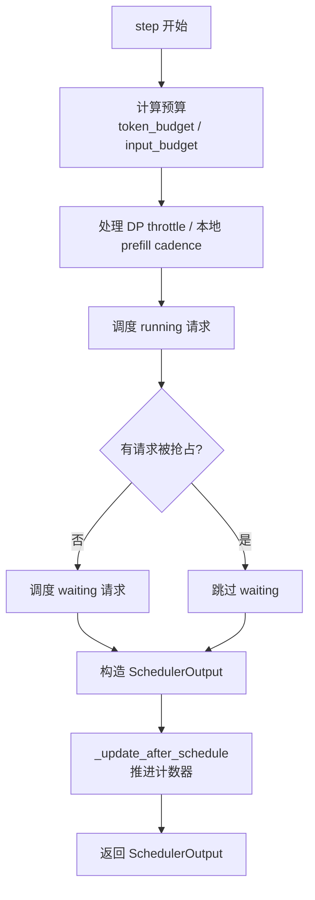
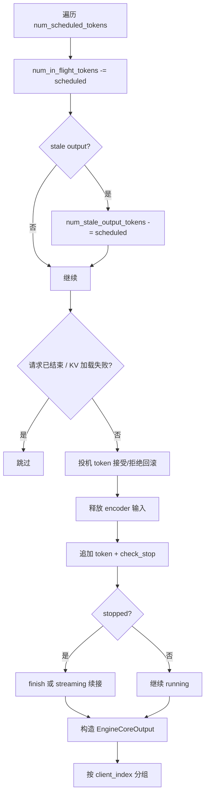

# 03 · 调度器原理

> 前置阅读：[00 · 整体架构与阅读路线](./00-整体架构与阅读路线.md)、[01 · 入口与请求生命周期](./01-入口与请求生命周期.md)、[02 · EngineCore 与进程通信](./02-EngineCore%20与进程通信.md)
> 对应源码：`vllm/v1/core/sched/scheduler.py`、`vllm/v1/core/sched/request_queue.py`、`vllm/v1/core/kv_cache_manager.py`、`vllm/v1/request.py`
> 适用版本：本仓库 commit `5082c45853`（2026-10-29）

---

## 1. 一句话概括

调度器每个 step 只回答一个问题：

> **“这一步，每个请求各算多少个 token？”**

它不区分“prefill 阶段”和“decode 阶段”，只维护两个计数器：

- `num_computed_tokens`：这个请求已经算到哪；
- `num_tokens_with_spec`：这个请求“应该”算到哪（prompt + 已生成 + 投机 token）。

每一步，调度器在 **token 预算** 和 **KV block 预算** 的约束下，尽量让每个请求的 `num_computed_tokens` 追上 `num_tokens_with_spec`。追的过程可能是：

- 一次性算完整个 prompt；
- 分多个 chunk 算 prompt（chunked prefill）；
- 只算 1 个 decode token；
- 一次算多个投机 token；
- 因为 KV 不够，把某个请求抢占掉，稍后重算。

这就是 V1 调度器的全部核心。

---

## 2. 为什么调度器是 vLLM 的心脏

### 2.1 GPU 的成本按 token 算，不按请求算

一次 forward 的耗时主要取决于：

- 本步 token 总数 `T`；
- KV Cache 的访问量；
- kernel 的并行度。

请求数本身不是主要成本。一个 4K prompt 的请求和一个 1 token 的 decode 请求，计算量差几个数量级。

所以调度器不能用“这一轮跑几个请求”来做决策，而要用 **“这一轮跑多少个 token”**。

### 2.2 KV Cache 是比 token 更稀缺的资源

token 预算可以靠增大 batch 提高吞吐，但 KV Cache 是有限的：

```text
KV 容量 ≈ num_gpu_blocks × block_size × 每 token 的 KV 大小
```

当 KV 不够时，调度器必须做选择：

- 不调度新请求；
- 或抢占一个正在运行的请求，释放它的 block，稍后重算。

这就是 **preemption**。它不是异常路径，而是调度器的正常组成部分。

### 2.3 没有独立的 prefill / decode 阶段

V1 调度器里没有“先跑完所有 prefill，再跑 decode”的阶段机。每个请求只有：

```text
num_computed_tokens  <  num_tokens_with_spec
```

差距可能是：

| 场景 | 差距 | 本步通常调度 |
|---|---|---|
| 新请求 | prompt 长度 | 整个 prompt 或一个 chunk |
| chunked prefill 中间 | 剩余 prompt | 一个 chunk |
| 普通 decode | 1 | 1 |
| 投机解码 | 1 + K | 1 + K |
| 前缀缓存命中 | prompt - hit | 剩余部分 |

同一个 step 里，完全可以同时有“正在 prefill 的请求”和“正在 decode 的请求”。这就是 chunked prefill 能提高 GPU 利用率的原因。

### 2.4 调度器还要处理很多“非计算”问题

除了算 token，它还要处理：

- 前缀缓存命中；
- 多模态 encoder 输入；
- 结构化输出 grammar；
- 投机解码的 draft / 拒绝回滚；
- KV connector 的远程 KV 加载；
- 流式输入（resumable session）；
- 公平性和优先级；
- DP 场景下的 prefill 节流。

这些逻辑让 `schedule()` 看起来很长，但主干仍然是“预算 + 分配 + 入队/出队”。

---

## 3. 核心状态

### 3.1 `Request` 的计数器

定义在 `vllm/v1/request.py:60`。

| 字段 | 含义 | 谁来改 |
|---|---|---|
| `num_prompt_tokens` | prompt 的 token 数（含多模态占位符） | 创建时固定 |
| `num_tokens` | `prompt + 已生成 token` 的总数 | `append_output_token_ids` |
| `num_tokens_with_spec` | `num_tokens + len(spec_token_ids)` | 投机解码 |
| `num_computed_tokens` | 已经“调度并假定会算完”的 token 数 | Scheduler |
| `num_in_flight_tokens` | 已调度但输出还没回来的 token 数 | Scheduler |
| `num_output_placeholders` | async scheduling 下“未来会生成”的 token 数 | AsyncScheduler |
| `num_output_tokens` | 已生成 token 数 | `append_output_token_ids` |
| `spec_token_ids` | 本步要验证的投机 token | Scheduler / Worker |
| `is_prefill_chunk` | 是否是“非最终”的 prefill chunk | `_update_after_schedule` |
| `status` | `WAITING` / `RUNNING` / `PREEMPTED` / `FINISHED_*` | Scheduler |
| `block_hashes` | 完整 block 的链式哈希 | `update_block_hashes` |

#### 最容易混淆的三个数

```text
num_tokens            = prompt + 已经生成的 token
num_tokens_with_spec  = num_tokens + 投机 token
num_computed_tokens   = 已经调度过的 token（乐观值）
```

举例：prompt 100，已经生成 5 个 token，当前有 3 个投机 token：

```text
num_prompt_tokens    = 100
num_tokens           = 105
num_tokens_with_spec = 108
num_computed_tokens  = 104   # 假设最后一个输出 token 还没算
```

下一步要算的 token 数：

```text
num_new_tokens = num_tokens_with_spec - num_computed_tokens = 4
```

也就是 1 个普通 decode token + 3 个投机 token。

#### 为什么 `num_computed_tokens` 是“乐观”的

`_update_after_schedule` 在调度后立刻推进 `num_computed_tokens`：

```python
request.num_computed_tokens += num_scheduled_token
request.num_in_flight_tokens += num_scheduled_token
```

这样下一步可以立刻继续调度，而不必等 GPU 输出。等输出回来时，`update_from_output` 再做修正：

- 投机 token 被拒绝 → 回滚 `num_computed_tokens`；
- 遇到 stop → 回滚未使用的 token；
- 请求被抢占 → 重置为 0。

所以 `num_computed_tokens` 不是“KV 一定有效”的承诺，而是“调度器认为已经安排了多少”。

### 3.2 四个队列

`Scheduler.__init__`（`scheduler.py:226` 附近）：

```python
self.policy = SchedulingPolicy(self.scheduler_config.policy)
self.waiting = create_request_queue(self.policy)
self.kv_holding_waiting = create_request_queue(self.policy)
self.deferred_waiting: set[Request] = set()
self.running: list[Request] = []
```

| 队列 | 类型 | 放什么 | 调度顺序 |
|---|---|---|---|
| `running` | `list` | 已准入、正在运行的请求 | 按列表顺序 |
| `waiting` | `RequestQueue` | 普通等待请求 | FCFS 或 priority |
| `kv_holding_waiting` | `RequestQueue` | 持有 KV block 的等待请求 | 永远先于 `waiting` |
| `deferred_waiting` | `set` | 被跳过 / 阻塞的请求 | 不直接调度，等状态就绪 |

#### 为什么要有 `kv_holding_waiting`

有些请求虽然不在 `running`，但仍然持有 KV block：

- 正在异步加载远程 KV；
- 流式输入暂停，等待下一段输入；
- 被抢占但 block 还没释放完。

这些请求如果排在普通 waiting 后面，而前面的新请求又因为分配失败让整个扫描 `break`，就会造成“持有 block 的请求永远排不到”的饥饿。因此它们必须单独排队，并且优先 drain。

#### `deferred_waiting` 的作用

`deferred_waiting` 是“这一轮先不调度”的集合，包含：

- `WAITING_FOR_STRUCTURED_OUTPUT_GRAMMAR`：grammar 还在编译；
- `WAITING_FOR_REMOTE_KVS`：远程 KV 还没到；
- `WAITING_FOR_STREAMING_REQ`：流式输入还没到。

它们不会从队列里消失，只是暂时不参与扫描。

### 3.3 `SchedulerOutput`

定义在 `vllm/v1/core/sched/output.py:232`。

| 字段 | 含义 |
|---|---|
| `scheduled_new_reqs` | 本步首次调度的请求（V2 也包含 resume） |
| `scheduled_cached_reqs` | 之前调度过、本步继续的请求 |
| `num_scheduled_tokens` | `{req_id: 本步 token 数}` |
| `total_num_scheduled_tokens` | 本步扁平 token 总数 `T` |
| `scheduled_spec_decode_tokens` | `{req_id: [draft_token_ids]}` |
| `scheduled_encoder_inputs` | 本步要跑的多模态 encoder 输入 |
| `finished_req_ids` | 上一步到本步之间完成的请求 |
| `preempted_req_ids` | 本步被抢占的请求（V2） |
| `has_structured_output_requests` | 是否有结构化输出请求 |
| `pending_structured_output_tokens` | 是否还在等上一步 token 才能算 bitmask |
| `num_spec_tokens_to_schedule` | 动态投机解码选出的 K |
| `skip_drafts` | 本步是否没必要生成 draft |

> `SchedulerOutput` 是“调度 → 执行”的契约。Model Runner 只看这个对象，不回头读 Scheduler 的内部状态。

---

## 4. `schedule()` 全景

入口：`vllm/v1/core/sched/scheduler.py:699`。



### 4.1 预算

```python
token_budget = self.max_num_scheduled_tokens
input_budget = self.scheduler_config.max_num_batched_tokens
draft_slots = spec.max_num_new_slots_for_drafting if spec is not None else 0
```

| 预算 | 来源 | 作用 |
|---|---|---|
| `token_budget` | `max_num_scheduled_tokens` | 本步最多“调度”多少 token |
| `input_budget` | `max_num_batched_tokens` | 本步模型实际输入最多多少 token |
| `draft_slots` | 投机配置 | 每个请求为 draft token 预留的槽位 |
| `encoder_compute_budget` | `max_num_encoder_input_tokens` | 多模态 encoder 的 token 预算 |

为什么需要两个 token 预算？

- `max_num_batched_tokens` 是模型侧的真实上限（静态 buffer、CUDA Graph 捕获尺寸都依赖它）；
- `max_num_scheduled_tokens` 可以更小，用于在投机解码等场景下给模型“追加 token”留余量。

大多数情况下两者相等。

### 4.2 每请求 token 数的计算

running 请求：

```python
num_new_tokens = (
    request.num_tokens_with_spec
    + request.num_output_placeholders
    - request.num_computed_tokens
)
```

waiting 请求：

```python
num_new_tokens = request.num_tokens - num_computed_tokens
```

然后统一做 cap：

```python
num_new_tokens = min(num_new_tokens, token_budget, input_budget - draft_slots)
num_new_tokens = min(
    num_new_tokens,
    self.max_model_len - request.num_computed_tokens
    - self.num_sampled_tokens_per_step,
)
```

最后一行是为了给“采样出的新 token”留位置，避免生成长度超过 `max_model_len`。对 pooling / diffusion 模型，`num_sampled_tokens_per_step = 0`。

### 4.3 `long_prefill_token_threshold`

如果开启了 chunked prefill，一个超长 prompt 可能吃掉整个 token 预算，让其他请求饿死。`long_prefill_token_threshold` 用来限制单个请求一次能调度多少 token：

```python
if 0 < long_prefill_token_threshold < num_new_tokens:
    num_new_tokens = long_prefill_token_threshold
```

两个细节：

1. **只在有多个候选请求时生效**
   ```python
   long_prefill_token_threshold = (
       threshold if num_eligible_reqs > 1 else 0
   )
   ```
   如果只有一个请求，没人会被它饿死，就让它用满预算。

2. **adaptive 模式会设置下限**
   ```python
   threshold = max(threshold, input_budget // num_eligible_reqs)
   ```
   保证不会把某个请求压到“公平份额”以下。

### 4.4 DP prefill 节流

`schedule(throttle_prefills=True)` 来自 `DPEngineCoreProc._should_throttle_prefills()`。

```python
defer_prefills = (
    throttle_prefills and not self.prefill_capacity_bound
) and any(not r.is_prefill_chunk for r in self.running)
```

含义：

- 只有当前 running 里有“非 prefill chunk”（也就是 decode）时，才考虑推迟 prefill；
- 如果等待队列已经饱和（`prefill_capacity_bound`），就不再节流，避免 waiting 无限增长。

被推迟的 prefill：

- running 里的 prefill chunk 跳过；
- waiting 里的新 prefill 不准入；
- decode 继续跑。

目的：让所有 DP rank 的 prefill 节奏对齐，避免某个 rank 突然塞入大量 prefill，其他 rank 等它。

---

## 5. Running 循环：先保护已经在跑的请求

running 循环从 `scheduler.py:840` 附近开始。

### 5.1 基本流程

```python
req_index = 0
while req_index < len(self.running) and token_budget > 0:
    request = self.running[req_index]
    ...
    num_new_tokens = ...
    if num_new_tokens == 0:
        req_index += 1
        continue

    new_blocks = self.kv_cache_manager.allocate_slots(request, num_new_tokens, ...)
    if new_blocks is None:
        # 尝试抢占，直到能分配或没有可抢占的请求
        ...
    if new_blocks is None:
        break

    scheduled_running_reqs.append(request)
    num_scheduled_tokens[request.request_id] = num_new_tokens
    token_budget -= num_new_tokens
    input_budget -= num_new_tokens + draft_slots
    req_index += 1
```

### 5.2 哪些请求会被跳过

| 条件 | 行为 | 原因 |
|---|---|---|
| async 下已经确定达到 `max_tokens` | `continue` | 避免多算一步 |
| `current_step < next_decode_eligible_step` | `continue` | V2+PP+async 的 decode 节奏 |
| DP throttle 且是 prefill chunk | `continue` | 把 prefill 推迟到对齐步 |
| encoder cache 不可用 | `continue` | 多模态输入还没准备好 |
| `num_new_tokens == 0` | `continue` | 这个请求没东西可算，但后面的可能有 |

注意这里是 `continue` 而不是 `break`：后面的请求可能优先级更低，但仍然可以填满本步预算。

### 5.3 `allocate_slots` 失败：抢占

`allocate_slots` 返回 `None` 表示 KV block 不够。调度器进入抢占循环：

```python
while True:
    new_blocks = self.kv_cache_manager.allocate_slots(...)
    if new_blocks is not None:
        break

    if self.connector is not None and self.connector.has_pending_block_frees():
        break

    if self.policy == SchedulingPolicy.PRIORITY:
        preempted_req = max(
            self.running,
            key=lambda r: (r.priority, r.arrival_time),
        )
    else:
        preempted_req = self.running[-1]

    if not self._request_blocks_can_be_freed(preempted_req):
        break

    ...  # 从 running 移除、回滚本步已调度部分
    self._preempt_request(preempted_req, scheduled_timestamp, ...)

    if preempted_req == request:
        break
```

#### 抢占谁

| 策略 | 受害者 | 理由 |
|---|---|---|
| FCFS | `self.running[-1]` | 最后准入的请求“投入最少”，重算最便宜 |
| Priority | `max((priority, arrival_time))` | priority 数值越大越低优先级；同优先级时最晚到达的先牺牲 |

#### `_preempt_request` 做了什么

`vllm/v1/core/sched/scheduler.py:1799`：

```python
self._free_request_blocks(request)          # 释放 KV block
self.encoder_cache_manager.free(request)    # 释放 encoder cache
request.status = RequestStatus.PREEMPTED
request.num_computed_tokens = 0             # 需要重算
request.spec_token_ids = []
request.num_stale_output_tokens = request.num_in_flight_tokens
request.num_output_placeholders = 0
request.num_preemptions += 1
self.waiting.prepend_request(request)       # 放回队首
```

关键点：

1. **这是 recompute 抢占，不是 swap**
   当前 V1 代码没有把 KV 换到 CPU 的逻辑；抢占就是丢掉 KV，之后重算。

2. **`num_computed_tokens = 0`**
   请求回到 waiting 后，会重新走前缀缓存查询。如果 block 还在缓存里，可以命中一部分，避免全量重算。

3. **放回队首**
   `prepend_request` 让被抢占的请求优先于新请求重新准入，避免饥饿。

#### 抢占的代价

被抢占的请求可能已经算了几千个 token。重算会带来：

- 额外的 prefill 计算；
- 额外的 KV 写入；
- 更高的 TTFT / TPOT 抖动。

所以调度器的目标不是“尽量不抢占”，而是“在 KV 不够时，用最小的代价换取继续前进”。

---

## 6. Waiting 循环：准入新请求

running 循环结束后，如果本步没有发生抢占，才会调度 waiting：

```python
if not preempted_reqs and self._pause_state != PauseState.PAUSED_ALL:
    while token_budget > 0:
        ...
```

为什么“有抢占就跳过 waiting”？

因为抢占说明 KV 已经很紧张。此时再准入新请求，很可能立刻又触发抢占，造成抖动。先让 running 里的请求稳定下来。

### 6.1 队列选择

```python
request_queue = self.kv_holding_waiting
if not request_queue and self._pause_state == PauseState.UNPAUSED:
    request_queue = self.waiting
```

- `kv_holding_waiting` 永远优先；
- 只有 `UNPAUSED` 才允许从普通 `waiting` 准入；
- `PAUSED_NEW` 下只 drain 持有 block 的请求（例如异步 KV 加载完成）。

### 6.2 准入前的检查

| 检查 | 不通过时 |
|---|---|
| `num_running >= max_num_active_reqs` | `break`，running 已满 |
| `_handle_blocked_waiting_request` | `skip_request`，等状态就绪 |
| 有 stale output 未 drain | `skip_request`，避免乱序 |
| LoRA 数量超限 | `skip_request` |
| KV connector 无法确定匹配 token 数 | `skip_request` |
| encoder cache 不足 | `skip_request` |
| `num_new_tokens == 0` | `skip_request` |

`skip_request` 会把请求放进 `deferred_waiting`，并在本轮结束后重新放回队首：

```python
def skip_request(from_queue):
    request_to_skip = from_queue.pop_request()
    self.deferred_waiting.add(request_to_skip)
    if self._holds_kv_blocks(request_to_skip):
        step_skipped_kv_holding.appendleft(request_to_skip)
    else:
        step_skipped_waiting.appendleft(request_to_skip)

...

if step_skipped_kv_holding:
    self.kv_holding_waiting.prepend_requests(step_skipped_kv_holding)
if step_skipped_waiting:
    self.waiting.prepend_requests(step_skipped_waiting)
```

这样被跳过的请求不会丢失，也不会因为被跳过而排到新请求后面。

### 6.3 前缀缓存查询

只有 `num_computed_tokens == 0` 的请求才会做前缀缓存查询：

```python
if request.num_computed_tokens == 0:
    (
        new_computed_blocks,
        num_new_local_computed_tokens,
        request.shared_prefix_boundary,
        hit_diverged,
    ) = self._get_local_prefix_cache_hit(request, max_cache_hit_length)
```

`max_cache_hit_length` 的关键约束：

```python
limits = (self.num_tokens - 1, self.prefix_cache_hit_limit, bound)
return min(limit for limit in limits if limit is not None)
```

**为什么是 `num_tokens - 1`？**

因为最后一个 prompt token 必须重新算一次，才能得到 logits 去采样第一个输出 token。即使整个 prompt 都命中缓存，也要至少重算最后一个 token。

### 6.4 本地命中 + 外部命中

如果配置了 KV connector（P/D 分离、KV offload 等），还会查询外部缓存：

```python
ext_tokens, load_kv_async = self.connector.get_num_new_matched_tokens(
    request, block_aligned_local
)
```

最终：

```text
num_computed_tokens = local_hit + external_hit
```

如果 `load_kv_async=True`：

- 请求状态变成 `WAITING_FOR_REMOTE_KVS`；
- 本步不跑 forward（`num_new_tokens = 0`）；
- block 先分配，但 `delay_cache_blocks=True`；
- 等 connector 通知 KV 到达后，再重新调度。

如果 `load_kv_async=False`：

- KV 在 forward 前同步加载；
- 本步可以直接跑。

### 6.5 新请求准入

```python
request = request_queue.pop_request()
self.deferred_waiting.discard(request)
self.running.append(request)

if request.status == RequestStatus.WAITING:
    scheduled_new_reqs.append(request)
elif request.status == RequestStatus.PREEMPTED:
    scheduled_resumed_reqs.append(request)

request.status = RequestStatus.RUNNING
request.num_computed_tokens = num_computed_tokens
```

注意 `request.num_computed_tokens = num_computed_tokens` 赋值的是“本地命中 + 外部命中”的 token 数，而不是 0。这样第一次 forward 只需要算剩下的部分。

### 6.6 `continue` / `break` 的区别

waiting 循环里有两种退出方式：

| 情况 | 行为 | 原因 |
|---|---|---|
| 某个请求因为 encoder / 预算等原因 `num_new_tokens == 0` | `skip_request` + `continue` | 后面的请求可能还能跑 |
| 没有开 chunked prefill，且请求长度超过剩余预算 | `break` | FCFS：后来的请求不能插队 |
| `allocate_slots` 返回 `None` | `break` | block 耗尽，后面的也放不下 |
| `num_running >= max_num_active_reqs` | `break` | 并发槽位满 |

这是调度器公平性的关键：**局部失败可以跳过，全局资源耗尽必须停止。**

---

## 7. KV 分配：`allocate_slots`

入口：`vllm/v1/core/kv_cache_manager.py:379`。

### 7.1 block 布局

`allocate_slots` 的 docstring 给了一张非常清晰的图：

```text
----------------------------------------------------------------------
| < comp > | < new_comp > | < ext_comp >  | < new >  | < lookahead > |
----------------------------------------------------------------------
                                          |   < to be computed >     |
----------------------------------------------------------------------
                          |            < to be allocated >           |
----------------------------------------------------------------------
                          | < to be cached (roughly)>                |
----------------------------------------------------------------------
| Prefix-cached tokens from either vLLM   |
| or connector. Can be safely removed if  |
| they are outside sliding window.        |
----------------------------------------------------------------------
```

| 段 | 含义 |
|---|---|
| `comp` | `request.num_computed_tokens` |
| `new_comp` | 本步前缀缓存新命中的 token |
| `ext_comp` | connector 提供的远程 KV token |
| `new` | 本步要算的新 token |
| `lookahead` | 投机解码的 lookahead slot |

### 7.2 三个阶段


1. **释放不必要的 block**
   例如 sliding window 之外的 block、Mamba 已不需要的 block。

2. **接管命中 block**
   `allocate_new_computed_blocks` 把本地/外部命中的 block 挂到请求上。

3. **分配新 block**
   `allocate_new_blocks` 从 block pool 取新 block。

### 7.3 分配失败的条件

```python
available_blocks = self.block_pool.get_num_free_blocks() - reserved_blocks
required_blocks = num_blocks_to_allocate + watermark_blocks
if required_blocks > available_blocks:
    return None
```

三个扣除项：

| 项 | 作用 |
|---|---|
| `reserved_blocks` | 给其他在飞序列预留，避免异步加载把别人的 block 吃掉 |
| `watermark_blocks` | 给 waiting/preempted 准入留的余量 |
| `num_blocks_to_allocate` | 本请求真正需要的 block |

`watermark` 只在“已经有请求被调度”且“当前请求是 waiting/preempted”时生效，避免 running 请求被 watermark 误伤。

### 7.4 `full_sequence_must_fit`

如果开启 `scheduler_reserve_full_isl`，准入时会先检查“整个序列是否能放下”，而不是只看第一个 chunk。

这可以避免：

- 一个长 prompt 被准入，算了一半才发现 KV 不够；
- 然后触发大量抢占和抖动。

代价是：可能拒绝一些“分块后能跑完”的请求（因为要求完整序列一次性放得下）。

### 7.5 block 数与 token 数的关系

```text
num_blocks = ceil(num_tokens / block_size)
```

例如 block_size=16：

| token 数 | block 数 |
|---|---|
| 1 | 1 |
| 16 | 1 |
| 17 | 2 |
| 100 | 7 |
| 1000 | 63 |

最后一个 block 通常是不满的，但仍然占一整个 block 的显存。

---

## 8. Chunked prefill 示例

假设：

- `max_num_batched_tokens = 64`
- `block_size = 16`
- prompt 长度 200
- 没有前缀缓存、没有投机解码

### 8.1 调度过程

| step | `num_computed_tokens` 起始 | `num_new_tokens` | 结束 | `is_prefill_chunk` | 是否采样 |
|---|---|---|---|---|---|
| 1 | 0 | 64 | 64 | True | 否 |
| 2 | 64 | 64 | 128 | True | 否 |
| 3 | 128 | 64 | 192 | True | 否 |
| 4 | 192 | 8 | 200 | False | 是，1 个 token |
| 5 | 200 | 1 | 201 | False | 是，1 个 token |

### 8.2 为什么中间步骤不返回 token

`update_from_output` 里有一个断言：

```python
else:
    # Invariant: EngineCore returns no partial prefill outputs.
    assert not prompt_logprobs_tensors
```

原因：

- prefill chunk 只计算 KV，不采样；
- 用户不需要中间 hidden states；
- 只有最后一个 chunk 才有意义地产生第一个输出 token。

所以 `num_scheduled_tokens` 里的 prefill chunk 会出现在 `SchedulerOutput` 里，但 `ModelRunnerOutput.sampled_token_ids` 对它是空的。

### 8.3 `is_prefill_chunk` 的判定

```python
request.is_prefill_chunk = request.num_computed_tokens < (
    request.num_tokens + request.num_output_placeholders
)
```

- 如果还有 prompt token 没算完 → `True`；
- 如果 prefill 已经完成，进入 decode → `False`。

这个标志会影响：

- 结构化输出是否参与 grammar bitmask；
- DP prefill 节流是否跳过；
- async scheduling 是否设置 placeholder。

---

## 9. 前缀缓存：命中与重算

### 9.1 命中查询

入口：`KVCacheManager.get_computed_blocks`（`kv_cache_manager.py:266`）。

```python
computed_blocks, num_new_computed_tokens, num_uncached = (
    self.coordinator.find_longest_cache_hit(
        request.block_hashes, max_cache_hit_length
    )
)
```

`request.block_hashes` 是链式哈希：

```text
hash_0 = H(block_0_tokens)
hash_1 = H(hash_0, block_1_tokens)
hash_2 = H(hash_1, block_2_tokens)
...
```

所以“前缀相同”不仅要求当前 block 相同，还要求前面所有 block 都相同。

### 9.2 命中粒度

| 情况 | 命中 |
|---|---|
| prompt 前 32 个 token 与缓存一致，block_size=16 | 2 个 block |
| 只有前 20 个 token 一致 | 1 个 block（第 2 个 block 不满） |
| 整个 prompt 一致 | `num_tokens - 1`，最后一个 token 重算 |

### 9.3 为什么最后一个 token 必须重算

采样需要最后一个位置的 logits。如果整个 prompt 都从缓存拿，模型没有算最后一个 token，就没有 logits。

所以 `get_max_cache_hit_length` 强制：

```python
limits = (self.num_tokens - 1, ...)
```

### 9.4 前缀缓存命中后的调度

```text
num_computed_tokens = local_hit + external_hit
num_new_tokens = request.num_tokens - num_computed_tokens
```

如果命中了 100 个 token，prompt 长度 120：

```text
num_computed_tokens = 100
num_new_tokens = 20
```

只需要为 20 个新 token 分配 block。命中部分的 block 通过 `new_computed_blocks` 直接接管，不重新写入。

### 9.5 前缀缓存的代价

- 需要为每个完整 block 计算哈希；
- 需要维护 block 的引用计数和 LRU；
- 命中查询本身有开销；
- 缓存会占用本可以留给 running 请求的 block。

所以 prefix caching 并不是“免费加速”，而是在“重复前缀多”的场景下用显存换计算。

---

## 10. 投机解码调度

### 10.1 基本概念

投机解码每一步：

1. drafter 生成 K 个 draft token；
2. 主模型一次 forward 验证这 K 个 token；
3. 接受前缀匹配的 draft，拒绝后面的；
4. 被拒绝的 token 要回滚 `num_computed_tokens`。

调度器需要把 draft token 也纳入 token 预算和 KV 分配。

### 10.2 调度时的处理

```python
num_new_tokens = (
    request.num_tokens_with_spec
    + request.num_output_placeholders
    - request.num_computed_tokens
)
```

`num_tokens_with_spec` 包含 `spec_token_ids`，所以本步会多调度 K 个 token。

```python
if request.spec_token_ids:
    num_scheduled_spec_tokens = (
        num_new_tokens
        + request.num_computed_tokens
        - request.num_tokens
        - request.num_output_placeholders
    )
    ...
    scheduled_spec_decode_tokens[request.request_id] = spec_token_ids
    request.spec_token_ids = []
```

### 10.3 输出时的回滚

`update_from_output`：

```python
num_draft_tokens = len(scheduled_spec_token_ids)
num_accepted = max(len(generated_token_ids) - num_sampled, 0)
num_rejected = num_draft_tokens - num_accepted

if not output_is_stale:
    if request.num_computed_tokens > 0:
        request.num_computed_tokens -= num_rejected
    if request.num_output_placeholders > 0:
        request.num_output_placeholders -= num_rejected
```

举例：

- 调度了 1 个 decode token + 3 个 draft；
- 模型输出 2 个 token（1 个接受 + 1 个 bonus）；
- `num_accepted = 2 - 1 = 1`；
- `num_rejected = 3 - 1 = 2`；
- `num_computed_tokens` 回滚 2。

这样下一步不会把被拒绝的 draft 位置当成已计算。

### 10.4 `pad_spec_decode`

为了保持 CUDA Graph 的 batch 形状，调度器可能把普通 decode 请求补齐到 `1 + num_spec_tokens`：

```python
if num_new_tokens == 1 and not prefill_scheduled:
    padded_num_tokens = 1 + self.num_spec_tokens
    ...
    num_new_tokens = padded_num_tokens
    pad_spec_decode = True
```

这些额外的位置是“占位”，不是真实 token，采样器会忽略它们。

### 10.5 `skip_drafts`

如果本步没有任何请求能用上 draft（比如都是非最终 prefill chunk），调度器设置：

```python
scheduler_output.skip_drafts = not drafts_needed
```

这样可以跳过 drafter 的 forward，节省时间。

---

## 11. 结构化输出调度

### 11.1 grammar 初始化

请求进入 EngineCore 时，`preprocess_add_request` 会调用：

```python
self.structured_output_manager.grammar_init(req)
```

如果 grammar 还没编译完，请求状态是：

```text
WAITING_FOR_STRUCTURED_OUTPUT_GRAMMAR
```

它会被放进 `deferred_waiting`，暂时不调度。

### 11.2 grammar bitmask

`get_grammar_bitmask`（`scheduler.py:2229`）：

```python
structured_output_request_ids = [
    req_id
    for req_id in scheduler_output.num_scheduled_tokens
    if (req := self.requests.get(req_id))
    and (req.use_structured_output and not req.is_prefill_chunk)
]
```

只对“非 prefill chunk”的请求生成 bitmask，因为 prefill 不采样。

### 11.3 async scheduling 下的等待

`AsyncScheduler._update_after_schedule`：

```python
scheduler_output.pending_structured_output_tokens |= (
    request.use_structured_output and request.num_output_placeholders > 0
)
```

如果还有上一步的输出没回来，本步不能算 bitmask，于是 `step_with_batch_queue` 会把 `sample_tokens` 推迟到下一步。这就是 02 里 `deferred_scheduler_output` 的来源。

---

## 12. `update_from_output()`：把结果写回状态

入口：`vllm/v1/core/sched/scheduler.py:2260`。

### 12.1 处理顺序



### 12.2 每一步做什么

#### 1. 扣减 in-flight

```python
request.num_in_flight_tokens -= num_tokens_scheduled
```

这个计数在 `_update_after_schedule` 里加上去，在输出回来时扣掉。它用于：

- 判断 deferred block free 是否安全；
- preemption 时记录 stale output 数量。

#### 2. 处理 stale output

```python
if request.num_stale_output_tokens > 0:
    output_is_stale = True
    request.num_stale_output_tokens -= num_tokens_scheduled
```

stale output 来自“请求被抢占时还有输出在飞”。这些 token 仍然会返回，但不能修改重置后的计数器。

如果是 `drop_stale_output=True`（例如同一步抢占+恢复），直接丢弃。

#### 3. 投机 token 回滚

见第 10 节。

#### 4. 释放 encoder 输入

```python
if request.has_encoder_inputs:
    self._free_encoder_inputs(request)
```

多模态 encoder 输出只在当前 step 需要，之后可以释放 encoder cache。

#### 5. 追加 token 并检查 stop

`_update_request_with_output`（`scheduler.py:2745`）：

```python
for num_new, output_token_id in enumerate(new_token_ids, 1):
    request.append_output_token_ids(output_token_id)
    stopped = check_stop(request, self.max_model_len)
    if stopped:
        if not is_stale:
            request.num_computed_tokens -= len(new_token_ids) - num_new
        del new_token_ids[num_new:]
        break
```

关键点：

- token 是一个一个追加的；
- 每追加一个就检查 stop；
- 如果在中途 stop，后面的 token 被丢弃；
- `num_computed_tokens` 要回滚“已经算过但被丢弃”的 token 数。

#### 6. `check_stop` 的顺序

`vllm/v1/core/sched/utils.py`：

| 顺序 | 条件 | 状态 |
|---|---|---|
| 1 | `last_token == eos_token_id` | `FINISHED_STOPPED` |
| 2 | `last_token in stop_token_ids` | `FINISHED_STOPPED` |
| 3 | `num_tokens >= max_model_len` 或 `num_output_tokens >= max_tokens` | `FINISHED_LENGTH_CAPPED` |
| 4 | `num_output_tokens < min_tokens` | 不停止（继续检查 repetition） |
| 5 | 检测到重复模式 | `FINISHED_REPETITION` |

`RequestStatus` 到 `FinishReason` 的映射（`request.py:414`）：

| 状态 | FinishReason |
|---|---|
| `FINISHED_STOPPED` | `STOP` |
| `FINISHED_LENGTH_CAPPED` | `LENGTH` |
| `FINISHED_ABORTED` | `ABORT` |
| `FINISHED_IGNORED` | `LENGTH` |
| `FINISHED_ERROR` | `ERROR` |
| `FINISHED_REPETITION` | `REPETITION` |

#### 7. 结束或续接

```python
if stopped:
    finish_reason = request.get_finished_reason()
    finished = self._handle_stopped_request(request)
    if finished:
        kv_transfer_params, ec_transfer_params = self._free_request(request)
    else:
        continuing_reqs.append(request)
```

`_handle_stopped_request` 对 resumable / streaming 请求可能返回 `False`：

- 把当前 turn 的输出 frontier 固定下来；
- 丢掉 in-flight 的 stale output；
- 从 `streaming_queue` 取下一段输入；
- 如果没有下一段，状态变成 `WAITING_FOR_STREAMING_REQ`。

#### 8. 构造输出

```python
outputs[request.client_index].append(
    EngineCoreOutput(
        request_id=req_id,
        new_token_ids=new_token_ids,
        finish_reason=finish_reason,
        ...
    )
)
```

最后：

```python
engine_core_outputs = {
    client_index: EngineCoreOutputs(outputs=outs)
    for client_index, outs in outputs.items()
}
```

### 12.3 为什么 `finished_req_ids` 是“上一步到本步之间”

`finished_req_ids` 是 Scheduler 的一个成员：

```python
self.finished_req_ids: set[str] = set()
```

它在 `_free_request` 里加入，在 `_update_after_schedule` 里清空：

```python
self.finished_req_ids = set()
```

所以 `SchedulerOutput.finished_req_ids` 包含的是“上一步调度之后、本步调度之前”完成的请求。Worker 用这个集合释放对应的缓存状态。

---

## 13. Async scheduling 的占位符

### 13.1 为什么需要占位符

普通调度：

```text
step N:   调度 → GPU → 拿到 token → 更新状态
step N+1:                                     调度 → GPU → ...
```

GPU 在 step N 的采样阶段是空闲的。Async scheduling 想在 step N 的输出还没回来时，就调度 step N+1。

问题是：step N+1 的 `num_new_tokens` 依赖 step N 的输出 token。没有 token，怎么算？

答案是：用占位符假装它已经存在。

### 13.2 `AsyncScheduler._update_after_schedule`

```python
cur_num_spec_tokens = len(spec_decode_tokens.get(req_id, ()))
request.num_output_placeholders += (
    self.num_sampled_tokens_per_step + cur_num_spec_tokens
)
request.spec_token_ids = self._spec_token_placeholders
```

含义：

- 本步会生成 `num_sampled_tokens_per_step` 个 token（通常是 1）；
- 还会有 `cur_num_spec_tokens` 个 draft；
- 这些 token 现在还不存在，但下一步调度时按“已存在”计算。

### 13.3 下一步的 token 计算

```python
num_new_tokens = (
    request.num_tokens_with_spec
    + request.num_output_placeholders
    - request.num_computed_tokens
)
```

- `num_tokens_with_spec`：当前真实 token + 本步新 draft；
- `num_output_placeholders`：上一步在飞、还没回来的 token；
- `num_computed_tokens`：已经调度过的 token。

三者相减，得到“下一步还要算多少”。

### 13.4 输出回来时

```python
request.num_output_placeholders -= num_new_tokens
```

如果投机 token 被拒绝，还会额外扣减：

```python
request.num_output_placeholders -= num_rejected
```

### 13.5 代价

- 调度器要维护更多计数器；
- 抢占时要处理 stale output；
- 结构化输出要等待上一步 token 才能算 bitmask；
- 调试更复杂。

收益是 GPU 利用率更高，尤其在 decode 阶段。

---

## 14. 完整示例：一个 step 的调度决策

假设：

- `max_num_batched_tokens = 256`
- `block_size = 16`
- 当前有 3 个请求：
  - A：prompt 100，刚到，waiting；
  - B：prompt 40，已生成 5 个 token，`num_tokens=45`，`num_computed=44`，running；
  - C：prompt 300，waiting。
- 没有前缀缓存、没有投机、没有多模态。

### 14.1 Running 循环

先调度 B：

```text
num_new_tokens = 45 + 0 - 44 = 1
token_budget = 256 - 1 = 255
input_budget = 256 - 1 = 255
```

B 需要 1 个新 token。假设它的 block 已经够用，不需要新 block。

### 14.2 Waiting 循环

先看 A：

```text
num_new_tokens = 100 - 0 = 100
需要 block = ceil(100 / 16) = 7
token_budget = 255 - 100 = 155
```

A 被准入。

再看 C：

```text
num_new_tokens = 300 - 0 = 300
min(300, token_budget=155) = 155
```

但 C 需要 `ceil(155/16) = 10` 个 block。假设剩余 block 不够，`allocate_slots` 返回 `None`，waiting 循环 `break`。C 留在 waiting。

### 14.3 本步结果

```text
num_scheduled_tokens = {B: 1, A: 100}
total_num_scheduled_tokens = 101
```

### 14.4 `_update_after_schedule`

```text
B.num_computed_tokens = 44 + 1 = 45
A.num_computed_tokens = 0 + 100 = 100
B.is_prefill_chunk = 45 < 45 + 0 = False
A.is_prefill_chunk = 100 < 100 + 0 = False
```

### 14.5 输出回来

假设 B 和 A 各生成 1 个 token：

```text
B.num_tokens = 46
A.num_tokens = 101
```

下一步：

```text
B.num_new_tokens = 46 - 45 = 1
A.num_new_tokens = 101 - 100 = 1
```

两个请求都进入 decode。

### 14.6 如果 C 一直放不下

C 会继续留在 waiting。如果 running 里的请求持续生成，KV 越来越紧张，最终可能触发抢占：

- 抢占 B（FCFS 下 running 的最后一个）；
- 释放 B 的 block；
- C 仍然可能放不下；
- 继续抢占，直到 C 能放下，或者 running 清空。

这就是“用已经投入的请求换取新请求准入”的取舍。

---

## 15. 设计思考（Why）

### 15.1 为什么先调度 running，再调度 waiting

- running 请求已经持有 KV，抢占/重算成本高；
- decode 对延迟敏感，应该优先保证；
- 如果先调度 waiting，新来的长 prompt 可能把 running 的预算吃光。

### 15.2 为什么用 token 预算而不是请求数

因为 GPU 成本主要随 token 数增长。用 token 预算可以：

- 让一个长 prompt 分块，和多个 decode 请求混跑；
- 精确控制每步的 kernel 规模；
- 避免“请求数少但 token 极多”导致的 OOM / 超时。

### 15.3 为什么抢占是 recompute 而不是 swap

swap 需要：

- CPU 侧 KV buffer；
- 额外的拷贝带宽；
- 更复杂的状态机。

recompute 只需要：

- 释放 block；
- 重置 `num_computed_tokens`；
- 重新走前缀缓存。

在 prefix caching 开启时，recompute 往往能命中大部分已算过的 block，成本比想象中低。当前 V1 代码选择了实现更简单的 recompute。

### 15.4 为什么 `num_new_tokens == 0` 时用 `continue`

一个请求可能因为 encoder 预算、Mamba 对齐、lookahead 等原因暂时算不了，但后面的请求可能能算。用 `continue` 可以填满本步预算，避免 GPU 空转。

但如果是 **block 耗尽** 或 **并发槽位满**，就必须 `break`，因为后面的请求也不可能成功。

### 15.5 为什么整 prompt 命中缓存还要重算最后一个 token

采样需要最后一个位置的 logits。没有 logits，就无法生成第一个输出 token。

这个设计牺牲了一点性能，换来正确的语义。

### 15.6 为什么要有 `is_prefill_chunk`

它把“还在处理 prompt”和“已经在 decode”区分开。很多逻辑只对 decode 有意义：

- 结构化输出 bitmask；
- async placeholders；
- DP prefill 节流；
- 投机 draft。

没有这个标志，调度器就得反复比较 `num_computed_tokens` 和 `num_tokens`，代码会更散。

### 15.7 为什么 waiting 里被跳过的请求要放回队首

如果被跳过的请求直接放到队尾，它可能永远排在源源不断的新请求后面，造成饥饿。放回队首保证它下一轮优先被检查。

---

## 16. What if：修改/移除会发生什么

| 改动 | 后果 | 需要注意 |
|---|---|---|
| 关闭 chunked prefill | 长 prompt 要么一次跑完，要么无法调度 | `max_num_batched_tokens` 必须 ≥ `max_model_len` |
| 增大 `max_num_batched_tokens` | 吞吐上升，单步延迟上升，KV 压力变大 | 可能触发更多抢占 |
| 减小 `max_num_seqs` | 并发请求变少，KV 压力下降 | 吞吐可能下降 |
| 关闭 prefix caching | 重复前缀全部重算，TTFT 上升 | 显存压力可能反而下降 |
| 把 policy 改成 priority | 低 priority 数值优先 | 抢占受害者变为最低优先级 |
| 移除抢占 | KV 不足时只能拒绝/阻塞 | 需要新的背压机制 |
| 增大 `watermark` | 保留更多 block，减少抖动 | 可用 KV 变少，吞吐下降 |
| 关闭 async scheduling | 不再有 placeholders，调试简单 | GPU 利用率可能下降 |
| 关闭投机解码 | 不需要 draft slot 和回滚 | decode 吞吐可能下降 |
| 在 waiting 里用 `continue` 代替 `break` | 长请求被跳过后，短请求可以插队 | 破坏 FCFS 公平性 |
| 把 `num_computed_tokens` 改成“只在实际算完后推进” | 状态更准确 | 调度器无法提前调度下一步，流水线变浅 |

---

## 17. 常见陷阱

| 陷阱 | 正确理解 |
|---|---|
| “调度器按请求轮转” | 按 token 预算调度，一个请求可以占多个 token |
| “有 prefill 阶段和 decode 阶段” | 只有 `num_computed_tokens` 和 `num_tokens_with_spec` 的差距 |
| “`num_computed_tokens` 一定代表 KV 有效” | 它是乐观值，可能被投机拒绝、stop、抢占回滚 |
| “`num_tokens` 就是 prompt 长度” | 它是 prompt + 已生成 token |
| “`is_prefill_chunk` 等于 status 是 prefill” | 它是 `computed < tokens + placeholders` |
| “抢占会把 KV 换到 CPU” | 当前 V1 是 recompute，直接丢弃 KV |
| “`max_num_seqs` 就是最大并发请求数” | 还有 `max_num_active_seqs` 控制准入 |
| “`max_num_batched_tokens` 就是调度 token 上限” | 还有 `max_num_scheduled_tokens`，通常相等但可更小 |
| “整 prompt 命中缓存就完全不用算” | 最后一个 token 必须重算 |
| “`num_new_tokens == 0` 说明请求结束了” | 可能只是本步没东西可算 |
| “waiting 循环里的 `break` 和 `continue` 可以互换” | `break` 用于全局资源耗尽，`continue` 用于局部跳过 |
| “V2 的 `scheduled_new_reqs` 只包含全新请求” | 它也包含 resumed 请求，并携带完整 token ids |
| “`finished_req_ids` 是本步完成的请求” | 它是上一步调度到本步调度之间完成的请求 |
| “投机 token 被拒绝不影响 `num_computed_tokens`” | 会回滚，否则下一步会跳过未算的 token |
| “prefix cache 命中率越高越好” | 缓存也占 block，可能挤压 running 请求 |

---

## 18. 如何验证

### 18.1 断点位置

```python
# 1. 调度入口
vllm/v1/core/sched/scheduler.py: Scheduler.schedule

# 2. running 循环
vllm/v1/core/sched/scheduler.py: schedule 中 "First, schedule the RUNNING requests"

# 3. waiting 循环
vllm/v1/core/sched/scheduler.py: schedule 中 "Next, schedule the WAITING requests"

# 4. KV 分配
vllm/v1/core/kv_cache_manager.py: KVCacheManager.allocate_slots

# 5. 抢占
vllm/v1/core/sched/scheduler.py: Scheduler._preempt_request

# 6. 计数器推进
vllm/v1/core/sched/scheduler.py: Scheduler._update_after_schedule

# 7. 输出处理
vllm/v1/core/sched/scheduler.py: Scheduler.update_from_output

# 8. stop 条件
vllm/v1/core/sched/utils.py: check_stop
```

### 18.2 打印示例

```python
# schedule() 返回前
print("scheduled:", scheduler_output.num_scheduled_tokens)
print("total:", scheduler_output.total_num_scheduled_tokens)
print("running:", len(self.running), "waiting:", len(self.waiting))
print("free blocks:", self.kv_cache_manager.block_pool.get_num_free_blocks())

# update_from_output 里
print("req", req_id, "generated", generated_token_ids,
      "computed", request.num_computed_tokens,
      "tokens", request.num_tokens)
```

### 18.3 单进程调试

```bash
VLLM_ENABLE_V1_MULTIPROCESSING=0 \
VLLM_LOGGING_LEVEL=DEBUG \
python your_script.py
```

单进程下可以直接在 `Scheduler.schedule` 打断点。

### 18.4 指标

| 指标 | 含义 |
|---|---|
| `vllm:num_requests_waiting` | waiting 队列长度 |
| `vllm:num_requests_running` | running 队列长度 |
| `vllm:gpu_cache_usage_perc` | KV block 使用率 |
| `vllm:prefix_cache_hit_rate` | 前缀缓存命中率 |
| `vllm:num_preemptions_total` | 抢占次数 |

如果 `num_requests_waiting` 持续增长、`gpu_cache_usage_perc` 接近 1，说明 KV 不够，调度器在频繁抢占或拒绝准入。

### 18.5 测试用例

| 文件 | 覆盖内容 |
|---|---|
| `tests/v1/core/test_scheduler.py` | 基本调度、抢占、chunked prefill |
| `tests/v1/core/test_priority_scheduler_random.py` | 优先级调度随机测试 |
| `tests/v1/core/test_priority_preemption_bug.py` | 优先级抢占边界 |
| `tests/v1/core/test_prefix_caching.py` | 前缀缓存命中 |
| `tests/v1/core/test_async_scheduler.py` | async placeholders |

---

## 19. 总结

| 最值得记住的点 | 说明 |
|---|---|
| 调度单位是 token，不是请求 | `num_scheduled_tokens` 是核心输出 |
| 没有 prefill/decode 阶段 | 只有 `computed < target` 的差距 |
| running 优先于 waiting | 保护已投入 KV 的请求 |
| 预算有两层 | `max_num_scheduled_tokens` 和 `max_num_batched_tokens` |
| KV 不够就抢占 | FCFS 抢最后一个，priority 抢最低优先级 |
| 抢占是 recompute | 释放 block，重置 `num_computed_tokens` |
| 前缀缓存最多命中到 `num_tokens - 1` | 最后一个 token 必须重算 |
| `continue` 与 `break` 含义不同 | 局部跳过 vs 全局停止 |
| `update_from_output` 会回滚 | 投机拒绝、stop、抢占都需要修正计数器 |
| async scheduling 用 placeholders | 在输出回来前继续调度 |
| `finished_req_ids` 是上一轮的 | 不是本步完成的请求 |

下一篇进入 **04 KV Cache 与 PagedAttention**：看 `block_table`、`slot_mapping`、block pool、前缀哈希，以及 attention kernel 如何用这些元数据读写 KV。

---

## 附：关键源码索引

| 主题 | 文件 | 入口 |
|---|---|---|
| Scheduler 初始化 | `vllm/v1/core/sched/scheduler.py` | `Scheduler.__init__` (87) |
| 调度主循环 | `vllm/v1/core/sched/scheduler.py` | `Scheduler.schedule` (699) |
| 抢占 | `vllm/v1/core/sched/scheduler.py` | `Scheduler._preempt_request` (1799) |
| 计数器推进 | `vllm/v1/core/sched/scheduler.py` | `Scheduler._update_after_schedule` (1845) |
| 输出处理 | `vllm/v1/core/sched/scheduler.py` | `Scheduler.update_from_output` (2260) |
| 追加 token / stop | `vllm/v1/core/sched/scheduler.py` | `Scheduler._update_request_with_output` (2745) |
| stop 条件 | `vllm/v1/core/sched/utils.py` | `check_stop` |
| 请求队列 | `vllm/v1/core/sched/request_queue.py` | `FCFSRequestQueue` / `PriorityRequestQueue` |
| 调度输出 | `vllm/v1/core/sched/output.py` | `SchedulerOutput` (232) |
| KV 分配 | `vllm/v1/core/kv_cache_manager.py` | `KVCacheManager.allocate_slots` (379) |
| 前缀缓存查询 | `vllm/v1/core/kv_cache_manager.py` | `KVCacheManager.get_computed_blocks` (266) |
| Request 状态 | `vllm/v1/request.py` | `Request` (60) |
| 请求状态枚举 | `vllm/v1/request.py` | `RequestStatus` (384) |
| Async 调度 | `vllm/v1/core/sched/async_scheduler.py` | `AsyncScheduler._update_after_schedule` (26) |
| 调度器接口 | `vllm/v1/core/sched/interface.py` | `SchedulerInterface.schedule` |
