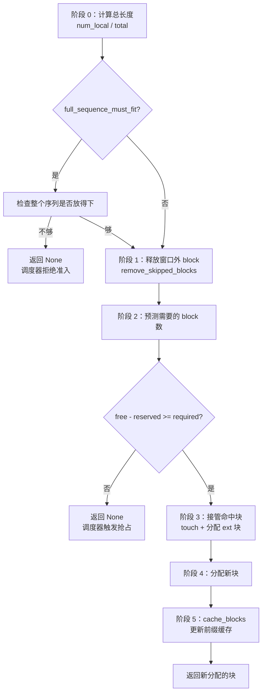
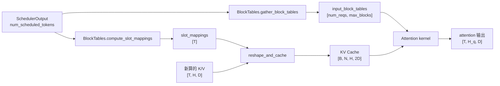

# 04 · KV Cache 与 PagedAttention

> 前置阅读：[00 · 整体架构与阅读路线](./00-整体架构与阅读路线.md)、[03 · 调度器原理](./03-调度器原理.md)
> 对应源码：`vllm/v1/kv_cache_interface.py`、`vllm/v1/core/kv_cache_manager.py`、`vllm/v1/core/kv_cache_coordinator.py`、`vllm/v1/core/single_type_kv_cache_manager.py`、`vllm/v1/core/block_pool.py`、`vllm/v1/core/kv_cache_utils.py`、`vllm/v1/worker/gpu/block_table.py`
> 适用版本：本仓库 commit `5082c45853`（2026-10-29）

---

## 1. 一句话概括

vLLM 把每个请求的 KV Cache 切成固定大小的 **block**，用一张 **block table** 把逻辑位置映射到物理块号，再用 **slot_mapping** 把本步要写的 token 映射到具体显存偏移。

```text
逻辑 token 位置  ──block table──▶  物理 block id  ──× block_size + offset──▶  slot id
```

这套机制叫 **PagedAttention**：它让 KV Cache 像操作系统分页一样按需分配、可以共享前缀、可以回收，而不要求每个请求占一段连续显存。

调度器只负责“要多少块”，真正决定“哪一块、写到哪个 slot”的是 `KVCacheManager` + `BlockPool` + worker 侧的 `BlockTables`。

---

## 2. Why：为什么不能用连续 KV Cache

### 2.1 连续分配的三个致命问题

假设每个请求预留 `max_model_len = 8192` token 的 KV：

```text
请求 A: [================ 8192 ================]
请求 B: [==== 实际 300 ====][..... 浪费 7892 .....]
请求 C: [== 实际 120 ==][........ 浪费 8072 ........]
```

问题一：**内部碎片**。每个请求都按最大长度占显存，实际生成长度远小于上限，浪费巨大。

问题二：**外部碎片**。请求结束后留下不同大小的空洞，新请求可能放不进去，即使总空闲显存足够。

问题三：**无法共享**。两个请求有相同 system prompt，连续布局下必须各存一份 KV。

### 2.2 分页后的样子

```text
逻辑块:   0      1      2      3
请求 A: [blk 7][blk 2][blk 9][blk 4]
请求 B: [blk 7][blk 2][blk 8]
                 ↑
          共享同一份 KV，ref_cnt = 2
```

物理块可以散落在显存任意位置。请求 A 的逻辑块 2 和请求 B 的逻辑块 2 指向同一个物理块 7/2，只要引用计数正确，就能安全共享。

好处：

| 问题 | 分页后 |
|---|---|
| 内部碎片 | 只有最后一个 block 可能不满，最多浪费 `block_size - 1` 个 token |
| 外部碎片 | 不存在，所有 block 等大，任意空闲块都能用 |
| 前缀共享 | 相同前缀的 block 直接复用，引用计数 +1 |
| 回收 | 请求结束按 block 归还，立即可被其他请求使用 |
| 长序列 | 不需要连续显存，序列可以无限增长（受块数限制） |

### 2.3 代价

- 每次 attention 都要多一次间接寻址（block table）；
- kernel 需要按页遍历 KV，而不是顺序读；
- 需要维护引用计数、LRU、前缀哈希；
- 需要一个全局 block pool 和调度器协同。

这些代价由 PagedAttention kernel 和 `BlockPool` 吸收，换来了显存利用率和吞吐的大幅提升。

---

## 3. 四个层次：Spec → Group → Config → Tensor

理解 KV Cache 的第一步，是分清这四个概念。它们经常被混着叫“block size”，但含义不同。

### 3.1 `KVCacheSpec`：一层缓存的格式

定义在 `vllm/v1/kv_cache_interface.py:202`。

```python
@dataclass(frozen=True)
class KVCacheSpec:
    block_size: int
    dcp_sharded: bool = False
    block_stride_alignment: int | MultipleOf | None = None
    is_draft: bool = False
```

它描述“这一层的 KV Cache 长什么样”：

| 字段/属性 | 含义 |
|---|---|
| `block_size` | 一个 block 覆盖多少 token |
| `dcp_sharded` | DCP 是否把 token 位置切到不同 rank |
| `block_stride_alignment` | 物理 block 之间的字节对齐要求 |
| `page_size_bytes` | 一个 block 占多少字节 |
| `num_heads` | 这一层有多少 KV head（或状态槽） |
| `tokens_per_state` | 一个状态覆盖多少 token |
| `state_content_size_bytes` | 每个 (head, state) 单元格多少字节 |
| `prefix_cacheable` | 是否参与前缀缓存 |
| `max_num_blocks_per_req` | worker 侧 block table 一行需要多少列 |

#### `AttentionSpec`

`kv_cache_interface.py:552`：

```python
@dataclass(frozen=True, kw_only=True)
class AttentionSpec(KVCacheSpec):
    num_kv_heads: int
    head_size: int
    dtype: torch.dtype
    head_size_v: int = None
    kv_quant_mode: KVQuantMode = KVQuantMode.NONE
    page_size_padded: int | None = None
    num_head_slots: int | None = None
    state_content_bytes: int | None = None
    tokens_per_state: int | Fraction = 1
```

关键公式（`AttentionSpec.state_content_size_bytes` 与 `page_size_bytes`）：

```text
每 token 每 head 的 K+V 字节数
    = (head_size + head_size_v) × dtype_size

每 block 字节数
    = num_heads × num_states × state_content_size_bytes

普通 full attention：
    num_states = block_size
    所以 page_size = block_size × num_kv_heads × (head_size + head_size_v) × dtype_size
```

#### 常见 Spec 子类

| 类 | 行号 | 用途 |
|---|---|---|
| `FullAttentionSpec` | 619 | 普通全注意力 |
| `MLAAttentionSpec` | 729 | DeepSeek MLA，压缩 KV |
| `SlidingWindowSpec` | 901 | 滑动窗口注意力 |
| `ChunkedLocalAttentionSpec` | 861 | 分块局部注意力 |
| `MambaSpec` | 1094 | Mamba / SSM 状态缓存 |
| `CrossAttentionSpec` | 1221 | encoder-decoder 交叉注意力 |
| `EncoderOnlyAttentionSpec` | 1214 | 只有 encoder，不缓存 |
| `CircularBufferSpec` | 968 | 环形缓冲，一圈一个 block |
| `UniformTypeKVCacheSpecs` | 1291 | 同类型多层的聚合 spec |

### 3.2 `KVCacheGroupSpec`：共享一张 block table 的层

定义在 `kv_cache_interface.py:1505`。

```python
@dataclass
class KVCacheGroupSpec:
    layer_names: list[str]
    kv_cache_spec: KVCacheSpec
    is_eagle_group: bool = False
    host_resident: bool = False
    enable_kv_transfer: bool = True
    role: KVCacheGroupRole = KVCacheGroupRole.DEFAULT
```

一个 group 里的所有层：

- 有相同的 `KVCacheSpec`；
- 共享同一张 block table；
- 一起分配、一起释放。

为什么按 group 而不是按层管理？因为同一类 attention 层的 block table 完全一样。如果把 32 层都单独管理，调度器要维护 32 张表、32 套引用计数，复杂且没必要。

什么时候会有多个 group？

- 混合模型：full attention + sliding window；
- Mamba + attention；
- 投机解码的 draft 层单独一组；
- encoder-decoder 的 cross attention；
- HiSparse 的 host / indexer 组。

### 3.3 `KVCacheConfig`：整个模型的缓存配置

定义在 `kv_cache_interface.py:1526`。

```python
@dataclass
class KVCacheConfig:
    num_blocks: int
    kv_cache_tensors: list[KVCacheTensor]
    kv_cache_groups: list[KVCacheGroupSpec]
    prefix_cache_retention_interval: int | None = None
    kv_cache_layout: str | None = None
    hash_block_size: int | None = None
    cache_hit_alignment_tokens: int | None = None
    ...
```

| 字段 | 含义 |
|---|---|
| `num_blocks` | 全局 block pool 里有多少个 block |
| `kv_cache_tensors` | 每层/每组在显存里的布局 |
| `kv_cache_groups` | 有哪些 group |
| `hash_block_size` | 前缀哈希按多少 token 一块 |
| `cache_hit_alignment_tokens` | 前缀命中最小对齐 token 数 |
| `kv_cache_layout` | 物理布局（LBNHC / LBHNC / ...） |

### 3.4 `KVCacheTensor`：物理显存怎么摆

定义在 `kv_cache_interface.py:1475`。

```python
@dataclass
class KVCacheTensor:
    size: int
    layers: list[str]
    layer_stride: int
    block_stride: int
    offset: int = 0
    host_resident: bool = False
```

每个 KVCacheTensor 描述“同一组形状相同的层”在 backing buffer 里的位置：

```text
layer l 的 block b 起始字节
    = offset + l × layer_stride + b × block_stride
```

默认布局（`LBNHC`）的逻辑形状是：

```text
[L, B, H, N, C]
 L = 层
 B = block 数
 H = head 数
 N = block_size（每块的 token/状态数）
 C = 内容字节数
```

单层视图就是：

```text
[B, N, H, C]
```

对普通 fp16 full attention：

```text
[num_blocks, block_size, num_kv_heads, 2 × head_size]
```

K 和 V 拼在最后一维。`flash_attn` backend 写入时：

```python
# vllm/v1/attention/backends/flash_attn.py:1452
# (B, N, H, 2*D) -> ((B, N, H, D), (B, N, H, D))
key_cache, value_cache = kv_cache.transpose(1, 2).split(self.head_size, dim=-1)
```

先转成 `[B, H, N, 2D]`，再 split 成 K 和 V。

> 注意：不同 backend 可能选择不同 layout（`LBHNC` 等）。这里用默认的 `LBNHC` 举例，读代码时以 `KVCacheLayout` 和 backend 的 `supported_kv_cache_layouts` 为准。

### 3.5 四个 block size 的区别

这是阅读 KV Cache 代码时最容易混的地方：

| 名称 | 来源 | 作用 |
|---|---|---|
| `hash_block_size` | `CacheConfig` / 引擎解析 | 前缀哈希按多少 token 计算 |
| group `block_size` | `KVCacheSpec.block_size` | 该 group 一个物理 block 覆盖多少 token |
| `scheduler_block_size` | 所有 group 的最小公倍数 | 调度器切 chunk 的对齐粒度 |
| `kernel_block_size` | attention backend 支持的值 | kernel 实际寻址的页大小，可能是 group block 的约数 |

大多数模型四者相等（比如都等于 16）。混合模型里可能不同，例如：

```text
full attention group: block_size = 16
Mamba group:          block_size = 128
hash_block_size = 16
scheduler_block_size = 128
```

调度器按 128 对齐，但 full attention 仍按 16 一块分配。`resolve_block_hashes()` 负责在哈希粒度和 group 粒度之间转换。

---

## 4. 显存怎么变成 block：`num_blocks`

### 4.1 每个 block 多少字节

`vllm/v1/core/kv_cache_planning.py:574` 的 `_get_kv_cache_bytes_per_block`：

```python
bytes_per_block = max(
    sum(page_size_bytes for layer in group.layer_names)
    for group in kv_cache_groups
)
```

注意是 **max 而不是 sum over groups**。因为所有 group 共享同一个 block id 空间：

- 一个 block id 在任意时刻只属于一个 group；
- group 0 的 block 5 和 group 1 的 block 5 不会同时存在；
- 所以不同 group 的物理区域可以 **overlay** 在同一段 buffer 上。

`KVCacheTensor` 的注释写得很清楚：

> Tensors whose address ranges overlap alias the same bytes: cache groups overlay each other, which is sound because a block ID is owned by one group at a time.

代价是：如果 group 0 比 group 1 大，group 1 使用 block 时会浪费 block 内属于 group 0 的那部分空间。这是支持异构 group 的必要成本。

### 4.2 `num_blocks` 公式

`kv_cache_planning.py:681`：

```python
num_blocks = available_memory // bytes_per_block
num_blocks = may_override_num_blocks(vllm_config, num_blocks)
```

`available_memory` 来自 worker 的 profiling：总显存减去模型权重、激活峰值、CUDA context 等之后，留给 KV Cache 的部分。

### 4.3 具体例子

模型假设：

```text
32 层
8 个 KV head
head_size = 128
dtype = fp16（2 字节）
block_size = 16
单 group（所有层都是 full attention）
```

单层每 block：

```text
16 × 8 × (128 + 128) × 2
= 16 × 8 × 256 × 2
= 65,536 字节
= 64 KiB
```

32 层：

```text
bytes_per_block = 32 × 64 KiB = 2 MiB
```

如果 `available_memory = 24 GiB`：

```text
num_blocks = 24 × 1024 MiB / 2 MiB = 12,288
```

总 token 容量：

```text
12,288 × 16 = 196,608 token
```

### 4.4 null block

`BlockPool.__init__`（`block_pool.py:159`）会从 free queue 里拿走第一个 block：

```python
self.null_block = self.free_block_queue.popleft()
self.null_block.is_null = True
```

所以：

```text
可用 block 数 = num_gpu_blocks - 1
```

`null_block` 的 `block_id` 通常是 0，用来表示“这个位置没有有效 KV”。它不参与引用计数，也不会被释放。

`get_usage()` 也会减 1：

```python
total_gpu_blocks = self.num_gpu_blocks - 1
```

---

## 5. `KVCacheBlock` 与 `BlockPool`

### 5.1 `KVCacheBlock`

定义在 `vllm/v1/core/kv_cache_utils.py:162`。

```python
@dataclass(slots=True)
class KVCacheBlock:
    block_id: int
    ref_cnt: int = 0
    pool: BlockPool | None = None
    _block_hash: BlockHashWithGroupId | None = None
    _block_hash_num_tokens: int | None = None
    prev_free_block: KVCacheBlock | None = None
    next_free_block: KVCacheBlock | None = None
    is_null: bool = False
```

| 字段 | 含义 |
|---|---|
| `block_id` | 物理块号，`0..num_gpu_blocks-1` |
| `ref_cnt` | 有多少个请求/引用正在使用它 |
| `_block_hash` | 块内容哈希 + group id，只有满块且被缓存时才有 |
| `_block_hash_num_tokens` | 这个哈希覆盖多少 token（支持部分块/细粒度） |
| `prev/next_free_block` | 空闲队列的双向链表指针 |
| `is_null` | 是否是占位 null block |

关键不变量：

```text
ref_cnt == 0  → 这个 block 在 free queue 里
ref_cnt > 0   → 这个 block 不在 free queue 里
```

`touch()` 在 `ref_cnt == 0` 时把它从 free queue 移除，然后 `ref_cnt += 1`。

### 5.2 `FreeKVCacheBlockQueue`

定义在 `kv_cache_utils.py:258`。

它用双向链表管理空闲块，支持 O(1) 从中间删除。注释说明了顺序规则：

1. 最久未使用的块在队首（LRU）；
2. 同一请求释放的块里，链尾（hash token 更多）的块更靠前。

为什么需要从中间删除？因为一个空闲块可能突然被前缀缓存命中（`touch`），必须立刻从 eviction 队列里拿走，不能等到它被弹出。

### 5.3 `BlockPool` 的四个核心操作

定义在 `block_pool.py:137`。

#### 分配：`get_new_blocks`

`block_pool.py:706`：

```python
ret = self.free_block_queue.popleft_n(num_blocks)

if self.enable_caching:
    for block in ret:
        self._maybe_evict_cached_block(block)   # 清掉旧哈希
        block.ref_cnt += 1
else:
    for block in ret:
        block.ref_cnt += 1
```

如果启用了前缀缓存，被复用的块要先从哈希表里移除，否则新内容会污染旧哈希。

#### 释放：`free_blocks`

`block_pool.py:816`：

```python
block.ref_cnt -= 1
if block.ref_cnt == 0:
    if block.block_hash is None or not self.enable_caching:
        blocks_to_evict_first.append(block)   # 无哈希：插到队首，LIFO
    else:
        blocks_to_evict_last.append(block)    # 有哈希：插到队尾，LRU
```

两种策略的原因：

- **无哈希块**：不会被前缀缓存命中，尽快复用能提高 GPU 局部性；
- **有哈希块**：可能被其他请求命中，放到队尾让它活得久一点。

#### 命中：`touch`

`block_pool.py:792`：

```python
if block.ref_cnt == 0:
    self.free_block_queue.remove(block)
block.ref_cnt += 1
```

前缀缓存命中时调用。它同时把块从 eviction 候选里“救回来”。

#### 缓存：`cache_full_blocks`

`block_pool.py:230`：

```python
for i, blk in enumerate(new_full_blocks):
    if blk.is_null or ...:
        continue
    block_hash = new_block_hashes[i]
    self._insert_block_hash(block_hash_with_group_id, blk, num_tokens=...)
```

只有 **满块** 才会被哈希缓存。最后不满的块不参与前缀缓存，直到它被填满。

### 5.4 哈希表：`BlockHashToBlockMap`

定义在 `block_pool.py:36`。

```python
self._cache: dict[
    BlockHashWithGroupId, KVCacheBlock | dict[int, KVCacheBlock]
] = {}
```

一个哈希可能对应多个 block，因为 vLLM **不做块去重**：

> if a block becomes full and is cached, we don't check if there is already an identical block in the cache. This is because we want to make sure the allocated block IDs won't change so that block tables are append-only.

也就是说，两个请求算出相同的哈希，如果它们各自的块已经分配了，就保留两份，而不是合并。这牺牲了一点显存，换来了：

- block table 只追加、不改写；
- 不需要在运行中迁移块；
- CUDA Graph 的地址稳定。

`BlockHashWithGroupId` 是 `block_hash + 4 字节 group_id`，见 `make_block_hash_with_group_id`（`kv_cache_utils.py:60`）。这样同一个哈希在不同 group 下不会串。

---

## 6. `KVCacheManager.allocate_slots`：分配主流程

入口：`vllm/v1/core/kv_cache_manager.py:379`。

### 6.1 输入

```python
def allocate_slots(
    self,
    request,
    num_new_tokens,
    num_new_computed_tokens=0,
    new_computed_blocks=None,
    num_lookahead_tokens=0,
    num_external_computed_tokens=0,
    delay_cache_blocks=False,
    num_encoder_tokens=0,
    full_sequence_must_fit=False,
    reserved_blocks=0,
    has_scheduled_reqs=True,
    skip_zeroing_group_ids=(),
):
```

| 参数 | 含义 |
|---|---|
| `num_new_tokens` | 本步要算的新 token 数 |
| `num_new_computed_tokens` | 本步前缀缓存新命中的 token 数 |
| `new_computed_blocks` | 命中的 block（按 group 分组） |
| `num_lookahead_tokens` | 投机解码额外预留的 slot |
| `num_external_computed_tokens` | KV connector 提供的远程 token 数 |
| `delay_cache_blocks` | 异步 KV 传输时先不缓存 |
| `full_sequence_must_fit` | 准入时要求整个序列放得下 |
| `reserved_blocks` | 给其他在飞请求预留的块 |
| `has_scheduled_reqs` | 本步是否已有请求被调度 |

### 6.2 地址空间布局

docstring 里的图：

```text
----------------------------------------------------------------------
| < comp > | < new_comp > | < ext_comp >  | < new >  | < lookahead > |
----------------------------------------------------------------------
                                          |   < to be computed >     |
----------------------------------------------------------------------
                          |            < to be allocated >           |
----------------------------------------------------------------------
                          | < to be cached (roughly)>                |
----------------------------------------------------------------------
| Prefix-cached tokens from either vLLM   |
| or connector. Can be safely removed if  |
| they are outside sliding window.        |
----------------------------------------------------------------------
```

| 段 | 含义 |
|---|---|
| `comp` | `request.num_computed_tokens` |
| `new_comp` | 本步新命中的本地前缀缓存 |
| `ext_comp` | connector 提供的远程 KV |
| `new` | 本步要计算的 token |
| `lookahead` | 投机解码的额外 slot |

### 6.3 六个阶段

> 如果 `full_sequence_must_fit=True`，会先做一次全序列准入检查（见 6.4），不通过就直接返回 `None`；通过后才进入下面的释放和分配。



#### 阶段 0：计算长度

```python
num_local_computed_tokens = (
    request.num_computed_tokens + num_new_computed_tokens
)
total_computed_tokens = min(
    num_local_computed_tokens + num_external_computed_tokens,
    self.max_model_len,
)
```

`total_computed_tokens` 包含本地命中和远程命中。

#### 阶段 1：释放窗口外 block

```python
self.coordinator.remove_skipped_blocks(
    request.request_id,
    max(0, total_computed_tokens - request.num_in_flight_tokens),
    num_prompt_tokens=request.num_prompt_tokens,
)
```

为什么是 `total_computed_tokens - num_in_flight_tokens`？

因为 `num_computed_tokens` 是乐观值，里面可能包含“已经调度但 GPU 还没算完”的 token。这些 token 的 KV 还没写，attention 也还要读它们，不能提前释放。只有 **已处理并提交** 的前缀才能安全回收。

注释原文：

> Free on the processed-token basis: in-flight steps' attention windows still read blocks below the optimistic boundary, and rejected spec tokens can roll it back.

#### 阶段 2：预测 block 数

```python
num_blocks_to_allocate = self.coordinator.get_num_blocks_to_allocate(
    request_id=...,
    num_tokens=num_tokens_need_slot,
    new_computed_blocks=new_computed_block_list,
    ...
)
```

这一步只做预测，不真正分配。

然后检查：

```python
available_blocks = self.block_pool.get_num_free_blocks() - reserved_blocks
required_blocks = num_blocks_to_allocate + watermark_blocks
if required_blocks > available_blocks:
    return None
```

两个扣除项：

| 项 | 作用 |
|---|---|
| `reserved_blocks` | 给异步 KV load 等在飞序列留的余量 |
| `watermark_blocks` | 给 waiting/preempted 准入留的余量 |

`watermark` 只在以下条件同时满足时生效：

```python
has_scheduled_reqs and request.status in (
    RequestStatus.WAITING,
    RequestStatus.PREEMPTED,
)
```

即：本步已经有请求在跑，当前请求是新准入的。running 请求不受 watermark 影响，避免自己把自己卡死。

#### 阶段 3：接管命中块

```python
self.coordinator.allocate_new_computed_blocks(
    request_id=...,
    new_computed_blocks=...,
    num_local_computed_tokens=...,
    num_external_computed_tokens=...,
)
```

内部是两阶段：

1. 先对所有 group 的本地命中块 `touch`；
2. 再给所有 group 分配远程 KV 需要的块。

顺序很重要。如果先给 group 0 分配远程块，可能会把 group 1 尚未 `touch` 的命中块 evict 掉。`kv_cache_coordinator.py:265` 的注释就是在说这个问题。

`add_local_computed_blocks` 里还有滑动窗口的处理：

```python
num_skipped_blocks = num_skipped_tokens // self.block_size
if num_skipped_blocks > 0:
    new_computed_blocks = new_computed_blocks[num_skipped_blocks:]
...
req_blocks.extend([self._null_block] * num_skipped_blocks)
req_blocks.extend(new_computed_blocks)
```

被窗口跳过的前缀用 null block 占位，保持 block table 的索引位置不变。

#### 阶段 4：分配新块

```python
new_blocks = self.coordinator.allocate_new_blocks(
    request_id,
    num_tokens_need_slot,
    num_tokens_main_model,
    num_encoder_tokens,
)
```

`SingleTypeKVCacheManager.allocate_new_blocks`（`single_type_kv_cache_manager.py:370`）：

```python
num_required_blocks = cdiv(num_tokens, self.block_size)
num_new_blocks = num_required_blocks - len(req_blocks)
if num_new_blocks <= 0:
    return cow_blocks
new_blocks = self.block_pool.get_new_blocks(num_new_blocks)
req_blocks.extend(new_blocks)
```

block table 是 **按需增长** 的：只分配“还差多少块”，不是一次分配整个序列。

#### 阶段 5：更新前缀缓存

```python
num_tokens_to_cache = min(
    total_computed_tokens + num_new_tokens,
    request.num_tokens,
)
self.coordinator.cache_blocks(request, num_tokens_to_cache)
```

为什么 `min(..., request.num_tokens)`？

因为 `num_new_tokens` 可能包含 **未验证的投机 token**。这些 token 的 KV 已经写了，但如果被拒绝，就不能进入前缀缓存，否则未来请求会命中错误的 KV。

所以只缓存“已确认”的 token：

```text
可缓存 token = min(已算 + 本步新算, 已生成 token 总数)
```

### 6.4 `full_sequence_must_fit`

配置项 `scheduler_reserve_full_isl` 默认 `True`（`vllm/config/scheduler.py:190`）。

开启后，准入一个 waiting 请求前会先检查：

```python
full_num_tokens = min(request.num_tokens, self.max_model_len)
num_blocks_to_allocate = coordinator.get_num_blocks_to_allocate(
    num_tokens=full_num_tokens,
    ...
)
```

**目的**：避免一个长 prompt 被准入，算到一半才发现 KV 不够，然后触发大量抢占。

**代价**：某些“分块后其实能跑完”的请求会被拒绝准入，直到有足够大的连续空间。这是吞吐和稳定性的权衡。

### 6.5 分配失败时发生什么

`allocate_slots` 返回 `None` 后，调度器：

- running 请求：触发抢占，释放其他请求的块；
- waiting 请求：`break`，本步不再准入新请求。

详见 03 的第 5、6 节。

---

## 7. block table 与 slot_mapping

调度器只传 **block id 列表**。worker 侧把它们变成 GPU 上的张量。

核心类：`vllm/v1/worker/gpu/block_table.py:17` 的 `BlockTables`。

### 7.1 两种表

```python
# 每个 group 一张，形状 [max_num_reqs, max_num_blocks_per_group]
self.block_tables: list[StagedWriteTensor] = []

# 每个 group 一份，形状 [num_groups, max_num_batched_tokens]
self.slot_mappings = torch.zeros(
    self.num_kv_cache_groups,
    self.max_num_batched_tokens,
    dtype=torch.int64,
    device=self.device,
)
```

| 张量 | shape | dtype | 作用 |
|---|---|---|---|
| `block_tables[g]` | `[max_num_reqs, max_blocks_g]` | int32 | 请求 → 物理块号 |
| `input_block_tables[g]` | 同上 | int32 | 本步 forward 用的紧凑副本 |
| `slot_mappings[g]` | `[max_num_batched_tokens]` | int64 | 本步 token → 物理 slot |
| `num_blocks[g]` | `[num_groups, max_num_reqs]` | int32 | 每个请求每 group 已用多少块 |

`max_blocks_g` 来自 `KVCacheSpec.max_num_blocks_per_req`：

- full attention：`cdiv(max_model_len, block_size)`
- 滑动窗口：只需要窗口大小对应的块数
- Mamba align：`cdiv(max_len, block_size) + num_speculative_blocks`

滑动窗口的 block table 行远小于 full attention，这是显存优化的一部分。

### 7.2 写入：`append_block_ids`

`block_table.py:125`：

```python
def append_block_ids(self, req_index, new_block_ids, overwrite):
    for i in range(self.num_kv_cache_groups):
        start = self.num_blocks.np[i, req_index] if not overwrite else 0
        block_ids = new_block_ids[i]
        ...
        self.block_tables[i].stage_write(req_index, start, block_ids)
        self.num_blocks.np[i, req_index] = end
```

两种模式：

| 场景 | overwrite | 行为 |
|---|---|---|
| 新请求 / resumed 请求 | `True` | 从第 0 列开始覆盖整行 |
| running 请求继续 | `False` | 追加到已有块之后 |

这就是为什么 block table 可以是 **append-only** 的。只有新请求或抢占后重新准入的请求才会重置整行。

### 7.3 收集：`gather_block_tables`

`block_table.py:160`。它把稀疏的 `req_index` 行拷贝到紧凑的 `input_block_tables`，供 kernel 使用。

滑动窗口 group 会做特殊处理：

```python
num_null = max(first_pos - reach, 0) // block_size
```

低于窗口的 block table 项被替换成 null block。原因是这些块可能已经被 `SlidingWindowManager` 释放并复用，但 attention kernel 加载一个跨越窗口起点的 KV tile 时仍可能读到它们。如果不 mask，被 mask 掉的 NaN 会传播到输出。

### 7.4 计算：`compute_slot_mappings`

`block_table.py:229`，核心公式：

```text
block_index  = position // block_size
block_offset = position % block_size
block_number = block_table[req_index, block_index]
slot_id      = block_number * block_size + block_offset
```

无效位置（padding、dummy request、非本 rank 的 CP token）写 `PAD_SLOT_ID = -1`。

`PAD_SLOT_ID` 定义在 `vllm/v1/attention/backends/utils.py:54`。

### 7.5 具体例子

继续用：

```text
block_size = 16
请求 A: prompt 40 token，前缀缓存命中前 32 token
命中块: block 7 (token 0..15), block 12 (token 16..31)
新块:   block 41 (token 32..47)
```

block table：

```text
行 A: [7, 12, 41, 0, 0, ...]
        ↑   ↑   ↑
       逻辑块 0 1 2
```

本步要算 token 32..39（8 个）：

```text
position 32 → block_index 2, offset 0 → block 41 → slot 41*16+0 = 656
position 33 → block_index 2, offset 1 → block 41 → slot 657
...
position 39 → block_index 2, offset 7 → block 41 → slot 663
```

slot_mapping（只列本步 8 个位置）：

```text
[656, 657, 658, 659, 660, 661, 662, 663]
```

之后生成 token 40..47，都落在 block 41 的 offset 8..15。等 48 个 token 都算完，block 41 变成满块，才会被哈希并加入前缀缓存。

### 7.6 一个 block 能装多少 token

```text
num_blocks = ceil(num_tokens / block_size)
```

block_size = 16 时：

| token 数 | block 数 | 最后一个块的使用率 |
|---|---|---|
| 1 | 1 | 1/16 |
| 16 | 1 | 16/16 |
| 17 | 2 | 1/16 |
| 40 | 3 | 8/16 |
| 100 | 7 | 4/16 |

最后一块不满是常态。它占满一整块显存，但不参与前缀缓存。

---

## 8. PagedAttention 的数据流

### 8.1 参与的张量

一次 forward 里，attention 层看到的是：

| 张量 | shape | 含义 |
|---|---|---|
| `query` | `[T, H_q, D]` | 本步所有请求的 query 扁平拼接 |
| `key` | `[T, H_kv, D]` | 本步新算的 key |
| `value` | `[T, H_kv, D]` | 本步新算的 value |
| `kv_cache` | `[B, N, H_kv, 2D]` | 整个模型的 KV 池（单层视图） |
| `block_table` | `[num_reqs, max_blocks]` | 逻辑块 → 物理块 |
| `seq_lens` | `[num_reqs]` | 每个请求的 KV 长度 |
| `query_start_loc` | `[num_reqs+1]` | 每个请求的 query 在 `T` 里的起止 |
| `slot_mapping` | `[T]` | 本步新 KV 写到哪 |

注意 `T` 是 **扁平 token 总数**，不是 `num_reqs`。一个请求可以贡献多个 token（prefill chunk 或投机解码）。

### 8.2 写入 KV：`reshape_and_cache`

`flash_attn.py:1432` 的 `do_kv_cache_update`：

```python
# (B, N, H, 2*D) -> ((B, N, H, D), (B, N, H, D))
key_cache, value_cache = kv_cache.transpose(1, 2).split(self.head_size, dim=-1)

reshape_and_cache_flash(
    key,
    value,
    key_cache,
    value_cache,
    slot_mapping,
    self.kv_cache_dtype,
    layer._k_scale,
    layer._v_scale,
)
```

`reshape_and_cache_flash` 对每个 token `i`：

```text
dst_slot = slot_mapping[i]
block_id = dst_slot // block_size
offset   = dst_slot % block_size
key_cache[block_id, offset, :, :] = key[i]
value_cache[block_id, offset, :, :] = value[i]
```

这是一个 scatter 写。`slot_mapping` 就是“散列表”。

### 8.3 读 KV：paged attention

以 FlashAttention 为例（`flash_attn.py:1401` 附近）：

```python
_FA4_DENSE_ATTENTION_KERNEL(
    q=query[:num_actual_tokens],
    k=key_cache,
    v=value_cache,
    out=output[:num_actual_tokens],
    cu_seqlens_q=cu_seqlens_q,
    seqused_k=seq_lens,
    max_seqlen_k=max_seqlen_k,
    block_table=block_table,
    ...
)
```

kernel 内部对请求 `i` 的第 `j` 个 KV 位置：

```text
logical_block = j // block_size
offset        = j % block_size
physical_block = block_table[i, logical_block]
k = key_cache[physical_block, offset]
```

再和 `query[query_start_loc[i]:query_start_loc[i+1]]` 做 attention。

### 8.4 和连续布局的对比

连续布局：

```text
K[i] = kv_cache[i * seq_len + j]
```

分页布局：

```text
K[i, j] = kv_cache[block_table[i, j // B] * B + j % B]
```

多了一次 block table 查表。但换来的是：

- 不需要为每个请求预留最大长度；
- 块可以任意复用；
- 前缀可以共享；
- 序列可以无限增长。

### 8.5 Mermaid：一次 paged attention 的数据流



---

## 9. 前缀缓存

### 9.1 链式哈希

入口：`hash_block_tokens`（`kv_cache_utils.py:707`）。

```python
def hash_block_tokens(hash_function, parent_block_hash, curr_block_token_ids, extra_keys=None):
    if not parent_block_hash:
        parent_block_hash = NONE_HASH
    return BlockHash(
        hash_function((parent_block_hash, tuple(curr_block_token_ids), extra_keys))
    )
```

哈希的输入是：

```text
(parent_hash, 当前块 token ids, extra_keys)
```

所以：

```text
h0 = H(NONE_HASH, tokens[0:16])
h1 = H(h0, tokens[16:32])
h2 = H(h1, tokens[32:48])
...
```

**链式** 是关键：只匹配当前块不够，必须前面所有块都匹配。否则两个请求可能在某一块碰巧有相同 token，但前缀不同，共享 KV 就是错的。

### 9.2 `extra_keys`：哈希还要包含什么

`generate_block_hash_extra_keys`（`kv_cache_utils.py:637`）会加入：

| 来源 | 作用 |
|---|---|
| LoRA 名称 | 不同 LoRA 的同一段文本 KV 不同 |
| 多模态特征 | 图片/音频 embedding 影响 KV |
| `cache_salt` | 用户主动隔离缓存，只在第一个块加 |
| prompt embeds 哈希 | 直接传 embedding 时，token ids 不足以区分 |

如果这些不参与哈希，不同 LoRA 或不同图片可能错误命中同一份 KV。

### 9.3 查询命中

`KVCacheManager.get_computed_blocks`（`kv_cache_manager.py:266`）：

```python
max_cache_hit_length = request.get_max_cache_hit_length(max_cache_hit_length)
computed_blocks, num_new_computed_tokens, num_uncached = (
    self.coordinator.find_longest_cache_hit(
        request.block_hashes, max_cache_hit_length
    )
)
```

`Request.get_max_cache_hit_length`（`vllm/v1/request.py:314`）：

```python
limits = (self.num_tokens - 1, self.prefix_cache_hit_limit, bound)
return min(limit for limit in limits if limit is not None)
```

**为什么是 `num_tokens - 1`？**

采样需要最后一个 prompt token 的 logits。如果整个 prompt 都命中缓存，模型没有算最后一个 token，就没有 logits，无法生成第一个输出 token。

所以最多命中到倒数第二个 token，最后一个必须重算。

如果缓存命中按 block 对齐，实际重算的往往不止最后一个 token，而是 **最后一个不完整的块**。例如 prompt 48 个 token、block_size 16、3 个块全部命中，`num_tokens - 1 = 47` 会被 block 对齐到 32，最后 16 个 token 仍然要重算。

#### 命中粒度

`FullAttentionManager.find_longest_cache_hit`（`single_type_kv_cache_manager.py:743`）：

```python
for block_hash in islice(full_block_hashes, max_length // block_size):
    cached_block = block_pool.get_cached_block(block_hash, kv_cache_group_ids)
    if not cached_block:
        break
    ...
```

从第一个块开始，遇到 miss 立即停止。因为哈希是链式的，后面的块不可能单独命中。

### 9.4 多 group 的命中：取最短

混合模型里，每个 group 独立查命中。`HybridKVCacheCoordinator.find_longest_cache_hit`（`kv_cache_coordinator.py:806`）用固定点迭代：

```text
hit_length = max_cache_hit_length
while True:
    for each attention group:
        new_length = group.find_longest_cache_hit(hit_length)
        hit_length = min(hit_length, new_length)
    if hit_length 不再变小:
        break
```

最终取所有 group 都能满足的 **最短前缀**。因为一个请求要同时使用所有 group 的 KV，任何一个 group 没缓存到，就不能算命中。

### 9.5 具体命中例子

```text
prompt tokens: 0..39（40 个）
block_size = 16
缓存里已有:
  block 0 (0..15)  → block 7
  block 1 (16..31) → block 12
  block 2 未满，未缓存
```

查询：

```text
max_cache_hit_length = min(40-1, ...) = 39
```

`find_longest_cache_hit`：

- 块 0 命中 → 16
- 块 1 命中 → 32
- 块 2 未命中 → 停止

返回：

```text
computed_blocks = [block 7, block 12]
num_new_computed_tokens = 32
```

调度：

```text
num_computed_tokens = 32
num_new_tokens = 40 - 32 = 8
```

只需要为 token 32..39 分配 1 个新块。

### 9.6 部分命中与 CoW

如果支持细粒度哈希（`hash_block_size < block_size`），命中可能落在块中间。例如：

```text
block_size = 16
hash_block_size = 8
命中 24 个 token = 1 个完整块 + 半个块
```

第 2 个块只匹配了前 8 个 token，后面 8 个 token 与缓存不同。如果直接在这个共享块上写，会破坏其他请求的 KV。

解决方案是 **Copy-on-Write**：

1. `add_local_computed_blocks` 记录 `_partial_hit_reqs[req_id] = (block_idx, shared_block)`；
2. `allocate_new_blocks` 分配一个私有块；
3. `_apply_cow` 把共享块替换成私有块，并记录 `(source, dest)`；
4. 调度器通过 `take_kv_cache_block_copies()` 把 copy 列表放进 `SchedulerOutput.kv_cache_block_copies`；
5. worker 在 forward 前调用 `copy_kv_cache_blocks_inplace` 拷贝整块。

代码位置：

| 步骤 | 位置 |
|---|---|
| 记录 partial hit | `single_type_kv_cache_manager.py:268` `add_local_computed_blocks` |
| 替换块 | `single_type_kv_cache_manager.py:455` `_apply_cow` |
| 生成 copy 列表 | `kv_cache_manager.py:862` `take_kv_cache_block_copies` |
| worker 执行拷贝 | `vllm/v1/worker/utils.py:909` `copy_kv_cache_blocks_inplace` |
| 调用点 | `vllm/v1/worker/gpu/model_runner.py:1333` |

### 9.7 前缀缓存的收益与成本

收益：

- 多轮对话的 system prompt 只算一次；
- few-shot 示例重复时大幅降低 TTFT；
- 抢占后重算可以命中之前的块。

成本：

- 每个满块要算哈希；
- 哈希表需要内存和查找时间；
- 缓存块占用本来可以给 running 请求的显存；
- 缓存命中率低时，哈希和引用计数是纯开销。

所以 `enable_prefix_caching` 不是永远开越大越好。短 prompt、低重复场景关闭可能更划算。

---

## 10. 释放与回收

### 10.1 `free()`

`KVCacheManager.free`（`kv_cache_manager.py:628`）委托给 coordinator：

```python
self.coordinator.free(request.request_id)
```

`SingleTypeKVCacheManager.free`（`single_type_kv_cache_manager.py:591`）：

```python
self.block_pool.free_blocks(reversed(self.pop_blocks_for_free(request_id)))
```

**倒序释放** 是关键：

```text
请求块: [7, 12, 41]
倒序:   [41, 12, 7]
```

`BlockPool.free_blocks` 会把有哈希的块 append 到 free queue 尾部。倒序释放意味着 **链尾的块先进入队列**，最终在队列里更靠前，更早被 evict。这符合 LRU 的直觉：一个序列的后缀最不可能被其他请求共享。

### 10.2 延迟释放

异步调度下，一个请求被抢占时可能还有 GPU 输出在飞。如果立刻把块还给池子，新请求可能覆盖这些块，而旧请求的 attention 还在读。

当前代码用 `num_stale_output_tokens` 和 `defer_block_free` 处理：

- 抢占时记录 stale token 数；
- 等这些输出都回来后才真正释放；
- `update_from_output` 里调用 `_drain_deferred_frees()`。

详见 03 的第 12 节。

### 10.3 显存零化

新分配的块可能包含上一个请求的旧数据。对 fp8 KV 或某些 SSM 状态，旧数据里的 NaN/Inf 会污染计算。

worker 在 forward 前：

```python
if scheduler_output.new_block_ids_to_zero:
    self.kv_block_zeroer.zero_block_ids(scheduler_output.new_block_ids_to_zero)
```

位置：`vllm/v1/worker/gpu/model_runner.py:1327`。

只有需要零化的 spec 才会记录新块 id，见 `SingleTypeKVCacheManager._record_new_block_ids`。

---

## 11. 滑动窗口与混合模型

### 11.1 滑动窗口：只保留最近 W 个 token

`SlidingWindowSpec`（`kv_cache_interface.py:901`）：

```python
@dataclass(frozen=True, kw_only=True)
class SlidingWindowSpec(AttentionSpec):
    sliding_window: int
    extra_retained_tokens: int = 0
```

一个 token 只 attend 最近 `sliding_window` 个位置。更早的 KV 永远不会再被读到，可以释放。

`SlidingWindowManager.remove_skipped_blocks` 会把窗口之前的块替换成 null block：

```python
num_skipped_tokens = self.get_num_skipped_tokens(processed_computed_tokens)
if num_skipped_tokens <= 0:
    return
num_skipped_blocks = num_skipped_tokens // self.block_size
self._remove_blocks_in_range(request_id, 0, num_skipped_blocks)
```

释放后 block table 的前几项变成 `null_block`，但索引位置不变。这样逻辑位置 `p` 仍然映射到 `block_table[p // block_size]`。

### 11.2 为什么窗口边界要特别小心

考虑：

```text
block_size = 16
sliding_window = 8
已经算到 position 100
窗口覆盖 93..100
```

窗口起点 93 在逻辑块 5（80..95）里，后半块还有效。如果直接释放整块 5，就会丢掉 93..95 的有效 KV。

所以 `get_num_skipped_tokens` 只按 **完整块** 释放：

```text
num_skipped_tokens = max(
    0,
    position - sliding_window + 1 - extra_retained_tokens,
)
num_skipped_blocks = num_skipped_tokens // block_size
```

不满一块的部分保留。`SlidingWindowSpec.max_admission_blocks_per_request` 额外 +1 就是为了覆盖这种跨界：

```python
return cdiv(num_tokens, self.block_size) + 1
```

### 11.3 worker 侧的窗口 mask

即使 block table 里保留了跨界块，attention kernel 仍可能加载整个 tile。`gather_block_tables` 会把 **完全低于窗口** 的项替换成 null：

```python
num_null = max(first_pos - reach, 0) // block_size
```

`reach = SlidingWindowSpec.num_retained_tokens = sliding_window - 1 + extra_retained_tokens`。

这一步防止已释放并复用的块被 kernel 读到。

### 11.4 Mamba / SSM

Mamba 不存每个 token 的 K/V，而是存一个 **递归状态**（SSM state）。

`MambaSpec`（`kv_cache_interface.py:1094`）：

```python
@dataclass(frozen=True)
class MambaSpec(KVCacheSpec):
    shapes: tuple[tuple[int, ...], ...]
    dtypes: tuple[torch.dtype, ...]
    mamba_cache_mode: str = "none"
    num_speculative_blocks: int = 0
    num_prefill_checkpoint_blocks: int = 0
    ...
```

和 attention 的区别：

| 维度 | Attention | Mamba |
|---|---|---|
| 每 token 存什么 | K/V 向量 | 不存 |
| 每块存什么 | block_size 个 token 的 KV | 一个状态快照 |
| 前缀缓存 | 按块哈希 | 需要 `align` 模式 + checkpoint |
| block table | 每个逻辑块一项 | 大部分是 null，只有状态块 |

`MambaSpec.max_memory_usage_bytes`：

```python
if mamba_cache_mode == "align":
    return page_size_bytes * (2 + num_speculative_blocks + num_prefill_checkpoint_blocks)
else:
    return page_size_bytes * (1 + num_speculative_blocks)
```

Mamba 的块数不随序列长度增长，只和并发请求数、投机块数有关。这是它显存效率高的原因。

### 11.5 混合模型的 group 协调

一个模型可能同时有：

```text
group 0: full attention，32 层
group 1: sliding window，8 层
group 2: Mamba，4 层
```

`HybridKVCacheCoordinator` 负责：

- 每个 group 独立分配；
- 命中取所有 group 的最短前缀；
- 释放时每个 group 各自处理；
- 保证一个请求在所有 group 里都有对应块。

`KVCacheBlocks.blocks` 是 `tuple[Sequence[KVCacheBlock], ...]`，外层就是 group。

```python
blocks[0] = [block 7, block 12, block 41]   # full attention
blocks[1] = [block 3, block 9]              # sliding window
blocks[2] = [block 55]                      # mamba state
```

---

## 12. KV Connector：把 KV 放到别处

vLLM 支持外部 KV 存储/传输，例如：

- P/D 分离：prefill 节点算完 KV，传给 decode 节点；
- LMCache / Mooncake：把 KV offload 到 CPU/远端；
- 多实例共享前缀缓存。

调度器侧：

```python
ext_tokens, load_kv_async = self.connector.get_num_new_matched_tokens(
    request, block_aligned_local
)
```

`ext_tokens` 是外部命中的 token 数。`load_kv_async` 表示是否需要异步加载。

两种模式：

| 模式 | 行为 |
|---|---|
| 同步 | forward 前 KV 已经就绪，本步直接跑 |
| 异步 | 请求进入 `WAITING_FOR_REMOTE_KVS`，本步不跑，等加载完成 |

异步模式下：

```python
allocate_slots(..., delay_cache_blocks=True)
```

先分配块，但不把块加入前缀缓存，因为内容还没到。等传输完成后，再重新调度。

外部命中的块也会被 `allocate_new_computed_blocks` 接管，和本地命中一样参与 block table。

---

## 13. 完整例子：从 0 到 48 个 token

### 13.1 初始状态

```text
block_size = 16
num_gpu_blocks = 100（其中 block 0 是 null）
free queue: 1..99
cache: 空
```

请求 A：

```text
prompt = 40 个 token
```

### 13.2 第一次调度

前缀缓存为空：

```text
num_computed_tokens = 0
num_new_tokens = 40
```

需要块：

```text
ceil(40 / 16) = 3
```

分配 block 41、42、43（假设 free queue 顺序）：

```text
block table A: [41, 42, 43]
ref_cnt: 41=1, 42=1, 43=1
```

block 43 只用了 8 个 slot（32..39），但整块都被占用。

本步 slot_mapping：

```text
position 0..39
→ 41*16+0 .. 41*16+15
→ 42*16+0 .. 42*16+15
→ 43*16+0 .. 43*16+7
```

### 13.3 缓存满块

`cache_blocks(num_tokens_to_cache=40)`：

```text
num_hashed_tokens = len(request.block_hashes) × hash_block_size = 2 × 16 = 32
num_full_blocks = min(40, 32) // 16 = 2
```

只有 block 41 和 42 被哈希：

```text
h0 = H(NONE_HASH, tokens[0:16])   → block 41
h1 = H(h0, tokens[16:32])         → block 42
```

block 43 不满，不缓存。

### 13.4 第一次 decode

生成 token 40，调度 1 个 token：

```text
position 40
block_index 2, offset 8
block 43
slot = 43*16 + 8 = 696
```

`num_tokens = 41`，`num_computed_tokens = 41`。

### 13.5 继续到 48

生成 token 41..47，依次写入 block 43 的 offset 9..15。

当 `num_tokens = 48`：

```text
num_full_blocks = 48 // 16 = 3
```

block 43 变满，计算：

```text
h2 = H(h1, tokens[32:48]) → block 43
```

现在前缀缓存里有 3 个块。

### 13.6 请求 B 到来

请求 B 的 prompt 与 A 的前 40 个 token 完全相同，但从第 41 个 token 开始不同。

查询：

```text
max_cache_hit_length = min(40-1, ...) = 39
```

命中：

```text
block 41, 42
→ 32 token
```

block 43 虽然被缓存，但它覆盖 32..47，而 B 的第 33..40 个 token 不同，所以链式哈希 `h2` 不匹配。

B 的调度：

```text
num_computed_tokens = 32
num_new_tokens = 8
需要 1 个新块（位置 32..39）
```

分配 block 44：

```text
block table B: [41, 42, 44]
ref_cnt: 41=2, 42=2, 43=1, 44=1
```

B 只重算 8 个 token，而不是 40 个。这就是前缀缓存的价值。

### 13.7 请求 A 结束

释放 `[41, 42, 43]`，倒序：

```text
free 43 → ref_cnt 0，有哈希 → append 队尾
free 42 → ref_cnt 1（B 还在用）→ 不释放
free 41 → ref_cnt 1（B 还在用）→ 不释放
```

block 43 变成 eviction 候选，但仍可被命中，直到被新分配覆盖。

---

## 14. What if：改动会带来什么

| 改动 | 后果 | 注意 |
|---|---|---|
| 增大 `block_size` | block 数减少，block table 更短，元数据开销降低 | 内部碎片变大，前缀命中粒度变粗，短请求浪费显存 |
| 减小 `block_size` | 碎片变小，命中更细 | block table 变长，kernel 间接寻址更多，元数据开销上升 |
| 关闭前缀缓存 | 不再有哈希和引用计数开销 | 重复前缀全部重算，TTFT 上升；抢占后重算成本变高 |
| 开启 `watermark` | 保留空闲块，减少抢占抖动 | 可用块变少，准入更保守，吞吐可能下降 |
| 关闭 `scheduler_reserve_full_isl` | 更多请求能被准入 | 长 prompt 可能算到一半才发现放不下，触发抢占 |
| 增大 `num_gpu_blocks_override` | 更多 KV 容量 | 可能 OOM，因为实际显存不够 |
| 使用 fp8 KV | 每块字节数减半，容量翻倍 | 精度损失，需要 zeroing 和 scale |
| 使用 sliding window | 每请求块数大幅下降 | 只能 attend 窗口内，模型质量可能变化 |
| 使用 Mamba | 每请求只存状态，不随长度增长 | 需要模型支持，前缀缓存模式受限 |
| 开启 KV connector | 可以跨实例/跨阶段共享 KV | 网络/传输开销，状态机更复杂 |
| 关闭块去重（当前行为） | block table 稳定、append-only | 相同内容可能存多份，浪费显存 |
| 允许块去重 | 省显存 | 需要改写 block table，破坏 append-only 和 CUDA Graph 地址稳定性 |

---

## 15. 常见陷阱

| 陷阱 | 正确理解 |
|---|---|
| “block_size 就是 kernel 的 page size” | 还有 scheduler block size、hash block size、kernel block size，可能不同 |
| “num_gpu_blocks 就是可用块数” | 有一个 block 被保留为 null block，可用是 `num_gpu_blocks - 1` |
| “不同 group 的显存是相加的” | 它们 overlay 在同一段 buffer 上，`bytes_per_block` 取最大 group |
| “block table 会随着前缀命中而重排” | 基本是 append-only；只有新请求/resume 会 overwrite |
| “block id 是逻辑块号” | block id 是物理块号，逻辑块号是它在 block table 里的下标 |
| “slot_mapping 是 token 在序列里的位置” | 它是 token 在 KV Cache 显存里的扁平偏移 |
| “前缀缓存命中整个 prompt 就不用算” | 最后一个 token 必须重算以产生 logits |
| “哈希只包含当前块 token” | 是链式哈希，包含父哈希和 extra keys |
| “相同内容的块会自动合并” | 当前不去重，保留多份以保证 block table 稳定 |
| “`num_computed_tokens` 对应的 KV 一定有效” | 它是乐观值，可能包含在飞 token 或被拒绝的投机 token |
| “释放块就是立刻清空显存” | 只是 `ref_cnt -= 1`，内容保留供前缀缓存命中 |
| “滑动窗口可以释放整块” | 只能释放完全在窗口外的块，跨界块要保留 |
| “Mamba 也按 token 存 KV” | Mamba 存递归状态，块数和序列长度无关 |
| “`free_blocks` 按分配顺序释放” | 倒序释放，让链尾块先被 evict |
| “prefix cache 命中率越高越好” | 缓存块也占显存，可能挤压 running 请求 |
| “异步 KV load 可以立即读” | 要等 connector 通知，期间请求在 `WAITING_FOR_REMOTE_KVS` |

---

## 16. 如何验证

### 16.1 断点

```python
# 1. 前缀命中
vllm/v1/core/kv_cache_manager.py: KVCacheManager.get_computed_blocks

# 2. 分配
vllm/v1/core/kv_cache_manager.py: KVCacheManager.allocate_slots

# 3. 单 group 预测
vllm/v1/core/single_type_kv_cache_manager.py: get_num_blocks_to_allocate

# 4. 真正取块
vllm/v1/core/block_pool.py: BlockPool.get_new_blocks

# 5. 释放
vllm/v1/core/block_pool.py: BlockPool.free_blocks

# 6. 哈希
vllm/v1/core/kv_cache_utils.py: hash_block_tokens

# 7. worker block table
vllm/v1/worker/gpu/block_table.py: BlockTables.append_block_ids
vllm/v1/worker/gpu/block_table.py: BlockTables.compute_slot_mappings

# 8. KV 写入
vllm/v1/attention/backends/flash_attn.py: do_kv_cache_update
```

### 16.2 打印示例

```python
# allocate_slots 里
print("req", request.request_id)
print("  computed", request.num_computed_tokens)
print("  new_tokens", num_new_tokens)
print("  local_hit", num_new_computed_tokens)
print("  ext_hit", num_external_computed_tokens)
print("  free", self.block_pool.get_num_free_blocks())
print("  blocks", self.coordinator.get_blocks(request.request_id))
```

```python
# compute_slot_mappings 之后
print("block_tables", [bt.shape for bt in block_tables])
print("slot_mappings", slot_mappings.shape, slot_mappings[:, :16])
```

### 16.3 观察指标

| 指标 | 含义 |
|---|---|
| `vllm:gpu_cache_usage_perc` | block pool 使用率 |
| `vllm:prefix_cache_hit_rate` | 前缀缓存命中率 |
| `vllm:num_preemptions_total` | 抢占次数 |
| `vllm:num_requests_waiting` | 等待队列长度 |

如果 `gpu_cache_usage_perc` 长期接近 1 且抢占频繁，说明 KV 容量不足，或者 `block_size` / `max_num_seqs` 设置不合理。

### 16.4 测试

| 文件 | 覆盖内容 |
|---|---|
| `tests/v1/core/test_prefix_caching.py` | 前缀命中、链式哈希 |
| `tests/v1/core/test_kv_cache_utils.py` | block pool、哈希、空闲队列 |
| `tests/v1/core/test_kv_cache_planning.py` | num_blocks 计算、group 布局 |
| `tests/v1/core/test_single_type_kv_cache_manager.py` | 单类型分配/释放 |
| `tests/v1/core/test_swa_inflight_window_free.py` | 滑动窗口在飞释放 |
| `tests/v1/core/test_kv_sharing.py` | 跨层 KV 共享 |
| `tests/v1/core/test_contiguous_kv_packing.py` | 物理布局 |

---

## 17. 设计思考（Why）

### 17.1 为什么用固定大小 block，而不是变长 segment

固定大小：

- 分配/释放 O(1)；
- 空闲队列简单；
- 任意块可互换；
- 前缀命中按块对齐。

变长 segment：

- 需要 best-fit / first-fit，分配变慢；
- 外部碎片；
- 共享和回收复杂。

固定 block 的代价是最后一块可能浪费，但 `block_size` 通常 16，浪费上限很小。

### 17.2 为什么 block table 要 append-only

因为：

- CUDA Graph 捕获的是固定地址的 block table；
- 运行中迁移块会改变地址，导致 graph 失效；
- 追加比插入简单，不需要移动已有项。

代价是不去重。但去重需要合并 block table 行，破坏 append-only。当前选择了简单和稳定。

### 17.3 为什么前缀哈希要链式

如果只哈希当前块：

```text
请求 A: [X][Y]
请求 B: [Z][Y]
```

块 `Y` 的 token 相同，但前面的 `X` 和 `Z` 不同。如果只按 `Y` 命中，B 会拿到 A 在 `Y` 位置的 KV，但 B 的 attention 上下文完全不同，结果错误。

链式哈希保证：

```text
hash(Y) 依赖 hash(X)
```

只有完整前缀相同才命中。

### 17.4 为什么释放要倒序

`free_blocks` 把有哈希的块 append 到队尾。倒序释放让 **序列尾部** 的块先入队，因而在队列里更靠前，更早被 evict。

为什么尾部更该被 evict？

- 尾部块只被当前请求使用，共享概率低；
- 头部块（system prompt）更可能被其他请求命中，应该活得更久。

这是一个很细但很重要的 LRU 优化。

### 17.5 为什么要有 null block

滑动窗口、Mamba、部分命中都会让 block table 出现“这个位置没有有效块”的情况。

用 `None` 会导致：

- block table 不能是稠密 tensor；
- kernel 需要处理空指针；
- gather/copy 逻辑复杂。

用 `null_block`（一个真实的 block id，通常是 0）可以保持 block table 稠密、类型统一。kernel 读到它时，内容无效但不会崩，配合 mask 使用。

### 17.6 为什么 group 之间可以 overlay

因为 block id 是全局唯一的，一个 block id 在任意时刻只属于一个 group。

```text
group 0 的 block 5 和 group 1 的 block 5
不会同时存在
```

所以两组可以共用同一段物理地址空间。代价是 block 内可能有 padding，但省下了“每组独立 pool”的显存。

---

## 18. 总结

| 最值得记住的点 | 说明 |
|---|---|
| KV Cache 按固定 block 分页 | 消除内外碎片，支持共享和回收 |
| `block_table` 是逻辑块 → 物理块 | worker 侧 `[num_reqs, max_blocks]` int32 |
| `slot_mapping` 是 token → 显存偏移 | `block_id * block_size + offset` |
| 单层视图 `[B, N, H, 2D]` | K/V 拼在最后一维 |
| `BlockPool` 是全局块池 | 引用计数 + LRU + 前缀哈希 |
| 前缀哈希是链式的 | 包含父哈希、token ids、extra keys |
| 最多命中 `num_tokens - 1` | 最后一个 token 必须重算出 logits |
| 多 group 命中取最短 | 所有 group 都命中才算命中 |
| 滑动窗口释放窗口外块 | 跨界块保留，worker 侧再 mask |
| Mamba 存状态不存 KV | 块数与序列长度无关 |
| 释放倒序 | 让链尾块更早被 evict |
| 当前不做块去重 | 保证 block table append-only 和地址稳定 |

下一篇进入 **05 Model Runner 输入准备**：看 `SchedulerOutput` 如何变成 `InputBatch`、`input_ids`、`positions`、`seq_lens`、`query_start_loc`、`logits_indices`，以及 V2 Runner 的 buffer 复用和 CUDA Graph 对齐。

---

## 附：关键源码索引

| 主题 | 文件 | 入口 |
|---|---|---|
| Spec 基类 | `vllm/v1/kv_cache_interface.py` | `KVCacheSpec` (202) |
| Attention Spec | `vllm/v1/kv_cache_interface.py` | `AttentionSpec` (552) |
| Full attention | `vllm/v1/kv_cache_interface.py` | `FullAttentionSpec` (619) |
| 滑动窗口 | `vllm/v1/kv_cache_interface.py` | `SlidingWindowSpec` (901) |
| Mamba | `vllm/v1/kv_cache_interface.py` | `MambaSpec` (1094) |
| Group | `vllm/v1/kv_cache_interface.py` | `KVCacheGroupSpec` (1505) |
| Config | `vllm/v1/kv_cache_interface.py` | `KVCacheConfig` (1526) |
| 物理布局 | `vllm/v1/kv_cache_interface.py` | `create_kv_cache_views` (418) |
| 单层 shape | `vllm/v1/kv_cache_interface.py` | `compute_layer_kv_cache_shape_bytes` (360) |
| 分配入口 | `vllm/v1/core/kv_cache_manager.py` | `allocate_slots` (379) |
| 前缀命中 | `vllm/v1/core/kv_cache_manager.py` | `get_computed_blocks` (266) |
| 释放 | `vllm/v1/core/kv_cache_manager.py` | `free` (628) |
| CoW 列表 | `vllm/v1/core/kv_cache_manager.py` | `take_kv_cache_block_copies` (862) |
| 块池 | `vllm/v1/core/block_pool.py` | `BlockPool` (137) |
| 取块 | `vllm/v1/core/block_pool.py` | `get_new_blocks` (706) |
| 释放块 | `vllm/v1/core/block_pool.py` | `free_blocks` (816) |
| 命中 touch | `vllm/v1/core/block_pool.py` | `touch` (792) |
| 缓存满块 | `vllm/v1/core/block_pool.py` | `cache_full_blocks` (230) |
| 块元数据 | `vllm/v1/core/kv_cache_utils.py` | `KVCacheBlock` (162) |
| 空闲队列 | `vllm/v1/core/kv_cache_utils.py` | `FreeKVCacheBlockQueue` (258) |
| 哈希 | `vllm/v1/core/kv_cache_utils.py` | `hash_block_tokens` (707) |
| 哈希 extra keys | `vllm/v1/core/kv_cache_utils.py` | `generate_block_hash_extra_keys` (637) |
| 多 group 协调 | `vllm/v1/core/kv_cache_coordinator.py` | `HybridKVCacheCoordinator` (617) |
| 单 group 命中 | `vllm/v1/core/single_type_kv_cache_manager.py` | `FullAttentionManager.find_longest_cache_hit` (743) |
| 窗口释放 | `vllm/v1/core/single_type_kv_cache_manager.py` | `remove_skipped_blocks` (682) |
| 真正分配 | `vllm/v1/core/single_type_kv_cache_manager.py` | `allocate_new_blocks` (370) |
| block table | `vllm/v1/worker/gpu/block_table.py` | `BlockTables` (17) |
| 收集 block table | `vllm/v1/worker/gpu/block_table.py` | `gather_block_tables` (160) |
| slot mapping | `vllm/v1/worker/gpu/block_table.py` | `compute_slot_mappings` (229) |
| KV 写入 | `vllm/v1/attention/backends/flash_attn.py` | `do_kv_cache_update` (1432) |
| CoW 拷贝 | `vllm/v1/worker/utils.py` | `copy_kv_cache_blocks_inplace` (909) |
| 显存规划 | `vllm/v1/core/kv_cache_planning.py` | `get_kv_cache_config_from_groups` (642) |
| 每块字节 | `vllm/v1/core/kv_cache_planning.py` | `_get_kv_cache_bytes_per_block` (574) |
