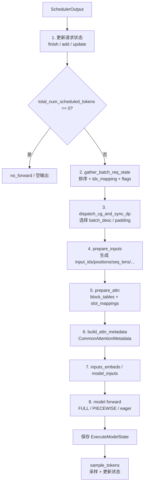

# 05 · Model Runner 输入准备

> 前置阅读：[03 · 调度器原理](./03-调度器原理.md)、[04 · KV Cache 与 PagedAttention](<./04-KV Cache 与 PagedAttention.md>)
> 对应源码：`vllm/v1/worker/gpu/model_runner.py`、`vllm/v1/worker/gpu/input_batch.py`、`vllm/v1/worker/gpu/states.py`、`vllm/v1/worker/gpu/buffer_utils.py`、`vllm/v1/worker/gpu/attn_utils.py`、`vllm/v1/worker/gpu/block_table.py`
> 适用版本：本仓库 commit `5082c45853`（2026-10-29）

---

## 1. 一句话概括

调度器给的是 **“这一步每个请求算几个 token”**，模型要的是 **一组扁平、连续、固定 shape 的 GPU 张量**。

Model Runner 输入准备做的事就是：

```text
SchedulerOutput
    │
    ├─ 更新每个请求的持久状态（token 序列、已算长度、block table）
    ├─ 把本步请求排序、编号、映射到固定 slot
    ├─ 用 Triton kernel 生成 input_ids / positions / seq_lens / query_start_loc / logits_indices
    ├─ 收集 block_table、计算 slot_mapping
    ├─ 构建 attention metadata
    └─ 组装 model_inputs，交给 model.forward()
```

核心目标有三个：

1. **扁平化**：把变长请求拼成 `[T]` 的一维 token 序列；
2. **去 Python 化**：关键路径尽量用 Triton kernel 在 GPU 上生成，避免逐 token Python 循环；
3. **固定 shape**：为 CUDA Graph 提供稳定的 batch 形状和缓冲区地址。

---

## 2. Why：CPU 的请求，GPU 的张量

### 2.1 两边看到的世界不一样

调度器看到的是：

```python
{
    "req-A": 6,   # 本步算 6 个 token
    "req-B": 1,   # 本步算 1 个 token
    "req-C": 4,   # 本步算 4 个 token（1 个 sampled + 3 个 draft）
}
```

模型看到的是：

```text
input_ids:       [t0, t1, t2, t3, t4, t5, t6, t7, t8, t9, t10]
positions:       [0, 1, 2, 3, 4, 5, 40, 41, 42, 43, 6]
query_start_loc: [0, 4, 5, 11]
seq_lens:        [44, 7, 6]
```

模型不知道“请求”是什么，它只知道：

- 这 11 个 token 是一个 batch；
- 第 0..3 个 token 属于请求 C；
- 第 4 个 token 属于请求 B；
- 第 5..10 个 token 属于请求 A；
- 每个 token 的绝对位置是多少；
- 每个请求的 KV 长度是多少；
- 哪些位置的 hidden state 需要拿去做采样。

输入准备就是这座“语义桥”。

### 2.2 为什么不能每一步都重新分配张量

如果每次 forward 都 `torch.zeros(...)`：

- 分配/释放开销大；
- 地址不稳定，CUDA Graph 无法复用；
- 碎片化；
- 无法和异步调度流水线配合。

所以 V2 Runner 使用 **持久缓冲区**：

```python
self.input_buffers = InputBuffers(
    max_num_reqs=self.max_num_reqs,
    max_num_tokens=self.max_num_tokens,
    device=self.device,
)
```

所有请求共用同一组 `[max_num_tokens]` 缓冲区，每步只覆盖前 `T` 个位置。

### 2.3 为什么需要 `idx_mapping`

请求在 `RequestState` 里有一个固定 slot：

```text
req_id -> req_state_idx
```

但 batch 里的顺序是每步动态排序的。于是需要一张映射：

```text
batch_idx -> req_state_idx
```

也就是 `idx_mapping`。

这样：

- GPU kernel 用 `idx_mapping[batch_idx]` 找到请求状态；
- 不需要在 GPU 上做字符串哈希；
- 请求完成时只释放 slot，不影响其他请求。

### 2.4 为什么需要 UVA 和 staged write

`RequestState` 里有一些“大而冷”的数据：

```text
all_token_ids: [max_num_reqs, max_model_len] int32
```

例如 `max_num_reqs=256`、`max_model_len=32768`：

```text
256 × 32768 × 4 字节 = 32 MiB
```

更大的配置可能到数 GB。这些数据不是每步都全量访问，放在 GPU 上很浪费。

vLLM 用 **UVA（Unified Virtual Address）**：

- CPU 侧 pinned memory 保存真实数据；
- GPU kernel 可以通过 UVA 地址直接读；
- 省下 GPU 显存，代价是访问走 PCIe/NVLink。

而元数据更新（`num_computed_tokens`、block table 行）用 **staged write**：

- 先在 CPU 侧收集所有要写的 `(row, start, values)`；
- 最后用一个 Triton kernel 一次性写到 GPU；
- 避免成百上千次小 H2D copy。

---

## 3. 两层状态：RequestState 与 InputBatch

### 3.1 持久状态：`RequestState`

定义在 `vllm/v1/worker/gpu/states.py:9`。

每个请求在 worker 侧有一个固定 slot，直到请求结束。

| 字段 | shape / 类型 | 设备 | 含义 |
|---|---|---|---|
| `req_id_to_index` | `dict[str, int]` | CPU | 请求 ID → slot |
| `index_to_req_id` | `dict[int, str]` | CPU | slot → 请求 ID |
| `free_indices` | `list[int]` | CPU | 空闲 slot 栈 |
| `all_token_ids` | `[max_num_reqs, max_model_len]` int32 | UVA 或 GPU | prompt + 已生成 token |
| `prompt_len` | `[max_num_reqs]` int32 | UVA | 用户 prompt 长度 |
| `prefill_len` | `[max_num_reqs]` int32 | UVA | 模型输入长度（可含重放输出） |
| `total_len` | `[max_num_reqs]` int32 | GPU | prompt + output 总长度 |
| `num_computed_tokens` | `[max_num_reqs]` int32 | GPU | GPU 侧已算 token 数 |
| `num_computed_tokens_np` | `[max_num_reqs]` int32 | CPU | 调度器视角的乐观镜像 |
| `num_computed_prefill_tokens` | `[max_num_reqs]` int32 | CPU | 已算的 prefill 部分 |
| `last_sampled_tokens` | `[max_num_reqs, 1]` int64 | GPU | 上一步采样出的 token |
| `max_seq_len` | `[max_num_reqs]` int32 | CPU | prompt + max_tokens |
| `draft_tokens` | `[max_num_reqs, K]` int64 | GPU | 投机 draft token |
| `next_prefill_tokens` | `[lookahead, max_num_reqs]` int32 | GPU | prefill 后面的 lookahead token |

#### `prompt_len` vs `prefill_len`

代码注释（`states.py:41`）专门区分了这两个：

```text
prompt_len  = 用户提供的 prompt token 数
prefill_len = 送进 model runner 的 token 数
```

大多数时候相等。但请求被抢占后重新准入时，会重放一部分已生成的 token，此时：

```text
prefill_len > prompt_len
```

为什么要区分？

- prompt logprobs 只关心用户 prompt；
- frequency penalty 等要区分 prompt 和 output；
- 前缀缓存重放时，重放的是 output token，不是 prompt。

#### `num_computed_tokens` 的两份拷贝

```python
self.num_computed_tokens = StagedWriteTensor(...)      # GPU
self.num_computed_tokens_np = np.zeros(...)            # CPU mirror
```

- **GPU 版本**：worker 在采样后通过 `post_update` 自己推进，用于 `positions` / `seq_lens` kernel；
- **CPU 版本**：`update_requests` 从 `SchedulerOutput` 写入，作为调度器视角的乐观上界，用于 `seq_lens_cpu_upper_bound` 等 CPU 侧判断。

两者在异步调度下可能短暂不一致，这是设计的一部分。

#### `all_token_ids` 为什么要 UVA

```python
self.all_token_ids = StagedWriteTensor(
    (self.max_num_reqs, self.max_model_len),
    dtype=torch.int32,
    device=device,
    uva_instead_of_gpu=not use_dense_all_token_ids,
)
```

默认 `uva_instead_of_gpu=True`，只有 n-gram 投机解码需要频繁扫描整张表时才放 GPU：

```python
use_dense_all_token_ids = (
    self.speculative_config is not None and self.speculative_config.use_ngram()
)
```

### 3.2 每步状态：`InputBatch`

定义在 `vllm/v1/worker/gpu/input_batch.py:43`。

它是“本步 batch 的完整描述”，生命周期只有一步。

| 字段 | shape / 类型 | 含义 |
|---|---|---|
| `req_ids` | `list[str]` | batch 顺序的请求 ID |
| `num_reqs` | `int` | 实际请求数 |
| `num_reqs_after_padding` | `int` | CUDA Graph 对齐后的请求数 |
| `idx_mapping` | `[num_reqs]` int64 | batch_idx → req_state_idx |
| `idx_mapping_np` | `[num_reqs]` np.intp | CPU 版本 |
| `expanded_idx_mapping` | `[total_num_logits]` int64 | logits 行 → req_state_idx |
| `expanded_local_pos` | `[total_num_logits]` int32 | logits 在本请求内的位置 |
| `num_scheduled_tokens` | `[num_reqs]` int32 | 每请求本步 token 数 |
| `num_tokens` | `int` | 实际扁平 token 数 `T` |
| `num_tokens_after_padding` | `int` | 对齐后的 `T_pad` |
| `num_draft_tokens` | `int` | draft token 总数 |
| `num_draft_tokens_per_req` | `[num_reqs]` int32 | 每请求 draft 数 |
| `query_start_loc` | `[num_reqs_pad+1]` int32 | 每请求 query 的起止 |
| `query_start_loc_np` | `[num_reqs_pad+1]` np.int32 | CPU 版本 |
| `seq_lens` | `[num_reqs_pad]` int32 | 每请求 KV 长度 |
| `seq_lens_cpu_upper_bound` | `[num_reqs_pad]` int32 | CPU 上界 |
| `dcp_local_seq_lens` | `[num_reqs_pad]` int32 | DCP 本地长度 |
| `num_computed_tokens_np` | `[num_reqs]` int32 | 本步开始时的已算长度 |
| `prefill_len_np` | `[num_reqs]` int32 | 每请求 prefill 长度 |
| `num_computed_prefill_tokens_np` | `[num_reqs]` int32 | 已算 prefill 部分 |
| `is_prefilling_np` | `[num_reqs]` bool | 是否还在 prefill |
| `has_prefill` | `bool` | batch 是否含 prefill |
| `decode_graph_eligible` | `bool` | 能否走 decode CUDA Graph |
| `input_ids` | `[T_pad]` int32 | 本步输入 token |
| `positions` | `[T_pad]` int64 | 每 token 绝对位置 |
| `is_padding` | `[T_pad]` bool | 是否是 padding token |
| `logits_indices` | `[total_num_logits]` int64 | 要采样哪些 hidden state |
| `cu_num_logits` | `[num_reqs_pad+1]` int32 | 每请求 logits 数前缀和 |
| `cu_num_logits_np` | `[num_reqs_pad+1]` np.int32 | CPU 版本 |
| `has_structured_output_reqs` | `bool` | 是否有结构化输出 |
| `prompt_lens` | `[num_reqs]` int32 | R-SWA 用 |
| `max_seq_len_np` | `[num_reqs]` int32 | PP 用 |
| `max_query_len` | `int \| None` | CUDA Graph 上界 |
| `fast_prefill` | `FastPrefillBatchMetadata` | KV-sharing fast prefill |
| `pcp` | `PCPBatchMetadata` | PCP 元数据 |
| `prefill_runs_as_decode_np` | `[num_reqs]` bool | 单 token prefill 当 decode 跑 |
| `num_admitted_draft_tokens` | `AdmittedDraftCounts` | 自适应投机 |

#### `InputBuffers` 是这些张量的底层存储

定义在 `input_batch.py:23`：

```python
self.input_ids = torch.zeros(max_num_tokens, dtype=torch.int32, device=device)
self.positions = torch.zeros(max_num_tokens, dtype=torch.int64, device=device)
self.is_padding = torch.zeros(max_num_tokens, dtype=torch.bool, device=device)
self.query_start_loc = torch.zeros(
    max_num_reqs + 1, dtype=torch.int32, device=device
)
self.seq_lens = torch.zeros(max_num_reqs, dtype=torch.int32, device=device)
self.dcp_local_seq_lens = torch.zeros(
    max_num_reqs, dtype=torch.int32, device=device
)
```

`InputBatch` 里的 `input_ids` / `positions` / `is_padding` 只是这些 buffer 的切片，不是新分配的张量。

---

## 4. 全景：`execute_model` 的八个阶段

入口：`vllm/v1/worker/gpu/model_runner.py:1794`。



### 4.1 阶段 1：更新请求状态

`execute_model` 开头：

```python
self.update_pp_decode_requests()
self.finish_requests(scheduler_output)
self.free_states(scheduler_output)
self.add_requests(scheduler_output)
self.update_requests(scheduler_output)
```

| 步骤 | 作用 |
|---|---|
| `update_pp_decode_requests` | PP 非最后 rank 接收上一轮采样结果 |
| `finish_requests` | 释放已完成/被抢占请求的 slot 和缓存 |
| `free_states` | 释放 encoder cache |
| `add_requests` | 新请求（V2 也包含 resume）注册到 `RequestState` |
| `update_requests` | 已有请求追加 block、更新 CPU 镜像、zeroing、CoW |

### 4.2 阶段 2：`gather_batch_req_state`

纯 CPU 阶段。它把 `SchedulerOutput` 的 dict 变成按 batch 顺序排列的 numpy 数组。

### 4.3 阶段 3：选择 batch descriptor

`dispatch_cg_and_sync_dp` 决定：

- 用 FULL / PIECEWISE / eager；
- padding 到多少 token；
- 是否 padding 请求数；
- DP 各 rank 是否一致。

### 4.4 阶段 4：`prepare_inputs`

生成 `InputBatch`。核心是三个 Triton kernel：

1. `prepare_prefill_inputs`：填 prefill 的 `input_ids`；
2. `prepare_pos_seq_lens`：填 `positions` 和 `seq_lens`；
3. `combine_sampled_and_draft_tokens`：填 decode 的 `input_ids` 和 `logits_indices`。

### 4.5 阶段 5：`prepare_attn`

```python
block_tables = self.block_tables.gather_block_tables(...)
slot_mappings = self.block_tables.compute_slot_mappings(...)
```

### 4.6 阶段 6：构建 attention metadata

`model_state.prepare_attn` → `build_attn_metadata` → 每个 backend 的 `build()`。

### 4.7 阶段 7：准备 model inputs

```python
model_inputs = {
    "input_ids": input_ids,
    "positions": input_batch.positions,
    "inputs_embeds": inputs_embeds,
    "intermediate_tensors": None,
    **self.model_state.prepare_inputs(input_batch, self.req_states),
}
```

### 4.8 阶段 8：forward 并保存状态

- FULL：`cudagraph_manager.run_fullgraph(batch_desc)`；
- PIECEWISE：`run_pw_graph(self.model, model_inputs)`；
- eager：`self.model(**model_inputs)`。

最后保存 `ExecuteModelState`，供 `sample_tokens` 使用。

---

## 5. 阶段 1 细节：请求状态更新

### 5.1 `add_requests`

`model_runner.py:1249`。

对每个 `scheduled_new_reqs`：

```python
self.req_states.add_request(
    req_id=req_id,
    prompt_len=prompt_len,
    all_token_ids=new_req_data.prefill_token_ids,
    num_computed_tokens=new_req_data.num_computed_tokens,
    max_tokens=...,
)
req_index = self.req_states.req_id_to_index[req_id]
...
self.model_state.add_request(req_index, new_req_data)
self.block_tables.append_block_ids(
    req_index, new_req_data.block_ids, overwrite=True
)
```

关键点：

| 步骤 | 说明 |
|---|---|
| 分配 slot | `free_indices.pop()`，LIFO 复用 |
| 写入 token 序列 | `all_token_ids` 整行 staged write |
| 记录长度 | `prompt_len`、`prefill_len`、`total_len` |
| 记录已算长度 | `num_computed_tokens` |
| RoPE 初始化 | `model_state.add_request` 初始化 M-RoPE 位置 |
| block table | `overwrite=True`，整行重置 |
| sampler | 注册采样参数 |

V2 Runner 里 **resume 请求也走 `scheduled_new_reqs`**：

```python
if self.use_v2_model_runner:
    scheduled_new_reqs.extend(scheduled_resumed_reqs)
```

所以被抢占后重新准入的请求会重新 `append_block_ids(overwrite=True)`，整行 block table 被替换成新的分配结果。

### 5.2 `update_requests`

`model_runner.py:1304`。

对每个 `scheduled_cached_reqs`：

```python
num_computed_tokens_np[req_index] = num_computed_tokens
if req_new_block_ids is not None:
    self.block_tables.append_block_ids(
        req_index, req_new_block_ids, overwrite=False
    )
```

然后：

```python
np.minimum(
    self.req_states.num_computed_tokens_np,
    self.req_states.prefill_len.np,
    out=self.req_states.num_computed_prefill_tokens,
)
```

即：

```text
已算 prefill 部分 = min(已算总长度, prefill 长度)
```

接着处理：

```python
if scheduler_output.new_block_ids_to_zero:
    self.kv_block_zeroer.zero_block_ids(...)

if scheduler_output.kv_cache_block_copies:
    copy_kv_cache_blocks_inplace(...)
```

顺序很重要：

1. 先追加 block id；
2. 再 zeroing 新块；
3. 再 CoW 拷贝；
4. 最后 forward。

### 5.3 为什么 `add_requests` 后要 `apply_staged_writes`

```python
if scheduler_output.scheduled_new_reqs:
    self.req_states.apply_staged_writes()
    self.model_state.apply_staged_writes()
    if self.sampler is not None:
        self.sampler.apply_staged_writes()
```

`add_request` 只是把写操作暂存到 CPU 列表：

```python
self.all_token_ids.stage_write(req_idx, 0, all_token_ids)
self.num_computed_tokens.stage_write_elem(req_idx, num_computed_tokens)
```

`apply_staged_writes` 才真正用 Triton kernel 写到 GPU。

为什么不在每个 `add_request` 里直接写？

- 一个 step 可能准入几十个请求；
- 每个请求有 token ids、长度、block table 多处写；
- 逐次 H2D copy 会有大量小传输和同步开销；
- 批量 staged write 可以合并成一次 kernel。

---

## 6. 阶段 2 细节：`gather_batch_req_state`

`model_runner.py:1340`。

### 6.1 先排序

```python
req_ids = sort_batch_req_ids(
    num_tokens_per_req, draft_tokens, self.decode_query_len
)
```

`sort_batch_req_ids`（`model_runner.py:2538`）：

```python
key = lambda r: (
    not draft_tokens.get(r),
    (num := num_tokens_per_req[r]) != decode_query_len,
    num,
)
return sorted(num_tokens_per_req, key=key)
```

排序优先级：

1. **有 draft token 的请求** 最前；
2. **长度为 `decode_query_len` 的请求** 其次；
3. 其余按 token 数升序。

`decode_query_len = num_speculative_steps + num_new_sampled_tokens_per_step`，通常就是 `K + 1`。

为什么 decode 要排前面？

- 一些 attention backend 的 `split_decodes_and_prefills` 假定 decode-like 请求在前；
- CUDA Graph 的 uniform decode 判断依赖前几行形状一致；
- 把短的 decode 放前面，prefill 放后面，方便 kernel 分段。

### 6.2 构建 `idx_mapping`

```python
idx_mapping_iter = map(self.req_states.req_id_to_index.__getitem__, req_ids)
idx_mapping_np = np.fromiter(idx_mapping_iter, dtype=np.intp, count=num_reqs)
```

```text
batch_idx:      0    1    2
req_ids:       C    B    A
idx_mapping:   2    5    7   # 对应 RequestState 的 slot
```

### 6.3 计算 prefill 标志

```python
prefill_len_np = self.req_states.prefill_len.np[idx_mapping_np]
num_computed_prefill_tokens_np = self.req_states.num_computed_prefill_tokens[
    idx_mapping_np
]
is_prefilling_np = num_computed_prefill_tokens_np < prefill_len_np
has_prefill = bool(is_prefilling_np.any())
```

含义：

```text
is_prefilling = 已算 prefill 部分 < prefill 总长度
```

注意：**最后一个 prefill chunk 仍然算 `is_prefilling=True`**，因为这一步开始时还没算完。只有下一步才会变成 decode。

### 6.4 `decode_graph_eligible`

```python
decode_graph_eligible = not has_prefill
```

如果 batch 有 prefill，再看是否有“单 token extend”：

```python
one_token_ext = (num_new_tokens == 1) & (num_computed_prefill_tokens_np > 0)
prefill_runs_as_decode_np = is_prefilling_np & one_token_ext
decode_graph_eligible = bool(
    (prefill_runs_as_decode_np | ~is_prefilling_np).all()
)
```

含义：

- 正常情况下，有 prefill 就不能走 decode CUDA Graph；
- 但“已有上下文、只再算 1 个 prompt token”的请求，计算形态和 decode 一样，可以走 decode 路径。

这是 chunked prefill 尾部和投机解码常见的优化。

### 6.5 返回 `BatchReqState`

```python
batch_state = BatchReqState(
    req_ids=req_ids,
    num_scheduled_tokens=num_scheduled_tokens,
    num_tokens=num_toks,
    ...
)
```

`BatchReqState` 是纯 CPU 的中间结构，定义在 `model_runner.py:2519`。

---

## 7. 阶段 3 细节：batch descriptor 与 padding

### 7.1 `BatchExecutionDescriptor`

定义在 `vllm/v1/worker/gpu/cudagraph_utils.py:71`：

```python
@dataclass
class BatchExecutionDescriptor:
    cg_mode: CUDAGraphMode
    num_tokens: int
    num_reqs: int | None
    uniform_token_count: int | None = None
    max_query_len: int | None = None
    num_active_loras: int = 0
    num_ubatches: int = 1
```

| 字段 | 含义 |
|---|---|
| `cg_mode` | FULL / PIECEWISE / NONE |
| `num_tokens` | 本次运行的 token 数（可能大于实际） |
| `num_reqs` | padding 后的请求数；`None` 表示 PIECEWISE 不 padding 请求 |
| `uniform_token_count` | 是否 uniform decode，及每请求 token 数 |
| `max_query_len` | varlen decode graph 的 query 长度上界 |
| `num_active_loras` | 活跃 LoRA 数 |
| `num_ubatches` | DBO 微批数 |

### 7.2 为什么要 padding

CUDA Graph 在捕获时固定了：

- 输入张量地址；
- batch 形状；
- kernel launch 参数。

运行时如果 `T=11`，但 graph 只捕获了 `T=16`，就必须把输入填到 16：

```text
actual:  [0..10] 11 tokens
padded:  [0..10][11..15] 16 tokens
```

padding 的位置：

- `input_ids`：填 0 或旧值；
- `positions`：填 0 或旧值；
- `seq_lens`：填 0；
- `query_start_loc`：pad 到 `num_tokens`，使 padding 请求 query 长度为 0；
- `block_table`：padding 行清零；
- `slot_mapping`：填 `PAD_SLOT_ID = -1`；
- `is_padding`：标 True。

### 7.3 `num_tokens_after_padding`

```python
num_tokens_after_padding = max(num_tokens, batch_desc.num_tokens)
```

如果 descriptor 选的 bucket 比实际大，就需要 padding。

### 7.4 为什么 PIECEWISE 不需要请求 padding

`BatchExecutionDescriptor.num_reqs=None` 表示：

- PIECEWISE graph 捕获的是“每段计算图”，不是整个 batch；
- 请求数可以动态变化；
- 只需要 token 数在支持范围内。

FULL graph 则需要固定的 `num_reqs` 和 `num_tokens`。

---

## 8. 阶段 4 细节：`prepare_inputs`

`model_runner.py:1422`。

这是整篇文档的核心。

### 8.1 输入

| 输入 | 来源 |
|---|---|
| `scheduler_output` | 调度器 |
| `batch_req_state` | 上一步 CPU 排序结果 |
| `batch_desc` | CUDA Graph 选择结果 |
| `num_active_loras` | LoRA 统计 |

### 8.2 输出

一个 `InputBatch`，包含本步所有 GPU 张量和 CPU 元数据。

### 8.3 第一步：`idx_mapping` 上 GPU

```python
idx_mapping = async_tensor_h2d(
    idx_mapping_np, device=self.device, dtype=torch.int64
)
```

`async_tensor_h2d` 是异步 H2D copy，不阻塞 CPU。

### 8.4 第二步：计算 `cu_num_logits`

#### 常见情况：无 draft，每请求 1 个 logits

```python
if not draft_tokens and self.model_state.num_new_sampled_tokens_per_step == 1:
    total_num_draft_tokens = 0
    total_num_logits = num_reqs
    cu_num_logits_np = np.arange(num_reqs + 1, dtype=np.int32)
    cu_num_logits = torch.arange(
        num_reqs + 1, device=self.device, dtype=torch.int32
    )
    expanded_idx_mapping = idx_mapping
    expanded_local_pos = torch.zeros(
        num_reqs, dtype=torch.int32, device=self.device
    )
```

```text
cu_num_logits = [0, 1, 2, 3, ..., num_reqs]
```

每个请求 1 个 logits，位置是该请求 query 的最后一个 token。

#### 一般情况：有 draft

```python
num_draft_tokens_per_req = batch_req_state.num_draft_tokens_np
num_bonus_tokens = self.model_state.num_new_sampled_tokens_per_step
total_num_draft_tokens = int(num_draft_tokens_per_req.sum())
total_num_logits = num_reqs * num_bonus_tokens + total_num_draft_tokens
num_logits = num_draft_tokens_per_req + num_bonus_tokens
cu_num_logits_np = np.empty(num_reqs + 1, dtype=np.int32)
cu_num_logits_np[0] = 0
np.cumsum(num_logits, out=cu_num_logits_np[1:])
```

每个请求的 logits 数：

```text
num_logits_i = num_draft_tokens_i + num_bonus_tokens
```

为什么是 `draft + bonus`？

- 每个 draft token 都要验证；
- 如果全部接受，还要额外采样一个 bonus token；
- 所以 query 里最后 `draft + bonus` 个位置的 hidden state 都要拿去做 logits。

例如 3 个 draft、1 个 bonus：

```text
num_logits = 4
logits 行 = [last_sampled, draft0, draft1, draft2]
```

#### `expanded_idx_mapping`

有 draft 时：

```python
expanded_idx_mapping, expanded_local_pos = expand_idx_mapping(
    idx_mapping, total_num_logits, cu_num_logits, self.decode_query_len
)
```

作用：

```text
logits 行号 -> req_state_idx
logits 行号 -> 本请求内的第几个 logit
```

采样器用这两张表把 `[total_num_logits, V]` 的 logits 结果映射回请求。

### 8.5 第三步：计算 `query_start_loc`

```python
query_start_loc_np = np.empty(self.max_num_reqs + 1, dtype=np.int32)
query_start_loc_np[0] = 0
np.cumsum(num_scheduled_tokens_np, out=query_start_loc_np[1 : num_reqs + 1])
query_start_loc_np[num_reqs + 1 :] = num_tokens
query_start_loc = self.input_buffers.query_start_loc
async_tensor_h2d(query_start_loc_np, out=query_start_loc)
```

#### 正常情况

```text
num_scheduled_tokens = [4, 1, 6]
query_start_loc      = [0, 4, 5, 11]
```

第 `i` 个请求的 token 在扁平数组里的范围：

```text
[query_start_loc[i], query_start_loc[i+1])
```

#### padding 情况

```text
num_reqs = 3
num_reqs_padded = 4
query_start_loc_np = [0, 4, 5, 11, 11, ...]
```

第 4 行（padding 请求）的长度是 `11 - 11 = 0`。

`query_start_loc_np[num_reqs+1:] = num_tokens` 还有一个作用：保证 `query_start_loc` 单调不降，满足 FA3 等 backend 的要求。

### 8.6 第四步：填 prefill 的 `input_ids`

```python
if batch_req_state.has_prefill:
    prepare_prefill_inputs(
        self.input_buffers.input_ids,
        self.req_states.next_prefill_tokens,
        idx_mapping,
        query_start_loc,
        self.req_states.all_token_ids.gpu,
        self.req_states.prefill_len.gpu,
        self.req_states.num_computed_tokens.gpu,
    )
```

`input_batch.py:329` 的 kernel：

```python
req_state_idx = tl.load(idx_mapping_ptr + batch_idx)
prefill_len = tl.load(prefill_lens_ptr + req_state_idx)
num_computed = tl.load(num_computed_tokens_ptr + req_state_idx)
if num_computed >= prefill_len:
    return

query_start = tl.load(query_start_loc_ptr + batch_idx)
query_end = tl.load(query_start_loc_ptr + batch_idx + 1)
query_len = query_end - query_start

request_ptr = all_token_ids_ptr + req_state_idx * all_token_ids_stride
for i in range(0, query_len, BLOCK_SIZE):
    tokens = tl.load(request_ptr + num_computed + block, ...)
    tl.store(input_ids_ptr + query_start + block, tokens, ...)
```

公式：

```text
input_ids[query_start + j] = all_token_ids[req_state_idx, num_computed + j]
```

也就是说：prefill chunk 从全局 token 序列的 `num_computed` 位置开始拷贝。

#### 为什么只处理 prefill

decode 的 `input_ids` 不是从 `all_token_ids` 拷贝的，而是由 `last_sampled_tokens` 和 `draft_tokens` 组成。下一个 kernel 处理。

#### `next_prefill_tokens`

kernel 还顺便把 prefill 后面的 lookahead token 写到 `next_prefill_tokens`：

```python
pos = num_computed + query_len + lookahead
tokens = tl.load(request_ptr + pos, ...)
tl.store(next_prefill_tokens_ptr + ..., tokens, ...)
```

这是给多模块 MTP / 投机解码 prefill 用的，不是主链路必需。

### 8.7 第五步：填 `positions` 和 `seq_lens`

```python
prepare_pos_seq_lens(
    idx_mapping,
    query_start_loc,
    self.req_states.num_computed_tokens.gpu,
    self.input_buffers.positions,
    self.input_buffers.seq_lens,
)
```

`input_batch.py:393` 的 kernel：

```python
req_state_idx = tl.load(idx_mapping_ptr + req_id)
num_computed_tokens = tl.load(num_computed_tokens_ptr + req_state_idx)

start = tl.load(query_start_loc_ptr + req_id)
end = tl.load(query_start_loc_ptr + req_id + 1)
query_len = end - start

seq_len = num_computed_tokens + query_len
tl.store(seq_lens_ptr + req_id, seq_len)

for i in range(0, query_len, BLOCK_SIZE):
    pos = num_computed_tokens + block
    tl.store(pos_ptr + start + block, pos, ...)
```

公式：

```text
positions[query_start + j] = num_computed + j
seq_lens[req]              = num_computed + query_len
```

#### 例子

请求 A：`num_computed=0`，本步 6 个 token：

```text
positions: [0, 1, 2, 3, 4, 5]
seq_len:   6
```

请求 B：`num_computed=6`，本步 1 个 token：

```text
positions: [6]
seq_len:   7
```

请求 C：`num_computed=40`，本步 4 个 token：

```text
positions: [40, 41, 42, 43]
seq_len:   44
```

#### 最后一个 program 的作用

kernel 启动 `num_reqs + 1` 个 program：

```python
if req_id == num_reqs:
    for i in range(num_reqs, max_num_reqs, BLOCK_SIZE):
        tl.store(seq_lens_ptr + block, 0, mask=...)
    return
```

它把 padding 的 `seq_lens` 清零，避免 FULL CUDA Graph 读到上一步的旧长度。

### 8.8 第六步：填 decode 的 `input_ids` 和 `logits_indices`

```python
logits_indices = combine_sampled_and_draft_tokens(
    self.input_buffers.input_ids,
    idx_mapping,
    self.req_states.last_sampled_tokens,
    query_start_loc,
    seq_lens,
    self.req_states.prefill_len.gpu,
    self.req_states.draft_tokens,
    cu_num_logits,
    total_num_logits,
    self.model_state.num_new_sampled_tokens_per_step,
)
```

`input_batch.py:475` 的 kernel：

```python
cu_num_logits_start = tl.load(cu_num_logits_ptr + batch_idx)
cu_num_logits_end = tl.load(cu_num_logits_ptr + batch_idx + 1)
num_logits = cu_num_logits_end - cu_num_logits_start
num_draft_tokens = num_logits - NUM_NEW_SAMPLED_TOKENS

query_end = tl.load(query_start_loc_ptr + batch_idx + 1)
logits_start = query_end - num_logits
tl.store(
    logits_indices_ptr + cu_num_logits_start + block,
    logits_start + block,
    mask=block < num_logits,
)

seq_len = tl.load(seq_lens_ptr + batch_idx)
prefill_len = tl.load(prefill_len_ptr + req_state_idx)
if seq_len <= prefill_len:
    return
...
if NUM_NEW_SAMPLED_TOKENS > 0 and first_logit_seq_pos >= prefill_len:
    tl.store(input_ids_ptr + logits_start, last_token_id)

if num_draft_tokens > 0:
    tl.store(input_ids_ptr + query_end - num_draft_tokens + block, draft_tokens, ...)
```

#### 逻辑拆解

1. **算 logits 位置**

```text
logits_start = query_end - num_logits
logits_indices[cu_start + k] = logits_start + k
```

也就是每个请求 query 的 **最后 `num_logits` 个位置**。

2. **prefill 直接返回**

```python
if seq_len <= prefill_len:
    return
```

prefill 的 `input_ids` 已经由上一个 kernel 填好，不需要 last sampled / draft。

3. **decode 写入 last sampled token**

```python
input_ids[logits_start] = last_sampled_tokens[req_state_idx]
```

4. **写入 draft tokens**

```python
input_ids[query_end - num_draft_tokens + k] = draft_tokens[req_state_idx, k]
```

#### 为什么 decode 不读 `all_token_ids`

因为：

- `all_token_ids` 是 UVA 上的大表，逐 token 读慢；
- decode 每步只需要 1 个 last token + K 个 draft；
- `last_sampled_tokens` 和 `draft_tokens` 是紧凑的 GPU 张量，读起来快。

#### 例子

请求 B：decode 1 token，`last_sampled=123`：

```text
query_start=4, query_end=5, num_logits=1
logits_start=4
logits_indices=[4]
input_ids[4]=123
```

请求 C：3 draft，`last_sampled=200`，drafts=[201,202,203]：

```text
query_start=0, query_end=4, num_logits=4
logits_start=0
logits_indices=[0,1,2,3]
input_ids[0]=200
input_ids[1..3]=[201,202,203]
```

### 8.9 第七步：`seq_lens_cpu_upper_bound`

```python
num_computed_tokens_np = self.req_states.num_computed_tokens_np[idx_mapping_np]
seq_lens_cpu_upper_bound_np = np.zeros(num_reqs_padded, dtype=np.int32)
np.add(
    num_computed_tokens_np,
    num_scheduled_tokens_upper_bound,
    out=seq_lens_cpu_upper_bound_np[:num_reqs],
)
seq_lens_cpu_upper_bound = torch.from_numpy(seq_lens_cpu_upper_bound_np)
```

公式：

```text
seq_lens_cpu_upper_bound[i] = num_computed_tokens_np[i] + num_scheduled_tokens_upper_bound[i]
```

为什么叫 upper bound？

- 用的是 CPU 镜像（调度器视角），可能比 GPU 实际值大；
- 自适应投机解码可能减少实际 token 数；
- 一些 backend 需要 CPU 侧的长度做调度/分块，只能用上界保证安全。

### 8.10 第八步：构造 `InputBatch`

把所有张量和元数据打包：

```python
input_batch = InputBatch(
    req_ids=req_ids,
    num_reqs=num_reqs,
    num_reqs_after_padding=num_reqs_padded,
    idx_mapping=idx_mapping,
    ...
    input_ids=self.input_buffers.input_ids[:num_tokens_after_padding],
    positions=self.input_buffers.positions[:num_tokens_after_padding],
    is_padding=is_padding,
    logits_indices=logits_indices,
    cu_num_logits=cu_num_logits,
    ...
)
```

注意 `input_ids` / `positions` 是 `[:num_tokens_after_padding]` 的切片，长度可能大于实际 `num_tokens`。

---

## 9. 阶段 5 细节：`prepare_attn`

`model_runner.py:1629`：

```python
block_tables = self.block_tables.gather_block_tables(
    input_batch.idx_mapping,
    num_reqs_padded=input_batch.num_reqs_after_padding,
    num_computed_tokens=self.req_states.num_computed_tokens.gpu,
)
slot_mappings = self.block_tables.compute_slot_mappings(
    input_batch.idx_mapping,
    input_batch.query_start_loc,
    input_batch.positions,
    num_tokens_padded=input_batch.num_tokens_after_padding,
)
```

### 9.1 `gather_block_tables`

把 `RequestState` 的整行 block table 按 batch 顺序 gather 到 `input_block_tables`：

```text
src: block_tables[group][req_state_idx, :]
dst: input_block_tables[group][batch_idx, :]
```

padding 行清零。

滑动窗口 group 会用 `num_computed_tokens` 把窗口之前的项置为 null block。详见 04 第 7.3 节。

### 9.2 `compute_slot_mappings`

公式（04 第 7.4 节）：

```text
slot = block_table[req, position // block_size] * block_size + position % block_size
```

padding / dummy / 非本 rank 的 CP token 写 `PAD_SLOT_ID = -1`。

返回形状：

```text
[num_kv_cache_groups, num_tokens_padded]
```

### 9.3 为什么先 `prepare_attn` 再 `build_attn_metadata`

因为 attention metadata 需要：

- `block_table`；
- `slot_mapping`；
- `seq_lens`；
- `query_start_loc`。

这些都在 `InputBatch` + `prepare_attn` 之后才齐。

---

## 10. 阶段 6 细节：构建 attention metadata

入口：`model_state.prepare_attn`（`model_states/default.py:167`）。

### 10.1 选择 padded 还是 unpadded 尺寸

```python
if cudagraph_mode == CUDAGraphMode.FULL:
    num_reqs = input_batch.num_reqs_after_padding
    num_tokens = input_batch.num_tokens_after_padding
else:
    num_reqs = input_batch.num_reqs
    num_tokens = input_batch.num_tokens
```

FULL graph 必须用捕获时的 padded 尺寸；eager/piecewise 用实际尺寸。

### 10.2 `max_seq_len`

```python
if for_capture:
    max_seq_len = self.max_model_len
else:
    max_seq_len = seq_lens_cpu_upper_bound[:num_reqs].max().item()
```

捕获时用 `max_model_len`，保证 graph 在任何 replay 下都有效。

### 10.3 `build_attn_metadata`

`attn_utils.py:458`：

```python
for i in range(num_kv_cache_groups):
    block_table = block_tables[i]
    slot_mapping = slot_mappings[i]

    common_attn_metadata = CommonAttentionMetadata(
        query_start_loc=query_start_loc_gpu,
        query_start_loc_cpu=query_start_loc_cpu,
        seq_lens=seq_lens,
        seq_lens_cpu_upper_bound=seq_lens_cpu_upper_bound,
        max_seq_len=max_seq_len,
        num_reqs=num_reqs,
        num_actual_tokens=num_tokens,
        max_query_len=max_query_len,
        block_table_tensor=block_table,
        slot_mapping=slot_mapping,
        causal=group_causal,
        positions=positions,
        is_prefilling=group_is_prefilling,
        ...
    )

    for attn_group in attn_groups[i]:
        metadata = attn_group.build_metadata(common_attn_metadata, ...)
        for layer_name in attn_group.layer_names:
            attn_metadata[layer_name] = metadata
```

### 10.4 `CommonAttentionMetadata`

定义在 `vllm/v1/attention/backend.py:395`。

| 字段 | shape | 含义 |
|---|---|---|
| `query_start_loc` | `[num_reqs+1]` int32 | query 起止（GPU） |
| `query_start_loc_cpu` | `[num_reqs+1]` int32 | query 起止（CPU） |
| `seq_lens` | `[num_reqs]` int32 | KV 长度 |
| `seq_lens_cpu_upper_bound` | `[num_reqs]` int32 | CPU 上界 |
| `num_reqs` | `int` | 请求数 |
| `num_actual_tokens` | `int` | 实际 token 数 |
| `max_query_len` | `int` | 最长 query |
| `max_seq_len` | `int` | 最长 KV |
| `block_table_tensor` | `[num_reqs, max_blocks]` int32 | block table |
| `slot_mapping` | `[T]` int64 | slot mapping |
| `causal` | `bool` / tensor | 是否 causal |
| `positions` | `[T]` int64 | 位置 |
| `is_prefilling` | `[num_reqs]` bool | 是否 prefill |

### 10.5 backend 的 `build`

以 FlashAttention 为例（`flash_attn.py:814`）：

```python
def build(self, common_prefix_len, common_attn_metadata, fast_build=False):
    ...
    query_start_loc = common_attn_metadata.query_start_loc
    seq_lens = common_attn_metadata.seq_lens
    block_table_tensor = common_attn_metadata.block_table_tensor
    slot_mapping = common_attn_metadata.slot_mapping
    ...
    return FlashAttentionMetadata(
        seq_lens=seq_lens,
        block_table=block_table_tensor,
        slot_mapping=slot_mapping,
        ...
    )
```

不同 backend 会在这里：

- 计算 scheduler metadata（AOT schedule）；
- 设置 sliding window；
- 拆分 decode / prefill；
- 准备 DCP 本地长度；
- 准备 sparse attention 元数据。

### 10.6 `slot_mappings_by_layer`

```python
slot_mappings_by_layer = build_slot_mappings_by_layer(
    slot_mappings, self.kv_cache_config
)
```

它把 `[num_groups, T]` 展开成：

```python
{
    "model.layers.0.self_attn": slot_mappings[0],
    "model.layers.1.self_attn": slot_mappings[0],
    ...
    "model.layers.32.mamba": slot_mappings[1],
}
```

attention 层通过 forward context 拿到自己 group 的 slot mapping，不需要从 `model_inputs` 逐层传参。

---

## 11. 阶段 7 细节：`inputs_embeds` 与 `model_inputs`

### 11.1 什么时候需要 `inputs_embeds`

如果模型使用多模态输入或 prompt embeds：

```python
self.uses_inputs_embeds = (
    self.supports_mm_inputs or self.model_config.enable_prompt_embeds
)
```

`prepare_inputs_embeds`（`model_states/default.py:98`）：

1. 执行多模态 encoder；
2. 收集 image/audio embeddings；
3. 与 text token embeddings 合并；
4. 叠加 prompt embeds。

如果模型不需要 raw input ids：

```python
if inputs_embeds is not None and not requires_raw_input_tokens(self.model):
    input_ids = None
```

### 11.2 `model_inputs`

```python
model_inputs = {
    "input_ids": input_ids,
    "positions": input_batch.positions,
    "inputs_embeds": inputs_embeds,
    "intermediate_tensors": None,
    **self.model_state.prepare_inputs(input_batch, self.req_states),
}
```

`model_state.prepare_inputs` 可能覆盖 `positions`：

- 普通 1D RoPE：返回空 dict，用 `input_batch.positions`；
- M-RoPE（多模态）：`rope_state.prepare_positions` 重新计算多维位置。

### 11.3 PP 非首 rank

```python
if not self.is_first_pp_rank:
    if not requires_raw_input_tokens(self.model):
        model_inputs["input_ids"] = None
    model_inputs["inputs_embeds"] = None
    model_inputs["intermediate_tensors"] = IntermediateTensors(new_tensors)
```

非首 rank 不重新算 embedding，只接收上一 stage 的 intermediate tensors。

### 11.4 LoRA

```python
lora_inputs = self.lora_state.make_lora_inputs(
    input_batch.req_ids,
    input_batch.idx_mapping_np,
    input_batch.num_scheduled_tokens,
    np.diff(input_batch.cu_num_logits_np),
)
self._set_active_loras(*lora_inputs)
```

LoRA 需要知道：

- 本 batch 有哪些 LoRA；
- 每个请求用哪个；
- 每个请求的 token 范围；
- 每个请求的 logits 行数。

---

## 12. 阶段 8 细节：forward 与 `ExecuteModelState`

### 12.1 三种执行模式

```python
if batch_desc.cg_mode == CUDAGraphMode.FULL:
    self.kv_connector.pre_forward(...)
    model_output = self.cudagraph_manager.run_fullgraph(batch_desc)
else:
    with set_forward_context(...):
        self.kv_connector.pre_forward(...)
        if ubatch_state is not None:
            model_output = self.ubatch_runner.run(...)
        elif batch_desc.cg_mode == CUDAGraphMode.PIECEWISE:
            model_output = self.cudagraph_manager.run_pw_graph(self.model, model_inputs)
        else:
            model_output = self.model(**model_inputs)
```

| 模式 | 输入来源 | 特点 |
|---|---|---|
| FULL | 静态输入 buffer | 整个 batch 一次 replay |
| PIECEWISE | `model_inputs` | 按编译段 replay |
| eager | `model_inputs` | 直接调用 model |

### 12.2 保存 `ExecuteModelState`

```python
self.execute_model_state = ExecuteModelState(
    input_batch=input_batch,
    attn_metadata=attn_metadata,
    slot_mappings_by_layer=slot_mappings_by_layer,
    hidden_states=hidden_states,
    aux_hidden_states=aux_hidden_states,
    dp_sync_state=dp_sync_state,
    finished_req_ids=finished_req_ids,
    ...
)
```

为什么要存？

因为 `execute_model` 和 `sample_tokens` 是分开的：

```text
execute_model: 准备输入 → forward → 得到 hidden_states
sample_tokens: hidden_states → logits → 采样 → 更新状态
```

中间可能插入其他 rank 的通信、PP 同步、grammar bitmask 等。

### 12.3 `sample_tokens` 用哪些输入

```python
sampler_output, num_sampled, num_rejected = self.sample(
    hidden_states, input_batch, grammar_output
)
```

`self.sample` 会用：

- `input_batch.logits_indices` 选 hidden states；
- `input_batch.cu_num_logits` 分请求；
- `input_batch.expanded_idx_mapping` 映射回请求；
- `input_batch.num_draft_tokens` 决定验证逻辑。

---

## 13. 完整例子

假设本步有三个请求：

| 请求 | 类型 | prompt | 已生成 | `num_computed` | 本步 token |
|---|---|---|---|---|---|
| A | prefill（最后一块） | 6 | 0 | 0 | 6 |
| B | decode | 5 | 2 | 6 | 1 |
| C | 投机 decode | 30 | 10 | 40 | 1 + 3 draft = 4 |

`scheduler_output.num_scheduled_tokens`：

```python
{"A": 6, "B": 1, "C": 4}
```

`total_num_scheduled_tokens = 11`。

### 13.1 排序

`sort_batch_req_ids`：

```text
C 有 draft        → 第一优先级
B 长度 == 1       → 第二优先级
A 长度 6          → 最后
```

结果：

```python
req_ids = ["C", "B", "A"]
num_scheduled_tokens = [4, 1, 6]
```

### 13.2 `idx_mapping`

假设 RequestState 分配：

```text
C -> slot 2
B -> slot 5
A -> slot 7
```

```python
idx_mapping = [2, 5, 7]
```

### 13.3 `query_start_loc`

```text
query_start_loc = [0, 4, 5, 11]
```

### 13.4 `positions` / `seq_lens`

| 请求 | `num_computed` | query len | positions | seq_len |
|---|---|---|---|---|
| C | 40 | 4 | 40,41,42,43 | 44 |
| B | 6 | 1 | 6 | 7 |
| A | 0 | 6 | 0,1,2,3,4,5 | 6 |

扁平静态：

```text
positions = [40, 41, 42, 43, 6, 0, 1, 2, 3, 4, 5]
seq_lens  = [44, 7, 6]
```

### 13.5 `input_ids`

C（decode + draft）：

```text
last_sampled = 200
draft_tokens = [201, 202, 203]
input_ids[0..3] = [200, 201, 202, 203]
```

B（普通 decode）：

```text
last_sampled = 123
input_ids[4] = 123
```

A（prefill）：

```text
all_token_ids[A, 0:6] = [10, 11, 12, 13, 14, 15]
input_ids[5..10] = [10, 11, 12, 13, 14, 15]
```

最终：

```text
input_ids = [200, 201, 202, 203, 123, 10, 11, 12, 13, 14, 15]
```

### 13.6 `cu_num_logits` 与 `logits_indices`

无自适应投机时：

```text
num_logits = [4, 1, 1]
cu_num_logits = [0, 4, 5, 6]
total_num_logits = 6
```

`logits_indices`：

```text
C: query [0,4) -> 最后 4 个 -> [0,1,2,3]
B: query [4,5) -> 最后 1 个 -> [4]
A: query [5,11) -> 最后 1 个 -> [10]
```

```text
logits_indices = [0, 1, 2, 3, 4, 10]
```

注意 A 的 5..9 位置的 hidden state 不参与采样，只有最后一个 token（位置 10）用于生成第一个输出 token。

### 13.7 padding 到 16

如果 CUDA Graph bucket 是 16：

```text
num_tokens_after_padding = 16
num_reqs_after_padding = 4
query_start_loc = [0, 4, 5, 11, 11]
seq_lens = [44, 7, 6, 0]
```

`input_ids[11..15]` 是 padding 值，`is_padding[11..15]=True`，`slot_mapping[11..15]=-1`。

### 13.8 最终 `InputBatch`

```text
num_reqs = 3
num_reqs_after_padding = 4
num_tokens = 11
num_tokens_after_padding = 16

input_ids:       [200,201,202,203,123,10,11,12,13,14,15, ?, ?, ?, ?, ?]
positions:       [40,41,42,43,6,0,1,2,3,4,5, ?, ?, ?, ?, ?]
is_padding:      [F,F,F,F,F,F,F,F,F,F,F,T,T,T,T,T]
query_start_loc: [0,4,5,11,11]
seq_lens:        [44,7,6,0]
logits_indices:  [0,1,2,3,4,10]
cu_num_logits:   [0,4,5,6]
idx_mapping:     [2,5,7]
```

---

## 14. 设计思考（Why）

### 14.1 为什么请求要固定 slot

如果每步都重新分配 slot：

- `idx_mapping` 每步都变；
- `all_token_ids`、`last_sampled_tokens`、`draft_tokens` 都要搬；
- block table 行也要搬；
- CUDA Graph 地址不稳定。

固定 slot 让请求状态可以原地更新，只有 batch 顺序在变。

### 14.2 为什么 batch 要重新排序

调度器输出是 dict，顺序是 running 队列顺序，不一定适合 GPU：

- decode 和 prefill 混在一起，kernel 需要不同的处理；
- CUDA Graph 的 uniform decode 要求 decode 行连续；
- attention backend 的 `split_decodes_and_prefills` 假定 decode 在前。

排序是每步一次 CPU 操作，成本可忽略。

### 14.3 为什么 `input_ids` 分两套逻辑

- prefill：从 `all_token_ids` 拷贝，因为要算整个 chunk；
- decode：从 `last_sampled_tokens` + `draft_tokens` 组合，因为只需要 1+K 个 token。

如果 decode 也从 `all_token_ids` 读，会多一次 UVA 访问，且需要知道输出 token 在表里的位置。分开更直接。

### 14.4 为什么 `query_start_loc` 要 padding 到 `num_tokens`

CUDA Graph 的 attention backend 可能要求：

- `query_start_loc` 长度固定；
- 单调不降；
- padding 请求长度为 0。

```text
actual: [0, 4, 5, 11]
pad:    [0, 4, 5, 11, 11, 11, ...]
```

这样 padding 行不会分到任何 token。

### 14.5 为什么 `seq_lens` 要单独一个 kernel

`seq_lens` 不是简单的 `positions[-1] + 1`，因为：

- 一个请求可能有多个 token；
- padding 行要清零；
- DCP 可能有本地长度；
- 有些 backend 需要 CPU 版本。

单独 kernel 可以一次处理所有请求，并顺便 padding。

### 14.6 为什么 `logits_indices` 不是 `query_start_loc[1:] - 1`

对普通 decode，确实是最后一个位置。

但对投机解码：

```text
query = [last_sampled, draft0, draft1, draft2]
```

需要验证 **所有 4 个位置**，不只是最后一个。所以：

```text
logits_start = query_end - num_logits
logits_indices = [query_end - num_logits, ..., query_end - 1]
```

### 14.7 为什么用 `is_padding` 而不是直接丢掉 padding

CUDA Graph 的 shape 是固定的，padding token 必须存在。但：

- 它们不应该参与 MoE 路由；
- 不应该写 KV；
- 不应该产生输出。

`is_padding` 让 MoE kernel 跳过它们；`slot_mapping=-1` 让 KV 写入跳过；`seq_lens=0` 让 attention 忽略它们。

### 14.8 为什么 staged write 要支持 `uva_instead_of_gpu`

- 小张量（`num_computed_tokens`）放 GPU，kernel 直接读；
- 大张量（`all_token_ids`）放 UVA，省显存；
- 两者用同一套 staged write 接口，代码统一。

---

## 15. What if：改动会带来什么

| 改动 | 后果 | 注意 |
|---|---|---|
| 不做 batch 排序 | decode/prefill 混杂，backend 可能回退到慢路径 | CUDA Graph 命中率下降 |
| `idx_mapping` 错误 | kernel 读写错请求状态 | 输出错乱，可能越界 |
| `query_start_loc` 错误 | token 被分到错误请求 | attention 计算错误 |
| `seq_lens` 错误 | attention 读多/读少 KV | 输出错误或越界 |
| `positions` 错误 | RoPE 位置错 | 生成质量严重下降 |
| `input_ids` 错误 | 模型输入错 token | 输出完全错误 |
| `logits_indices` 错误 | 采样了错误的 hidden state | 输出 token 错位 |
| `slot_mapping` 错误 | KV 写到错误位置 | 后续 attention 全错 |
| `num_tokens_after_padding` 太小 | CUDA Graph shape 不匹配 | 运行时报错 |
| padding 太多 | 浪费算力 | 吞吐下降 |
| `all_token_ids` 放 GPU | 省 UVA 访问延迟 | 显存占用大幅上升 |
| `all_token_ids` UVA 被提前覆盖 | 读到错误 token | 需要 `max_concurrency` 轮转 |
| 关闭 staged write | 每次 add 都同步 H2D | 准入开销变大 |
| `max_num_reqs` 太小 | 并发受限 | slot 不够，请求无法准入 |
| `max_num_tokens` 太小 | batch 太小 | GPU 利用率下降 |
| 把 prefill 当 decode 跑 | 需要 `prefill_runs_as_decode` 条件 | 否则 attention 形状不匹配 |

---

## 16. 常见陷阱

| 陷阱 | 正确理解 |
|---|---|
| “`input_ids` 就是 prompt” | 它是本步所有请求的扁平 token，包含 decode 的 last token 和 draft |
| “`positions` 是 batch 内偏移” | 它是每个 token 在各自请求里的绝对位置 |
| “`seq_lens` 等于 positions 最大值 + 1” | 它是 `num_computed + query_len`，padding 行为 0 |
| “`query_start_loc` 是 token 位置” | 它是每个请求在扁平 batch 里的起止下标 |
| “`idx_mapping` 是请求 ID” | 它是 batch_idx → RequestState slot |
| “`num_computed_tokens` 只有一份” | GPU 和 CPU 各一份，异步下可能短暂不同 |
| “`prefill_len` 等于 `prompt_len`” | 抢占重放时 `prefill_len > prompt_len` |
| “`logits_indices` 总是每请求一个” | 投机解码时是 `draft + bonus` 个 |
| “`cu_num_logits` 是 token 前缀和” | 它是每请求 logits 数的前缀和 |
| “padding token 会被模型正常计算” | `is_padding` / `slot_mapping=-1` / `seq_lens=0` 会让它们被跳过 |
| “PIECEWISE 也需要请求 padding” | `num_reqs=None`，不需要 |
| “`num_tokens` 等于 `num_tokens_after_padding`” | CUDA Graph 会 padding 到更大 bucket |
| “`all_token_ids` 一定在 GPU” | 默认 UVA，n-gram 才放 GPU |
| “staged write 是同步的” | 先暂存，最后一次性异步写 GPU |
| “最后一个 prefill chunk 不算 prefill” | `is_prefilling` 看开始时的 `num_computed_prefill_tokens`，仍为 True |
| “decode 一定走 CUDA Graph” | 有 prefill 或非 uniform 时会回退 |

---

## 17. 如何验证

### 17.1 断点

```python
# 1. 请求状态更新
vllm/v1/worker/gpu/model_runner.py: GPUModelRunner.add_requests (1249)
vllm/v1/worker/gpu/model_runner.py: GPUModelRunner.update_requests (1304)

# 2. batch 排序 / idx_mapping
vllm/v1/worker/gpu/model_runner.py: GPUModelRunner.gather_batch_req_state (1340)

# 3. 输入生成
vllm/v1/worker/gpu/model_runner.py: GPUModelRunner.prepare_inputs (1422)

# 4. Triton kernel
vllm/v1/worker/gpu/input_batch.py: prepare_prefill_inputs (329)
vllm/v1/worker/gpu/input_batch.py: prepare_pos_seq_lens (393)
vllm/v1/worker/gpu/input_batch.py: combine_sampled_and_draft_tokens (475)

# 5. block table / slot mapping
vllm/v1/worker/gpu/model_runner.py: GPUModelRunner.prepare_attn (1629)

# 6. attention metadata
vllm/v1/worker/gpu/attn_utils.py: build_attn_metadata (458)

# 7. forward
vllm/v1/worker/gpu/model_runner.py: GPUModelRunner.execute_model (1794)
```

### 17.2 打印示例

```python
# prepare_inputs 返回前
print("req_ids", input_batch.req_ids)
print("num_tokens", input_batch.num_tokens)
print("num_tokens_after_padding", input_batch.num_tokens_after_padding)
print("idx_mapping", input_batch.idx_mapping.tolist())
print("query_start_loc", input_batch.query_start_loc_np)
print("seq_lens", input_batch.seq_lens.tolist())
print("input_ids", input_batch.input_ids[:input_batch.num_tokens].tolist())
print("positions", input_batch.positions[:input_batch.num_tokens].tolist())
print("logits_indices", input_batch.logits_indices.tolist())
print("cu_num_logits", input_batch.cu_num_logits_np)
```

### 17.3 单进程调试

```bash
VLLM_ENABLE_V1_MULTIPROCESSING=0 \
VLLM_LOGGING_LEVEL=DEBUG \
python your_script.py
```

单进程下可以直接在 `prepare_inputs` 打断点，看到完整的 `SchedulerOutput` 和 `InputBatch`。

### 17.4 一致性检查

建议在 `prepare_inputs` 后加断言：

```python
assert input_batch.query_start_loc_np[input_batch.num_reqs] == input_batch.num_tokens
assert input_batch.seq_lens[:input_batch.num_reqs].min() > 0
assert input_batch.logits_indices.numel() == sum(input_batch.cu_num_logits_np.diff())
```

### 17.5 指标

| 指标 | 含义 |
|---|---|
| `vllm:num_requests_running` | batch 请求数 |
| `vllm:num_requests_waiting` | 等待请求数 |
| `vllm:gpu_cache_usage_perc` | KV 使用率 |
| `vllm:prompt_tokens_total` | prefill token 数 |
| `vllm:generation_tokens_total` | decode token 数 |
| `vllm:request_prefill_time_seconds` | prefill 耗时 |
| `vllm:request_decode_time_seconds` | decode 耗时 |

---

## 18. 总结

| 最值得记住的点 | 说明 |
|---|---|
| 调度器给 token 数，Runner 给张量 | 输入准备是语义桥 |
| `RequestState` 是持久状态 | 每请求固定 slot、token 表、长度、draft |
| `InputBatch` 是每步状态 | 本步扁平 token、位置、长度、logits |
| `idx_mapping` 解耦 batch 顺序和 slot | batch_idx → req_state_idx |
| `query_start_loc` 是扁平 batch 的分段 | `[num_reqs+1]`，padding 到 `num_tokens` |
| `positions` 是绝对位置 | `num_computed + j` |
| `seq_lens` 是 KV 长度 | `num_computed + query_len` |
| `logits_indices` 是采样位置 | 投机解码时是 `draft + bonus` 个 |
| prefill 从 `all_token_ids` 拷贝 | decode 从 `last_sampled + draft` 组合 |
| `all_token_ids` 默认 UVA | 省显存，n-gram 才放 GPU |
| staged write 批量更新 | 避免大量小 H2D copy |
| `build_attn_metadata` 按 group/layer | 每层拿到自己的 metadata |
| FULL graph 用 padded 尺寸 | PIECEWISE/eager 用实际尺寸 |
| `execute_model` 和 `sample_tokens` 分离 | 为异步/PP 流水线留空间 |

下一篇进入 **06 模型前向与 Tensor 流**：从 `input_ids` 进入 embedding，经过每层 attention / MLP / residual，最终得到 `hidden_states`，重点看 shape、dtype、reshape/transpose/split，以及 V2 Runner 如何把 `[T, H]` 的扁平 batch 喂给模型。

---

## 附：关键源码索引

| 主题 | 文件 | 入口 |
|---|---|---|
| Runner 初始化 | `vllm/v1/worker/gpu/model_runner.py` | `GPUModelRunner.__init__` (203) |
| 执行入口 | `vllm/v1/worker/gpu/model_runner.py` | `execute_model` (1794) |
| 采样入口 | `vllm/v1/worker/gpu/model_runner.py` | `sample_tokens` (2181) |
| 新请求注册 | `vllm/v1/worker/gpu/model_runner.py` | `add_requests` (1249) |
| 已有请求更新 | `vllm/v1/worker/gpu/model_runner.py` | `update_requests` (1304) |
| batch 排序 | `vllm/v1/worker/gpu/model_runner.py` | `gather_batch_req_state` (1340) |
| 输入生成 | `vllm/v1/worker/gpu/model_runner.py` | `prepare_inputs` (1422) |
| block table / slot | `vllm/v1/worker/gpu/model_runner.py` | `prepare_attn` (1629) |
| 请求状态 | `vllm/v1/worker/gpu/states.py` | `RequestState` (9) |
| 输入 buffer | `vllm/v1/worker/gpu/input_batch.py` | `InputBuffers` (23) |
| 每步 batch | `vllm/v1/worker/gpu/input_batch.py` | `InputBatch` (43) |
| prefill 输入 | `vllm/v1/worker/gpu/input_batch.py` | `prepare_prefill_inputs` (329) |
| 位置/长度 | `vllm/v1/worker/gpu/input_batch.py` | `prepare_pos_seq_lens` (393) |
| decode 输入/logits | `vllm/v1/worker/gpu/input_batch.py` | `combine_sampled_and_draft_tokens` (475) |
| 采样后状态 | `vllm/v1/worker/gpu/input_batch.py` | `post_update` (626) |
| UVA buffer | `vllm/v1/worker/gpu/buffer_utils.py` | `UvaBufferPool` (70) |
| staged write | `vllm/v1/worker/gpu/buffer_utils.py` | `StagedWriteTensor` (150) |
| attention metadata | `vllm/v1/worker/gpu/attn_utils.py` | `build_attn_metadata` (458) |
| 默认 ModelState | `vllm/v1/worker/gpu/model_states/default.py` | `DefaultModelState.prepare_attn` (167) |
| Common metadata | `vllm/v1/attention/backend.py` | `CommonAttentionMetadata` (395) |
| FlashAttention builder | `vllm/v1/attention/backends/flash_attn.py` | `FlashAttentionMetadataBuilder.build` (814) |
| batch descriptor | `vllm/v1/worker/gpu/cudagraph_utils.py` | `BatchExecutionDescriptor` (71) |
| DP 同步 | `vllm/v1/worker/gpu/dp_utils.py` | `dispatch_cg_and_sync_dp` (215) |
