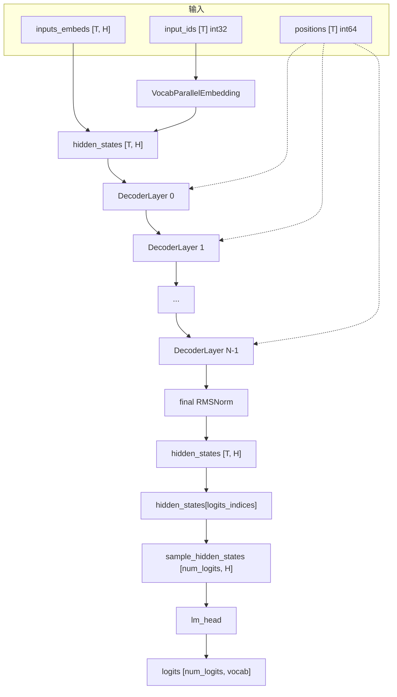
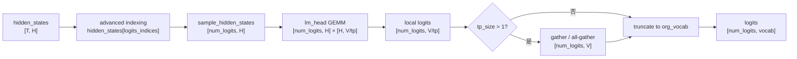

# 06 · 模型前向与 Tensor 流

> 前置阅读：[05 · Model Runner 输入准备](<./05-Model Runner 输入准备.md>)
> 对应源码：`vllm/model_executor/models/llama.py`、`vllm/model_executor/layers/attention/attention.py`、`vllm/model_executor/layers/linear.py`、`vllm/model_executor/layers/layernorm.py`、`vllm/model_executor/layers/rotary_embedding/base.py`、`vllm/model_executor/layers/vocab_parallel_embedding.py`、`vllm/model_executor/layers/logits_processor.py`、`vllm/v1/worker/gpu/model_runner.py`
> 适用版本：本仓库 commit `5082c45853`（2026-10-29）

---

## 1. 一句话概括

Model Runner 把变长请求压成了一条 **`[T, H]` 的扁平 token 流**；模型前向就是让这条流依次穿过：

```text
embedding → N × (RMSNorm → Attention → RMSNorm → MLP) → final RMSNorm
```

每一层都保持 **`[T, H]` 的主干形状不变**，只在 Attention / MLP 内部临时展开成多头或 2 倍中间维度；最后只挑出 `logits_indices` 对应的少量行，做 `lm_head` 得到 logits。

理解这篇的关键不是“Transformer 是什么”，而是：

- 为什么整个模型只认 `[T, H]`，不认“请求”；
- 每一层在什么位置 reshape / split / transpose；
- GQA 的 `num_heads != num_kv_heads` 是在哪一层处理的；
- `hidden_states` 怎么变成 `[num_logits, vocab]`；
- TP / PP / 多模态分别改变了哪一段 shape。

---

## 2. Why：为什么模型只认一条扁平 token 流

### 2.1 请求边界被“拍平”了

调度器眼里的 batch 是：

```text
请求 A: 6 个 token
请求 B: 1 个 token
请求 C: 4 个 token
```

模型眼里只有：

```text
input_ids: [T]        T = 11
positions: [T]
hidden_states: [T, H]
```

请求边界只存在于：

- `query_start_loc`：告诉 attention 每个请求的 query 范围；
- `seq_lens`：告诉 attention 每个请求能看多长的 KV；
- `block_table` / `slot_mapping`：告诉 attention KV 在哪里。

模型本身完全不需要知道“这是 A 的第几个 token”。这正是 PagedAttention 能把不同请求拼进同一个 batch 的前提。

### 2.2 为什么主干一直是 `[T, H]`

Transformer 的每一层都是 token-wise 的：

- RMSNorm 对每个 token 的 H 维做归一化；
- Linear 对每个 token 独立做矩阵乘；
- Attention 只在 token 之间交换信息；
- MLP 对每个 token 独立做升维/降维。

所以除了 Attention 内部需要 `[T, num_heads, head_dim]`，其余部分都可以用二维 `[T, H]` 表示。保持二维有三个好处：

1. **没有 batch 维**：T 是动态的，避免 `[B, S, H]` 的 padding；
2. **kernel 简单**：GEMM 直接是 `[T, H] × [H, N]`；
3. **CUDA Graph 友好**：只有第一维 T 在变。

### 2.3 为什么 sampling 只算一部分行

如果对全部 `T` 行都做 `lm_head`：

```text
T × vocab = 11 × 128256 ≈ 141 万个数
```

但真正需要采样的只有每个请求的最后一个（或投机解码的最后 K+1 个）位置：

```text
num_logits = 6
6 × 128256 ≈ 77 万个数
```

`lm_head` 是 vocab 维的大矩阵乘，能少算一行就少一行。所以 vLLM 先用 `logits_indices` 做 gather，再只对 `[num_logits, H]` 做投影。

---

## 3. 输入输出契约

### 3.1 模型拿到的 `model_inputs`

`model_runner.py:2043`：

```python
model_inputs = {
    "input_ids": input_ids,              # [T] int32，或 None
    "positions": input_batch.positions,  # [T] int64
    "inputs_embeds": inputs_embeds,      # [T, H] 或 None
    "intermediate_tensors": None,        # PP 非首 rank 才有
    **self.model_state.prepare_inputs(input_batch, self.req_states),
}
```

| 参数 | shape | dtype | 何时为 None |
|---|---|---|---|
| `input_ids` | `[T]` | int32 | 多模态 / prompt embeds 且模型不需要 raw token |
| `positions` | `[T]` | int64 | 永不为 None（M-RoPE 会替换成多维版本） |
| `inputs_embeds` | `[T, H]` | 模型 dtype | 纯文本模型 |
| `intermediate_tensors` | `dict[str, [T, H]]` | 模型 dtype | 首 rank / 非 PP |

注意：这里的 `T` 是 `num_tokens_after_padding`，可能大于实际 token 数。padding 行也会参与前向，但不会进入采样。

### 3.2 模型的输出

对 `LlamaForCausalLM`（`llama.py:534`）：

```python
def forward(self, input_ids, positions, intermediate_tensors=None, inputs_embeds=None):
    model_output = self.model(input_ids, positions, intermediate_tensors, inputs_embeds)
    return model_output
```

`LlamaModel.forward`（`llama.py:406`）有三种返回：

| 场景 | 返回类型 | shape |
|---|---|---|
| 最后一个 PP rank，普通模型 | `torch.Tensor` | `[T, H]` |
| 最后一个 PP rank，EAGLE 需要 aux hidden | `tuple[Tensor, list[Tensor]]` | `[T, H]` + 若干 `[T, H]` |
| 非最后一个 PP rank | `IntermediateTensors` | `{"hidden_states": [T,H], "residual": [T,H]}` |

`compute_logits`（`llama.py:546`）不参与 `forward`，由 Runner 在采样阶段单独调用。

---

## 4. 全景图



单层内部：

```mermaid
flowchart LR
    X["x [T, H]"] --> N1["RMSNorm + residual"]
    N1 --> QKV["QKV projection"]
    QKV --> SPLIT["split q/k/v"]
    SPLIT --> ROPE["RoPE"]
    ROPE --> ATT["Paged Attention"]
    ATT --> O["O projection"]
    O --> ADD1["+ residual"]
    ADD1 --> N2["RMSNorm + residual"]
    N2 --> MLP["Gate/Up → SiLU → Down"]
    MLP --> ADD2["+ residual"]
    ADD2 --> Y["y [T, H]"]
```



Residual 不是显式 `+`，而是通过 `RMSNorm(hidden_states, residual)` 的 fused add 完成的。下面细讲。

---

## 5. 入口：`LlamaModel.forward`

`llama.py:406`：

```python
def forward(
    self,
    input_ids: torch.Tensor | None,
    positions: torch.Tensor,
    intermediate_tensors: IntermediateTensors | None,
    inputs_embeds: torch.Tensor | None = None,
    **extra_layer_kwargs,
):
    if get_pp_group().is_first_rank:
        if inputs_embeds is not None:
            hidden_states = inputs_embeds
        else:
            hidden_states = self.embed_input_ids(input_ids)
        residual = None
    else:
        assert intermediate_tensors is not None
        hidden_states = intermediate_tensors["hidden_states"]
        residual = intermediate_tensors["residual"]

    ...
    for idx, layer in enumerate(
        islice(self.layers, self.start_layer, self.end_layer),
        start=self.start_layer,
    ):
        hidden_states, residual = layer(
            positions, hidden_states, residual, **extra_layer_kwargs
        )
        ...
```

三个关键点：

1. **首 rank 做 embedding**，非首 rank 直接接上一 stage 的 `hidden_states` / `residual`；
2. **`residual` 是跨层传递的独立张量**，不是藏在 `hidden_states` 里；
3. **每层返回 `(hidden_states, residual)`**，形状都不变。

### 5.1 为什么 residual 要单独传

如果写成：

```python
x = x + attn(norm(x))
x = x + mlp(norm(x))
```

每层需要显式保存 `x` 的副本。vLLM 用 fused add + norm：

```python
hidden_states, residual = norm(hidden_states, residual)
```

语义是：

```text
residual = residual + hidden_states   # 原地累加
hidden_states = RMSNorm(residual)
```

这样：

- 少一次 kernel launch；
- 少一次显存读写；
- `residual` 始终是“残差流”的当前值，`hidden_states` 是归一化后的分支输入。

### 5.2 第一层为什么特殊

第一层进入时 `residual is None`：

```python
if residual is None:
    residual = hidden_states          # embedding 输出直接作为残差
    hidden_states = self.input_layernorm(hidden_states)
else:
    hidden_states, residual = self.input_layernorm(hidden_states, residual)
```

之后每层都走 fused 路径。

### 5.3 `@support_torch_compile`

`llama.py:347`：

```python
@support_torch_compile(
    dynamic_arg_dims={
        "input_ids": {0: "b"},
        "positions": {0: "b"},
        "intermediate_tensors": {0: "b"},
        "inputs_embeds": {0: "b"},
    },
)
class LlamaModel(nn.Module, EagleModelMixin):
```

`dynamic_arg_dims` 告诉 `torch.compile`：

- 第 0 维是动态的（`T` 每步不同）；
- 所有输入的第 0 维共享同一个符号 `b`；
- 这样编译一次图就能处理任意 T，只重新编译那几个 T 的 CUDA Graph bucket。

这是 vLLM 能对动态 batch 做编译的前提。

---

## 6. Embedding：`input_ids` → `[T, H]`

### 6.1 `VocabParallelEmbedding`

`vocab_parallel_embedding.py:206`。它把 vocab 维按 TP 切分：

```text
完整 embedding: [vocab_size, H]
每个 rank:      [vocab_size / tp_size, H]
```

`forward`（`vocab_parallel_embedding.py:522`）：

```python
def forward(self, input_):
    if self.tp_size == 1:
        return self.quant_method.embedding(self, input_.long())

    if self.use_fused_embedding:
        output_parallel = ops.vocab_parallel_embedding(
            input_ if input_.ndim == 1 else input_.reshape(-1),
            self.weight,
            ...
        )
        ...
    else:
        masked_input, input_mask = get_masked_input_and_mask(...)
        output_parallel = self.quant_method.embedding(self, masked_input.long())
        output_parallel.masked_fill_(input_mask.unsqueeze(-1), 0)

    if self.reduce_results:
        output_parallel = tensor_model_parallel_all_reduce(output_parallel)
    return output_parallel.view(output_dtype)
```

### 6.2 TP > 1 时发生了什么

每个 rank 只拥有 vocab 的一个 shard。对 token id：

- 属于本 rank 的 shard → 正常查表；
- 不属于 → 查到一个无效行，然后被 mask 成 0；
- 最后所有 rank **all-reduce**，把各自 shard 的贡献加起来。

```text
rank 0: [0, 0, e_2, 0]   # 只有 token 2 在本 shard
rank 1: [e_0, 0, 0, e_3] # token 0,3 在本 shard
all-reduce → [e_0, 0, e_2, e_3]
```

因为每个 token 只属于一个 shard，所以 all-reduce 等价于“把正确的那一行搬运过来”。

> TP=1 时没有 all-reduce，直接查表，是最常见的情况。

### 6.3 `input_ids` 是 int32

`InputBuffers.input_ids` 是 `torch.int32`（`input_batch.py:30`），而 PyTorch embedding 要求 int64/long：

```python
self.quant_method.embedding(self, input_.long())
```

这一步会做一次 dtype 转换。为什么输入用 int32？

- token id 远小于 2^31，int32 足够；
- H2D / kernel 读写量减半；
- 只在实际查表时转 long。

### 6.4 多模态 / `inputs_embeds`

如果模型支持多模态或 prompt embeds，Runner 会先算好 `inputs_embeds`：

```python
# model_runner.py:2015
if self.uses_inputs_embeds and self.is_first_pp_rank:
    inputs_embeds = self.model_state.prepare_inputs_embeds(
        scheduled_encoder_inputs, input_batch, self.req_states
    )
    if inputs_embeds is not None and not requires_raw_input_tokens(self.model):
        input_ids = None
```

`prepare_inputs_embeds`（`model_states/default.py:98`）做三件事：

1. 跑 vision/audio encoder；
2. 把 multimodal embedding 按 `is_mm_embed` 散射到对应 token 位置；
3. 叠加 prompt embeds。

`LlamaModel.forward` 里：

```python
if inputs_embeds is not None:
    hidden_states = inputs_embeds
else:
    hidden_states = self.embed_input_ids(input_ids)
```

也就是说，**`inputs_embeds` 和 `input_ids` 是二选一**：文本走 embedding，多模态直接给 embedding。

---

## 7. 单层结构：`LlamaDecoderLayer`

`llama.py:251`，核心只有 30 行：

```python
class LlamaDecoderLayer(nn.Module):
    def __init__(...):
        self.self_attn = LlamaAttention(...)
        self.mlp = LlamaMLP(...)
        self.input_layernorm = RMSNorm(config.hidden_size, eps=config.rms_norm_eps)
        self.post_attention_layernorm = RMSNorm(config.hidden_size, eps=config.rms_norm_eps)

    def forward(self, positions, hidden_states, residual):
        # Self Attention
        if residual is None:
            residual = hidden_states
            hidden_states = self.input_layernorm(hidden_states)
        else:
            hidden_states, residual = self.input_layernorm(hidden_states, residual)
        hidden_states = self.self_attn(positions=positions, hidden_states=hidden_states)

        # Fully Connected
        hidden_states, residual = self.post_attention_layernorm(hidden_states, residual)
        hidden_states = self.mlp(hidden_states)
        return hidden_states, residual
```

### 7.1 数据流

```text
输入: hidden_states = h_prev, residual = r_prev

1. input_layernorm(h_prev, r_prev)
   → r1 = r_prev + h_prev
   → n1 = RMSNorm(r1)

2. self_attn(n1)
   → a = Attention(n1)

3. post_attention_layernorm(a, r1)
   → r2 = r1 + a
   → n2 = RMSNorm(r2)

4. mlp(n2)
   → m = MLP(n2)

输出: hidden_states = m, residual = r2
```

下一层再做 `r3 = r2 + m`。所以残差流是逐步累加的：

```text
r0 = embedding
r1 = r0 + attn(norm(r0))
r2 = r1 + mlp(norm(r1))
r3 = r2 + attn(norm(r2))
...
```

### 7.2 RMSNorm 的 fused add

`layernorm.py:39`：

```python
class RMSNorm(CustomOp):
    def forward_native(self, x, residual=None):
        if residual is None:
            return ir.ops.rms_norm(x, self.weight.data, self.variance_epsilon, ...)
        else:
            return ir.ops.fused_add_rms_norm.maybe_inplace(
                x, residual, self.weight.data, self.variance_epsilon, ...
            )
```

`fused_add_rms_norm` 的语义：

```text
residual = residual + x
x = residual * rsqrt(mean(residual^2) + eps) * weight
return (x, residual)
```

它把“残差相加”和“归一化”合成一个 kernel，并且**原地修改** `residual` 和 `x`。

为什么权重初始化为全 1（`layernorm.py:65`）？

```python
self.weight = torch.ones(hidden_size, dtype=weight_dtype)
```

这是为了 dummy run / profiling 时不让随机权重扭曲激活分布，避免 data-dependent kernel（如 sparse top-k）选错。

---

## 8. Attention：`[T, H]` → `[T, num_heads, head_dim]`

### 8.1 `LlamaAttention.forward`

`llama.py:224`：

```python
def forward(self, positions, hidden_states):
    qkv, _ = self.qkv_proj(hidden_states)
    q, k, v = qkv.split([self.q_size, self.kv_size, self.kv_size], dim=-1)
    q, k = self.rotary_emb(positions, q, k)
    attn_output = self.attn(q, k, v)
    output, _ = self.o_proj(attn_output)
    return output
```

五步，shape 变化如下（以 Llama-3-8B、TP=1 为例）：

| 步骤 | 张量 | shape | dtype |
|---|---|---|---|
| 输入 | `hidden_states` | `[T, 4096]` | bf16 |
| QKV 投影 | `qkv` | `[T, 6144]` | bf16 |
| split | `q` | `[T, 4096]` | bf16 |
| split | `k` | `[T, 1024]` | bf16 |
| split | `v` | `[T, 1024]` | bf16 |
| RoPE | `q`, `k` | 不变，原地修改 | bf16 |
| Attention | `attn_output` | `[T, 4096]` | bf16 |
| O 投影 | `output` | `[T, 4096]` | bf16 |

其中：

```text
q_size  = num_heads    × head_dim = 32 × 128 = 4096
kv_size = num_kv_heads × head_dim =  8 × 128 = 1024
```

### 8.2 QKV projection

`QKVParallelLinear`（`linear.py:1011`）把 q/k/v 三个权重拼在一起：

```text
weight_q: [4096, 4096]
weight_k: [1024, 4096]
weight_v: [1024, 4096]
--------------------------------
weight_qkv: [6144, 4096]
```

前向就是一次 GEMM：

```text
[T, 4096] × [4096, 6144] → [T, 6144]
```

比三次独立 GEMM 少两次 kernel launch，也更容易被 cuBLAS 融合。

### 8.3 split 是 view，不是拷贝

```python
q, k, v = qkv.split([self.q_size, self.kv_size, self.kv_size], dim=-1)
```

`torch.split` 返回的是原张量的 view：

```text
qkv: [T, 6144]
      ├─ q: qkv[:, 0:4096]     stride 6144
      ├─ k: qkv[:, 4096:5120]  stride 6144
      └─ v: qkv[:, 5120:6144]  stride 6144
```

所以 q/k/v 在内存里是交错的，不能假设它们连续。后续 RoPE / attention kernel 必须支持带 stride 的输入。

### 8.4 RoPE

`RotaryEmbedding.forward_cuda`（`rotary_embedding/base.py:221`）：

```python
def forward_cuda(self, positions, query, key=None):
    from vllm import _custom_ops as ops
    cos_sin_cache = self._match_cos_sin_cache_dtype(query)
    ops.rotary_embedding(
        positions, query, key, self.head_size, cos_sin_cache, self.is_neox_style
    )
    return query, key
```

关键点：

1. **原地修改** `query` / `key`，不分配新张量；
2. `positions` 是 `[T]` int64，每个 token 一个绝对位置；
3. `cos_sin_cache` 是 `[max_position, rotary_dim]`，按 position 索引；
4. `query` 在这里的 shape 是 `[T, num_heads * head_dim]`，kernel 内部按 `head_size` 切分；
5. 只旋转前 `rotary_dim` 维，剩余维度原样保留。

`forward_static`（`base.py:161`）是 PyTorch 参考实现：

```python
query = query.view(num_tokens, -1, head_size)
query_rot = query[..., :rotary_dim]
query_pass = query[..., rotary_dim:]
query_rot = ApplyRotaryEmb.forward_static(query_rot, cos, sin, is_neox_style)
query = torch.cat((query_rot, query_pass), dim=-1).reshape(query_shape)
```

`is_neox_style=True` 时，旋转是“前后半对半”配对；`False` 时是“相邻两维”配对。Llama 用 NeoX 风格。

### 8.5 Attention 层的 reshape

`attention/attention.py:495` 的 `Attention.forward`：

```python
num_tokens = query.shape[0]
output_shape = torch.Size((num_tokens, self.num_heads * self.head_size_v))
output = torch.empty(output_shape, dtype=output_dtype, device=query.device)
hidden_size = output_shape[-1]

query = query.view(-1, self.num_heads, self.head_size)
output = output.view(-1, self.num_heads, self.head_size_v)
if key is not None:
    key = key.view(-1, self.num_kv_heads, self.head_size)
if value is not None:
    value = value.view(-1, self.num_kv_heads, self.head_size_v)
```

shape：

```text
query:  [T, 4096] → [T, 32, 128]
key:    [T, 1024] → [T,  8, 128]
value:  [T, 1024] → [T,  8, 128]
output: [T, 4096] → [T, 32, 128]
```

注意：

- `-1` 就是 `T`；
- `output` 是**预先分配**的，attention kernel 直接写进去；
- `output` 的 dtype 默认等于 `query.dtype`；
- `hidden_size = num_heads * head_size_v`，对标准 MHA 就是 `H`。

### 8.6 GQA：不在 PyTorch 层 repeat

Llama-3-8B 是 GQA：

```text
num_heads    = 32
num_kv_heads = 8
group_size   = 4
```

也就是说每 4 个 query head 共享 1 个 KV head。

一个常见的误解是：

```python
k = k.repeat_interleave(4, dim=1)   # ❌ vLLM 不做这个
```

vLLM 不在 PyTorch 层复制 KV，而是把 `num_kv_heads=8` 直接传给 attention backend：

```python
self.num_queries_per_kv = self.num_heads // self.num_kv_heads  # flash_attn.py:1095
```

FlashAttention / FlashInfer 的 kernel 原生支持 GQA：

```text
q: [T, 32, 128]
k: [T,  8, 128]
v: [T,  8, 128]
kernel 内部: head h 使用 kv head h // 4
```

好处：

- 不产生 `[T, 32, 128]` 的 K/V 副本；
- KV Cache 只存 8 个 head，显存省 4 倍；
- kernel 内部按 group 广播，带宽更省。

> 只有少数 backend / 特殊路径会显式 expand，标准 FlashAttention 路径不会。

### 8.7 Attention 的输出

`Attention.forward` 最后：

```python
return output.view(-1, hidden_size)
```

也就是：

```text
output: [T, 32, 128] → [T, 4096]
```

然后进入 `o_proj`：

```python
output, _ = self.o_proj(attn_output)
```

`o_proj` 是 `RowParallelLinear`（`linear.py:1653`）：

```text
[T, 4096] × [4096, 4096] → [T, 4096]
```

TP > 1 时：

- 输入是每个 rank 的 local heads（`[T, H/tp]`）；
- 权重按输入维切分；
- 输出做 **all-reduce**，得到完整 `[T, H]`。

所以 **`hidden_states` 在 TP 各 rank 上是完全一致的**，这是后面 residual / MLP 能继续算的前提。

### 8.8 Attention 内部的 KV Cache 写入

`Attention.forward` 里还有一段：

```python
kv_cache_dummy_dep = None
if self.use_direct_call:
    if (
        not self.attn_backend.forward_includes_kv_cache_update
        and self.kv_sharing_target_layer_name is None
        and key is not None
        and value is not None
    ):
        kv_cache_dummy_dep = unified_kv_cache_update(key, value, self.layer_name)
```

`unified_kv_cache_update` 会：

1. 从 forward context 拿到本层的 `kv_cache` 和 `slot_mapping`；
2. 调用 backend 的 `do_kv_cache_update`；
3. 把当前 token 的 K/V 写到 `slot_mapping` 指定的物理位置。

具体写哪里、怎么分页，见 [04 · KV Cache 与 PagedAttention](<./04-KV Cache 与 PagedAttention.md>) 第 7 节。

这里只需要记住：**Attention 层同时承担“写 KV”和“读 KV 算 attention”两件事**，写是 side effect，读是主输出。

---

## 9. MLP：`[T, H]` → `[T, 2I]` → `[T, I]` → `[T, H]`

`llama.py:82`：

```python
class LlamaMLP(nn.Module):
    def __init__(...):
        self.gate_up_proj = MergedColumnParallelLinear(
            input_size=hidden_size,
            output_sizes=[intermediate_size] * 2,
            ...
        )
        self.down_proj = RowParallelLinear(
            input_size=intermediate_size,
            output_size=hidden_size,
            ...
        )
        self.act_fn = SiluAndMul()

    def forward(self, x):
        x, _ = self.gate_up_proj(x)
        x = maybe_fused_act_quant(self.act_fn, x, self.down_proj)
        x, _ = self.down_proj(x)
        return x
```

shape（Llama-3-8B，`intermediate_size=14336`）：

| 步骤 | 张量 | shape |
|---|---|---|
| 输入 | `x` | `[T, 4096]` |
| gate + up | `gate_up` | `[T, 28672]` |
| SiLU × gate | `x` | `[T, 14336]` |
| down | `x` | `[T, 4096]` |

### 9.1 为什么 gate 和 up 拼在一起

HF 的 Llama MLP 是：

```python
gate = gate_proj(x)   # [T, I]
up   = up_proj(x)     # [T, I]
out  = down_proj(silu(gate) * up)
```

vLLM 把 `gate_proj` 和 `up_proj` 的权重按输出维拼成：

```text
weight_gate_up: [2I, H] = [[W_gate], [W_up]]
```

一次 GEMM 得到 `[T, 2I]`，然后 `SiluAndMul` 一次性算：

```python
d = x.shape[-1] // 2
return F.silu(x[..., :d]) * x[..., d:]
```

### 9.2 `SiluAndMul`

`activation.py:116`：

```python
class SiluAndMul(CustomOp):
    def forward_cuda(self, x):
        d = x.shape[-1] // 2
        output_shape = x.shape[:-1] + (d,)
        out = torch.empty(output_shape, dtype=x.dtype, device=x.device)
        self.op(out, x)   # torch.ops._C.silu_and_mul
        return out
```

它调用 CUDA kernel `silu_and_mul`：

```text
out[i] = silu(x[i, :d]) * x[i, d:]
```

一个 kernel 完成 split + silu + 乘，避免三次 PyTorch 操作。

### 9.3 `maybe_fused_act_quant`

`fused_act_quant.py:196`：

```python
def maybe_fused_act_quant(act_fn, x, linear):
    key = get_input_quant_key(linear)
    if key is not None:
        producer = _FUSED_ACT_QUANT.get((type(act_fn), key))
        if producer is not None and ...:
            return producer(x, linear)
    return act_fn(x)
```

如果 `down_proj` 是 FP8/INT8 量化层，可以把“SiLU 激活”和“输入量化”融合成一个 kernel，直接产出量化后的激活，省一次读写。

非量化模型走普通 `act_fn(x)`。

### 9.4 TP 下的 MLP

TP=2 时：

```text
gate_up_proj 输出: [T, 28672 / 2] = [T, 14336]
silu_and_mul:     [T, 7168]
down_proj:        [T, 4096]，然后 all-reduce
```

`MergedColumnParallelLinear` 把 `[gate, up]` 两个 shard 都切一半，所以每个 rank 拿到的是：

```text
[gate_shard, up_shard] = [T, 7168 + 7168]
```

`SiluAndMul` 的 `d = 7168`，计算的仍然是“本 rank 的 gate × 本 rank 的 up”，结果正确。

---

## 10. 一层完整数值例子

用 Llama-3-8B、TP=1、`T=11`：

```text
H  = 4096
I  = 14336
nh = 32
nkv= 8
hd = 128
```

### 10.1 第一层

输入（来自 embedding）：

```text
hidden_states: [11, 4096] bf16
residual:      None
```

**Step 1: input_layernorm**

```text
residual = hidden_states            # [11, 4096]
hidden_states = RMSNorm(residual)   # [11, 4096]
```

**Step 2: QKV**

```text
qkv = [11, 4096] × [4096, 6144] = [11, 6144]
q   = [11, 4096]
k   = [11, 1024]
v   = [11, 1024]
```

**Step 3: RoPE**

```text
q, k 原地旋转，shape 不变
positions = [40,41,42,43,6,0,1,2,3,4,5]   # 来自 05 的例子
```

**Step 4: Attention**

```text
q → [11, 32, 128]
k → [11,  8, 128]
v → [11,  8, 128]
output → [11, 32, 128] → [11, 4096]
```

**Step 5: O projection**

```text
o_proj: [11, 4096] × [4096, 4096] → [11, 4096]
```

**Step 6: post_attention_layernorm**

```text
residual = residual + attn_output   # [11, 4096]
hidden_states = RMSNorm(residual)   # [11, 4096]
```

**Step 7: MLP**

```text
gate_up = [11, 4096] × [4096, 28672] = [11, 28672]
act     = [11, 14336]
down    = [11, 14336] × [14336, 4096] = [11, 4096]
```

返回：

```text
hidden_states = [11, 4096]   # MLP 输出
residual      = [11, 4096]   # 已累加 attn + 之前的残差
```

### 10.2 全部 32 层后

```text
hidden_states: [11, 4096]
residual:      [11, 4096]
```

最后：

```python
hidden_states, _ = self.norm(hidden_states, residual)
```

```text
residual = residual + hidden_states   # 加上最后一层 MLP 输出
hidden_states = RMSNorm(residual)     # [11, 4096]
```

这个 `hidden_states` 就是 `LlamaForCausalLM.forward` 的返回值。

### 10.3 采样

假设 `logits_indices = [0, 1, 2, 3, 4, 10]`（来自 05 的例子）：

```python
sample_hidden_states = hidden_states[logits_indices]
# [6, 4096]

logits = self.model.compute_logits(sample_hidden_states)
# [6, 128256]
```

`compute_logits`：

```python
def compute_logits(self, hidden_states):
    logits = self.logits_processor(self.lm_head, hidden_states)
    return logits
```

`LogitsProcessor.forward`（`logits_processor.py:98`）→ `_get_logits`（`:180`）→ `_apply_head`（`:136`）：

```python
logits = lm_head.quant_method.apply(lm_head, hidden_states, bias=embedding_bias)
if lm_head.tp_size > 1:
    logits = self._gather_logits(logits)
logits = logits[..., : self.org_vocab_size]
```

TP=1 时：

```text
[6, 4096] × [4096, 128256] → [6, 128256]
```

TP>1 时：

```text
每个 rank: [6, 128256/tp]
gather → [6, 128256]
截断 padding → [6, org_vocab_size]
```

---

## 11. `hidden_states` → `logits` 的完整路径



### 11.1 为什么用 advanced indexing

```python
sample_hidden_states = hidden_states[input_batch.logits_indices]
```

`logits_indices` 是 `[num_logits]` 的 int64 张量，advanced indexing 会产生一个**新的连续张量**：

```text
hidden_states: [11, 4096]
logits_indices: [0, 1, 2, 3, 4, 10]
result: [6, 4096]
```

为什么不直接传 `hidden_states` 和索引给 `lm_head`？

- `lm_head` 是标准 GEMM，要求输入连续；
- gather 后的 `[6, 4096]` 很小，拷贝成本低；
- 后续 sampler 直接按请求顺序处理。

### 11.2 `num_logits` 的来源

普通 decode：

```text
每个请求 1 个 logit
num_logits = num_reqs
```

投机解码：

```text
每个请求 num_draft + num_bonus 个 logit
num_logits = sum(num_draft_tokens) + num_reqs * num_bonus
```

这就是 05 里 `cu_num_logits` 的含义。

### 11.3 `lm_head` 的权重

`ParallelLMHead`（`vocab_parallel_embedding.py:578`）继承 `VocabParallelEmbedding`，但 `forward` 被禁用：

```python
def forward(self, input_):
    del input_
    raise RuntimeError("LMHead's weights should be used in the sampler.")
```

它只作为权重容器，实际计算由 `LogitsProcessor._apply_head` 完成：

```python
logits = lm_head.quant_method.apply(lm_head, hidden_states, bias=embedding_bias)
```

如果 `tie_word_embeddings=True`，`lm_head.weight` 和 `embed_tokens.weight` 是同一块内存：

```python
self.lm_head = self.lm_head.tie_weights(self.model.embed_tokens)
```

### 11.4 `logits_as_input` 与 soft cap

`LogitsProcessor` 还支持：

- `logits_as_input=True`：输入已经是 logits，跳过 `lm_head`（某些模型自己算 logits）；
- `soft_cap`：Gemma 2 的 `tanh` 软截断；
- `scale`：logit scale。

这些都在 `[num_logits, vocab]` 上做逐元素操作。

---

## 12. dtype 与设备

### 12.1 典型配置

| 张量 | dtype | 设备 |
|---|---|---|
| `input_ids` | int32 | cuda |
| `positions` | int64 | cuda |
| `hidden_states` | bf16 / fp16 | cuda |
| `residual` | bf16 / fp16 | cuda |
| RMSNorm weight | bf16 / fp16 | cuda |
| Linear weight | bf16 / fp16 / fp8 / int4 | cuda |
| `qkv` / `q` / `k` / `v` | bf16 / fp16 | cuda |
| `attn_output` | bf16 / fp16 | cuda |
| `logits` | bf16 / fp16 / fp32 | cuda |
| `slot_mapping` | int64 | cuda |
| `block_table` | int32 | cuda |

### 12.2 为什么 `positions` 是 int64

RoPE 的 `cos_sin_cache.index_select(0, positions)` 要求 index 是 int64。虽然 position 本身很小，但 PyTorch 的 index API 只接受 int64。

### 12.3 为什么 `input_ids` 是 int32

见 6.3。模型内部只在 embedding 前转 long。

### 12.4 `hidden_states` 的 dtype 什么时候会变

正常路径不变。但：

- **量化层**：Linear 内部可能反量化到 bf16 再算，输出仍是 bf16；
- **FP8 KV cache**：只影响 KV 存储，不影响 `hidden_states`；
- **`head_dtype=float32`**：只影响 `lm_head` 的输出，不影响主干；
- **`logits` 可能被 sampler 转 fp32**：采样时为了数值稳定。

---

## 13. TP 对 shape 的影响

设 TP=`P`，`H=4096`，`nh=32`，`nkv=8`，`I=14336`。

### 13.1 每个 rank 的 local 维度

```text
num_heads_local    = 32 / P
num_kv_heads_local = max(1, 8 / P)
q_size_local       = num_heads_local * 128
kv_size_local      = num_kv_heads_local * 128
```

| TP | local heads | local kv heads | q_size | kv_size | qkv 输出 |
|---|---|---|---|---|---|
| 1 | 32 | 8 | 4096 | 1024 | 6144 |
| 2 | 16 | 4 | 2048 | 512 | 3072 |
| 4 | 8 | 2 | 1024 | 256 | 1536 |
| 8 | 4 | 1 | 512 | 128 | 768 |

### 13.2 `hidden_states` 仍然是完整的 `[T, H]`

因为 `o_proj` 和 `down_proj` 都是 RowParallelLinear，输出会 all-reduce：

```text
每个 rank 算局部贡献 → all-reduce → 每个 rank 都有完整 [T, 4096]
```

所以：

```text
hidden_states / residual: 每个 rank 都是 [T, 4096]
qkv:                      每个 rank 是 [T, qkv_local]
```

### 13.3 vocab 维

Embedding 和 lm_head 按 vocab 切：

```text
每个 rank: [vocab/P, H]
```

embedding 输出需要 all-reduce；lm_head 输出需要 gather。

---

## 14. PP：`IntermediateTensors`

### 14.1 非最后 rank 返回什么

`LlamaModel.forward`：

```python
if not get_pp_group().is_last_rank:
    return IntermediateTensors(
        {
            "hidden_states": hidden_states,
            "residual": residual,
            **self.pack_local_aux_hidden_states(aux_hidden_states),
        }
    )
```

`IntermediateTensors`（`sequence.py:12`）就是一个 `dict[str, Tensor]` 的包装：

```python
@dataclass
class IntermediateTensors:
    tensors: dict[str, torch.Tensor]
```

shape：

```text
hidden_states: [T, H]
residual:      [T, H]
```

### 14.2 下一 rank 怎么接

```python
else:
    assert intermediate_tensors is not None
    hidden_states = intermediate_tensors["hidden_states"]
    residual = intermediate_tensors["residual"]
```

然后继续跑本 rank 负责的层。

### 14.3 Runner 侧的缓冲区

`model_runner.py:2061`：

```python
n = input_batch.num_tokens_after_padding
new_tensors = {
    k: v[:n].copy_(intermediate_tensors.tensors[k][:n])
    for k, v in self.intermediate_tensors.tensors.items()
}
model_inputs["intermediate_tensors"] = IntermediateTensors(new_tensors)
```

为什么要 `copy_` 到预分配 buffer？

- 避免每步分配；
- 保证 CUDA Graph / NCCL 使用稳定地址；
- `IntermediateTensors` 可能是上一步 recv 的临时 buffer。

### 14.4 aux hidden states

EAGLE-3 需要中间层的 hidden states：

```python
def _maybe_add_hidden_state(self, aux_hidden_states, layer_idx, hidden_states, residual):
    if layer_idx in self.aux_hidden_state_layers:
        value = hidden_states + residual if residual is not None else hidden_states
        aux_hidden_states.append(value)
    return aux_hidden_states
```

注意它保存的是 `hidden_states + residual`，也就是**残差流的值**，不是归一化后的分支输入。

PP 时这些 aux 张量也会放进 `IntermediateTensors`，key 是 `aux_hidden_state_0`、`aux_hidden_state_1`……

---

## 15. 多模态：`inputs_embeds` 如何合并

### 15.1 三种 embedding 来源

```text
text token embedding
    +
image / audio encoder embedding（按 token 位置散射）
    +
prompt embeds（用户直接传的 embedding）
    =
inputs_embeds [T, H]
```

### 15.2 `prepare_inputs_embeds`

`model_states/default.py:98`：

```python
input_ids_unpadded = input_batch.input_ids[: input_batch.num_tokens]

if self.supports_mm_inputs:
    self.execute_mm_encoder(scheduled_encoder_inputs)
    mm_embeds, is_mm_embed = super().gather_mm_embeddings(input_batch)
    if self.mm_pruner is not None and mm_embeds:
        mm_embeds = self.mm_pruner.recompute(mm_embeds, input_batch, req_states)
        self.apply_staged_writes()
    inputs_embeds = self.encoder_runner.get_inputs_embeds(
        input_ids_unpadded, mm_embeds, is_mm_embed
    )
```

`get_inputs_embeds` 的逻辑：

1. 先对 `input_ids` 做普通 embedding；
2. 对 `is_mm_embed=True` 的位置，用 `mm_embeds` 覆盖；
3. 返回 `[T, H]`。

### 15.3 为什么只处理 `num_tokens` 而不是 padded

```python
input_ids_unpadded = input_batch.input_ids[: input_batch.num_tokens]
```

因为 `is_mm_embed` 的长度是实际 token 数，padding 行没有对应的多模态标记。

### 15.4 M-RoPE

多模态模型（Qwen2-VL 等）用多维 RoPE。`prepare_inputs` 会覆盖 `positions`：

```python
def prepare_inputs(self, input_batch, req_states):
    if self.rope_state is None:
        return {}
    self.rope_state.prepare_positions(...)
    positions = self.rope_state.get_positions(input_batch.num_tokens_after_padding)
    return {"positions": positions}
```

此时 `positions` 不再是 `[T]`，而可能是 `[3, T]` 或 `[T, 3]`，取决于模型。

---

## 16. CUDA Graph / 编译对 Tensor 流的影响

### 16.1 动态维度

```python
@support_torch_compile(
    dynamic_arg_dims={
        "input_ids": {0: "b"},
        "positions": {0: "b"},
        "intermediate_tensors": {0: "b"},
        "inputs_embeds": {0: "b"},
    },
)
```

所有输入的第 0 维共享符号 `b`。这意味着：

- 编译器生成一张图，T 是符号；
- 运行时 T 变，不需要重新编译；
- 但 CUDA Graph 捕获需要固定 T，所以按 bucket 捕获。

### 16.2 FULL graph

FULL graph 的输入来自固定 buffer：

```python
model_output = self.cudagraph_manager.run_fullgraph(batch_desc)
```

此时：

- `input_ids` / `positions` / `hidden_states` 地址固定；
- `T` 是捕获时的 padded 大小；
- padding 行也参与计算，但不影响输出。

### 16.3 PIECEWISE / eager

```python
model_output = self.cudagraph_manager.run_pw_graph(self.model, model_inputs)
# 或
model_output = self.model(**model_inputs)
```

输入是真实 `model_inputs`，T 是 `num_tokens_after_padding`。

### 16.4 为什么 attention 的 metadata 不在 `model_inputs` 里

attention 层通过 forward context 拿 metadata：

```python
forward_context = get_forward_context()
attn_metadata = forward_context.attn_metadata[layer_name]
```

这样：

- `model_inputs` 保持简洁；
- 每层可以拿自己的 metadata；
- CUDA Graph 可以把 metadata 当成静态 buffer。

---

## 17. What if：改动会带来什么

| 改动 | 后果 | 注意 |
|---|---|---|
| 把 `hidden_states` 改成 `[B, S, H]` | 需要 padding，T 不再动态 | 吞吐下降，CUDA Graph 难做 |
| 不做 QKV 融合 | 三次 GEMM，kernel launch 变多 | 小 batch 下开销明显 |
| 在 PyTorch 层 repeat KV | 显存和带宽按 group_size 增长 | 失去 GQA 优势 |
| RoPE 不在原地做 | 每层多两次大张量分配 | 显存和带宽上升 |
| 去掉 residual 融合 | 每层多一个 add kernel | 延迟增加 |
| MLP 不融合 gate/up | 多一次 GEMM | 小 batch 下更明显 |
| 对所有 T 行做 lm_head | logits 计算量按 T 增长 | 采样阶段变慢 |
| `logits_indices` 选错 | 采样了错误的 hidden state | 输出完全错乱 |
| TP 时 o_proj 不 all-reduce | 每个 rank 只有部分贡献 | 结果错误 |
| PP 不传 residual | 下一 rank 残差流丢失 | 输出错误 |
| 多模态覆盖位置错 | 图像 embedding 放错 token | 输出语义错误 |
| aux hidden 保存归一化后的值 | EAGLE 输入分布不对 | 投机接受率下降 |
| `dynamic_arg_dims` 配错 | 每个 T 都重新编译 | 启动慢、显存涨 |

---

## 18. 常见陷阱

| 陷阱 | 正确理解 |
|---|---|
| “模型输入是 `[B, S, H]`” | vLLM 是 `[T, H]`，没有 batch/seq 维 |
| “`hidden_states` 每层 shape 会变” | 主干始终 `[T, H]`，只在内部临时变 |
| “q/k/v 是连续的三块” | 它们是同一个 `[T, 6144]` 的 view，stride 是 6144 |
| “GQA 会 repeat KV” | 标准路径不 repeat，backend 原生支持 |
| “RoPE 返回新张量” | CUDA 路径原地修改 q/k |
| “residual 是 `hidden_states` 的一部分” | 它是独立张量，跨层传递 |
| “RMSNorm 只做归一化” | 带 residual 时同时做加法，且原地修改 |
| “`lm_head` 对所有 token 做” | 只对 `logits_indices` 选出的行做 |
| “`lm_head.forward` 会被调用” | 它抛异常，实际用 `quant_method.apply` |
| “TP 时每个 rank 的 `hidden_states` 不同” | RowParallel 后 all-reduce，各 rank 一致 |
| “PP 只传 hidden_states” | 还要传 residual（以及 aux hidden） |
| “`IntermediateTensors` 是特殊张量” | 就是 dict 包装 |
| “多模态时 `input_ids` 一定存在” | 可能被设为 None |
| “`positions` 永远是 1D” | M-RoPE 可能是多维 |
| “CUDA Graph 会处理任意 T” | 按 bucket 捕获，超出会回退 |
| “padding token 的输出会被采样” | `logits_indices` 不会选 padding 行 |

---

## 19. 如何验证

### 19.1 断点

```python
# 模型入口
vllm/model_executor/models/llama.py: LlamaModel.forward (406)
vllm/model_executor/models/llama.py: LlamaDecoderLayer.forward (313)
vllm/model_executor/models/llama.py: LlamaAttention.forward (224)

# 核心层
vllm/model_executor/layers/attention/attention.py: Attention.forward (495)
vllm/model_executor/layers/layernorm.py: RMSNorm.forward_native (79)
vllm/model_executor/layers/linear.py: ColumnParallelLinear.forward (616)
vllm/model_executor/layers/linear.py: RowParallelLinear.forward (1799)
vllm/model_executor/layers/rotary_embedding/base.py: RotaryEmbedding.forward_cuda (221)

# 采样
vllm/v1/worker/gpu/model_runner.py: GPUModelRunner.sample (1667)
vllm/model_executor/layers/logits_processor.py: LogitsProcessor._get_logits (180)
```

### 19.2 打印 shape

最直接的方法是在 `LlamaDecoderLayer.forward` 里打印：

```python
def forward(self, positions, hidden_states, residual):
    if residual is None:
        residual = hidden_states
        hidden_states = self.input_layernorm(hidden_states)
    else:
        hidden_states, residual = self.input_layernorm(hidden_states, residual)

    print("after norm:", hidden_states.shape, hidden_states.dtype)
    hidden_states = self.self_attn(positions=positions, hidden_states=hidden_states)
    print("after attn:", hidden_states.shape)

    hidden_states, residual = self.post_attention_layernorm(hidden_states, residual)
    hidden_states = self.mlp(hidden_states)
    print("after mlp:", hidden_states.shape, "residual:", residual.shape)
    return hidden_states, residual
```

### 19.3 验证 GQA 没有 repeat

在 `FlashAttentionImpl.forward` 里打印：

```python
print("q", query.shape, "k", key.shape, "v", value.shape)
```

应该看到：

```text
q [T, 32, 128]
k [T,  8, 128]
v [T,  8, 128]
```

如果看到 `k [T, 32, 128]`，说明走了 repeat 路径（可能是某个特殊 backend）。

### 19.4 验证 logits 只算部分行

在 `sample` 里：

```python
print("hidden_states", hidden_states.shape)
print("logits_indices", input_batch.logits_indices.shape)
print("sample_hidden_states", sample_hidden_states.shape)
print("logits", logits.shape)
```

普通 decode、3 个请求时应该看到：

```text
hidden_states        [T, 4096]
logits_indices       [3]
sample_hidden_states [3, 4096]
logits               [3, 128256]
```

### 19.5 单进程调试

```bash
VLLM_ENABLE_V1_MULTIPROCESSING=0 \
VLLM_LOGGING_LEVEL=DEBUG \
python your_script.py
```

### 19.6 数值一致性

如果想对比 HF：

```python
# vLLM
out_vllm = llm.generate(prompts, SamplingParams(temperature=0, max_tokens=1))

# HF
out_hf = model.generate(**inputs, max_new_tokens=1, do_sample=False)
```

注意：

- vLLM 默认 bf16，HF 可能是 fp32；
- RoPE 实现有细微数值差异（vLLM 注释里提到 GPU 初始化 vs CPU 初始化）；
- 贪心解码第一个 token 应该一致。

---

## 20. 其他模型结构

`llama.py` 是最典型的 decoder-only 结构。其他模型只是在局部替换：

| 模型族 | 差异点 | 文件 |
|---|---|---|
| Qwen2 / Qwen3 | 可能带 qkv bias、RMSNorm 变体 | `qwen2.py`、`qwen3.py` |
| Gemma | `GemmaRMSNorm`、`(1+w)`、embedding 缩放 | `gemma.py` |
| DeepSeek-V2/V3 | MLA，Q/KV 低秩投影 | `deepseek_v2.py` |
| Mixtral / DeepSeek-MoE | MLP 换成 MoE | `mixtral.py`、`deepseek_v2.py` |
| Mamba / hybrid | attention 换成 SSM | `mamba.py`、`jamba.py` |
| 多模态 | `inputs_embeds` 合并 | `qwen2_vl.py`、`llava.py` |

但主干仍然是：

```text
embedding → layers → final norm → (logits)
```

差异集中在 `DecoderLayer` 内部。

### 20.1 MLA 的特殊之处

DeepSeek 的 MLA 不做标准 QKV：

```text
hidden_states → q_a_proj → q_b_proj → q
hidden_states → kv_a_proj → kv_b_proj → k, v
```

但它对外的接口仍然是 `[T, H]`，attention 层内部处理低秩投影和 KV cache 的特殊 layout。详见后续 Attention backend 文档。

### 20.2 MoE 的特殊之处

MoE 层把 `[T, H]` 先路由到不同 expert：

```text
[T, H] → router → top-k experts
       → 每个 expert 的 gate/up/down
       → 加权求和 → [T, H]
```

padding token 会被 `is_padding` 标记跳过路由，避免无效 expert 计算。

---

## 21. 总结

| 最值得记住的点 | 说明 |
|---|---|
| 主干是 `[T, H]` | 没有 batch/seq 维，请求边界靠 metadata |
| embedding 输出 `[T, H]` | TP 时 vocab 切分 + all-reduce |
| 每层输入输出都是 `[T, H]` | 只有内部临时变形 |
| residual 独立传递 | 通过 fused add + norm 原地累加 |
| QKV 一次 GEMM | `[T, H] → [T, q+2kv]` |
| split 是 view | q/k/v 共享底层存储，stride 是总宽 |
| RoPE 原地修改 | 只旋转前 `rotary_dim` 维 |
| GQA 不 repeat | backend 原生支持 `num_heads != num_kv_heads` |
| Attention 输出 `[T, H]` | 预分配 output，kernel 直接写 |
| O 投影 all-reduce | TP 后每个 rank 拿到完整 `[T, H]` |
| MLP 是 `H → 2I → I → H` | gate/up 融合，SiLU 融合 |
| 最终 norm 后才是 logits 输入 | `hidden_states` 是归一化后的值 |
| 只对 `logits_indices` 做 lm_head | 采样行数远小于 T |
| lm_head 输出 `[num_logits, vocab]` | TP 时 gather + 截断 |
| PP 传 hidden + residual | 用 `IntermediateTensors` |
| 多模态用 `inputs_embeds` | 与 `input_ids` 二选一 |
| CUDA Graph 固定 T | 按 bucket 捕获，padding 到 bucket |

下一篇进入 **07 · Attention 层与 Backend**：从 `Attention.forward` 往下，看 FlashAttention / FlashInfer / Triton / MLA 各自如何读 KV Cache、如何处理 GQA / sliding window / chunked prefill，以及 `AttentionMetadata` 如何驱动 kernel 选择。

---

## 附：关键源码索引

| 主题 | 文件 | 入口 |
|---|---|---|
| 模型入口 | `vllm/model_executor/models/llama.py` | `LlamaForCausalLM.forward` (534) |
| 主干 | `vllm/model_executor/models/llama.py` | `LlamaModel.forward` (406) |
| Decoder 层 | `vllm/model_executor/models/llama.py` | `LlamaDecoderLayer.forward` (313) |
| Attention 模块 | `vllm/model_executor/models/llama.py` | `LlamaAttention.forward` (224) |
| MLP | `vllm/model_executor/models/llama.py` | `LlamaMLP.forward` (118) |
| Attention 层 | `vllm/model_executor/layers/attention/attention.py` | `Attention.forward` (495) |
| reshape | `vllm/model_executor/layers/attention/attention.py` | view 调用 (543–548) |
| RMSNorm | `vllm/model_executor/layers/layernorm.py` | `RMSNorm` (39) |
| fused add norm | `vllm/model_executor/layers/layernorm.py` | `forward_native` (79) |
| QKV 并行 | `vllm/model_executor/layers/linear.py` | `QKVParallelLinear` (1011) |
| Column 并行 | `vllm/model_executor/layers/linear.py` | `ColumnParallelLinear.forward` (616) |
| Row 并行 | `vllm/model_executor/layers/linear.py` | `RowParallelLinear.forward` (1799) |
| RoPE | `vllm/model_executor/layers/rotary_embedding/base.py` | `forward_cuda` (221) |
| RoPE 参考实现 | `vllm/model_executor/layers/rotary_embedding/base.py` | `forward_static` (161) |
| Embedding | `vllm/model_executor/layers/vocab_parallel_embedding.py` | `VocabParallelEmbedding.forward` (522) |
| LM Head | `vllm/model_executor/layers/vocab_parallel_embedding.py` | `ParallelLMHead` (578) |
| Logits | `vllm/model_executor/layers/logits_processor.py` | `LogitsProcessor.forward` (98) |
| lm_head 投影 | `vllm/model_executor/layers/logits_processor.py` | `_apply_head` (136) |
| logits gather | `vllm/model_executor/layers/logits_processor.py` | `_get_logits` (180) |
| SiLU | `vllm/model_executor/layers/activation.py` | `SiluAndMul` (116) |
| 融合激活量化 | `vllm/model_executor/layers/fusion/fused_act_quant.py` | `maybe_fused_act_quant` (196) |
| PP 中间张量 | `vllm/sequence.py` | `IntermediateTensors` (12) |
| PP 空张量工厂 | `vllm/model_executor/models/utils.py` | `make_empty_intermediate_tensors_factory` (1028) |
| aux hidden | `vllm/model_executor/models/interfaces.py` | `_maybe_add_hidden_state` (1640) |
| 采样入口 | `vllm/v1/worker/gpu/model_runner.py` | `GPUModelRunner.sample` (1667) |
| 执行入口 | `vllm/v1/worker/gpu/model_runner.py` | `GPUModelRunner.execute_model` (1794) |
| forward context | `vllm/forward_context.py` | `set_forward_context` (278) |
| compile 装饰器 | `vllm/compilation/decorators.py` | `support_torch_compile` (121) |
